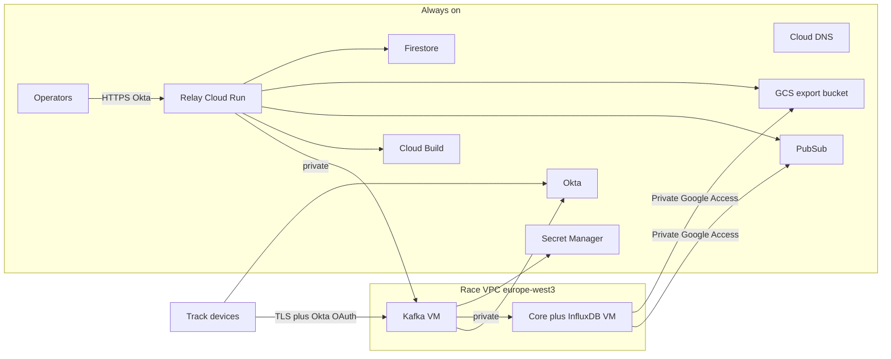

# Part 1. Infrastructure

Start flow: [2-race-provisioning.md](2-race-provisioning.md). Stop and export: [2-race-destruction.md](2-race-destruction.md). Phases and mutex: [3-firestore.md](3-firestore.md). Terraform resources: [4-terraform.md](4-terraform.md). API: [6-relay-api.md](6-relay-api.md). Locks: [7-architecture-review.md](7-architecture-review.md).

Region: all GCP resources in `europe-west3` (Frankfurt). Do not split regions.

## Cost rule

Always-on pieces stay in the free tier where they fit (Cloud Run scale-to-zero, Firestore).

Not free: Cloud Run VPC access to Kafka, Cloud DNS, Artifact Registry. Race VMs are paid and sized to be reliable. Free-tier micros are too small for Kafka and InfluxDB 3 Core. First real race is the sizing test: modest paid VMs, Kafka memory-heavy, Core/DB CPU plus SSD disk. Resize after that race if needed. Headroom is the mitigation for Core and Influx sharing a VM, not a third machine.

Google Pub/Sub, Cloud Build and Firestore will probably fit fully in free tier.

Cloud Run VPC access to Kafka is always-on cost.

Pointer set means assume spend until phase `destroyed`. Failed races may still have leftover VMs. No auto-destroy timeout. Status returns `startedAt` and `billableVms` so the operator can see elapsed billable time.

## Topology

## Components

### Relay

Where: Cloud Run, public HTTPS. No Google invoker IAM for operators. Relay checks Okta on operator calls. Pub/Sub pushes use OIDC, not Okta. Operators are not Google identities.

Lifecycle: always deployed. Survives races. Scale-to-zero when idle. Firestore holds state so Relay stays stateless.

Connections: operator API; Firestore; GCS (YAML write; export read and time-limited download access); Cloud Build trigger plus list/read (does not run Terraform); Pub/Sub push (build-finished, export-done); private VPC path to Kafka.

Responsibility: start/stop/force-destroy; return Kafka hostname, port, and public IP when ready; issue export download access. Only Cloud Build caller.

### Core unit and database

Where: one paid VM. Core and InfluxDB 3 Core (self-managed, single node) share that VM.

Lifecycle: race-scoped. Created at start. After export succeeds, VM and disk are destroyed.

Network: no public IP. No inbound internet. Private to Kafka only. Outbound to Google APIs via Private Google Access (YAML read, GCS export write, export-done publish). No Cloud NAT. Does not pull images at boot; uses the Compute image already on the VM.

Connections: Kafka private listener; local InfluxDB; GCS and Pub/Sub via Private Google Access. No operator API. No Cloud Build. No Firestore.

Blast radius: single failure domain for processing and storage during the race. Kafka on the other VM still buffers. Disk does not help live recovery during a short race; export then destroy is the model. Shared load spikes are accepted; size with headroom.

### Message broker

Where: a second paid VM, separate from Core/DB so public exposure is isolated.

Lifecycle: race-scoped. Created at start. Destroyed after Core exports Influx and selected topics.

Network: public IP plus private IP. Single node, not a cluster.

Listeners:

- Public: ingest from track devices. TLS terminated on Kafka. Okta OAuth required (client id and client secret on each device). Firewall opens the Kafka port only. No VPN. No IP allowlist.
- Private: Core and Relay. VPC firewall only. No Okta on this listener. If Okta is down, devices cannot write, but Core can still drain the broker into Influx.

Kafka VM must reach Okta (token validation). That egress is allowed; the VM has a public IP.

Boot contract: broker does not start unless the public TLS listener bound with the Secret Manager cert. Private-only Kafka is not a running Kafka. Heartbeat then implies public bind at boot. Ready still does not probe Okta or DNS.

Responsibility: accept external packets; forward to Core; carry Relay→Core control messages; hold the compacted heartbeat Relay reads on status.

### Export store

Where: one GCS bucket in `europe-west3`. Always on. Outlives race VMs. Operator downloads through Relay (temporary download links), not with a Google GCS identity.

Path: Core writes Influx export and selected Kafka topics under `{gcsPrefix}/export/`. Kafka VM does not write GCS. YAML lives at `{gcsPrefix}/core-config.yaml` (Relay-written, Core-read).

IAM (always-on, wildcard `raceId`; race Terraform does not change IAM): Core SA reads `races/*/core-config.yaml`, writes `races/*/export/**` only. Relay SA writes YAML, reads exports, issues time-limited download access. Service-account table: [4-terraform.md](4-terraform.md).

## Identity (outside GCP)

Okta developer free tier. Relay API (operator users) and Kafka public ingest (device machine clients). Not used on the Kafka private listener.

## Discovery and encryption

Stable Cloud DNS hostname for Kafka. Zone and hostname always exist. A record is updated when the Kafka VM comes up. When ready, Relay returns hostname, port, and the applied public IP. Track clients may connect to the IP with SNI/verify on the hostname so DNS lag is not the critical path. Do not use that address unless status says ready.

TLS on the public listener. One long-lived public certificate for the stable hostname lives in Secret Manager. Kafka VM attaches it at boot. Each race only updates the DNS A record (IP). Rotate the secret when the cert expires; do not issue a certificate per race. Private listener stays inside the VPC and does not use public TLS.

Kafka A record uses a short TTL. Destroy deletes the A record. Do not leave a stale target pointing at a released ephemeral IP. Between races the hostname must not resolve to a leftover address.

## Network inventory

Always on: VPC, subnet, baseline firewall; Cloud DNS zone and Kafka hostname; Cloud Run VPC attachment so Relay reaches Kafka privately; Private Google Access on the subnet; Secret Manager (Kafka TLS cert); Pub/Sub (Cloud Build → Relay; Core export-done → Relay).

Race-scoped: Kafka VM, ephemeral public IP, disk; Core/DB VM, no public IP, disk.

Not used: Cloud NAT. Core cannot use the public Kafka endpoint; it must use the private listener.

SSH: no public port 22. Track operators do not SSH. Break-glass only, via IAP and Google admin identities.

## Lifecycle inventory

Always on (not destroyed with the race): Cloud Run Relay; Firestore; VPC, subnet, baseline firewall; Cloud DNS zone and stable Kafka hostname; GCS export bucket; Secret Manager (TLS cert); Pub/Sub; Artifact Registry (controller image); Compute image families (Kafka, Core; published outside Terraform); IAM / service accounts; Okta.

Race-scoped (create at start, destroy after export): Kafka VM, ephemeral public IP, disk; Core/DB VM, disk; DNS A record target (hostname stays).

Race resource names are stable (`kafka`, `core`). `raceId` is metadata, GCS path, and YAML only. Reused race Terraform state plus names that include `raceId` would orphan resources.

Do not keep VM disks after a successful export. That duplicates data already in GCS.

## Ready

Ready means: Firestore phase `applied`, Kafka broker started (public TLS bound at boot), Core heartbeat fresh (Core up, private Kafka reachable, Influx reachable).

Until then, Relay must not hand out hostname, port, or public IP as usable ingest. How Relay detects that, and what happens if the Kafka read fails: [2-race-provisioning.md](2-race-provisioning.md). Ready is not a live probe of Okta or DNS.

## Risks and rejected options

Placement and topology only. Control-plane locks: [7-architecture-review.md](7-architecture-review.md).

- Destroying Relay with the race is invalid. Relay is the control plane and must stay.
- Free-tier micros for Kafka or Influx are invalid. Pay for race VMs.
- Cloud NAT is not needed and would cost when idle if left up.
- Core using the public Kafka endpoint is impossible without NAT.
- Unauthenticated public Kafka is invalid. Okta OAuth plus TLS is the lock.
- An extra on-track ingest gateway is not required. Devices talk to Kafka directly with client id and secret.
- Three VMs (split Core and Influx) are deferred. Co-location is the v1 choice.
- Reserved static IP kept between races is rejected. Unused reserved IPs cost extra; DNS plus Relay discovery is enough.
- VPN or IP allowlist is rejected. Track networks are not stable.
- Google invoker IAM on Relay for operators is invalid. Operators are Okta-only.
