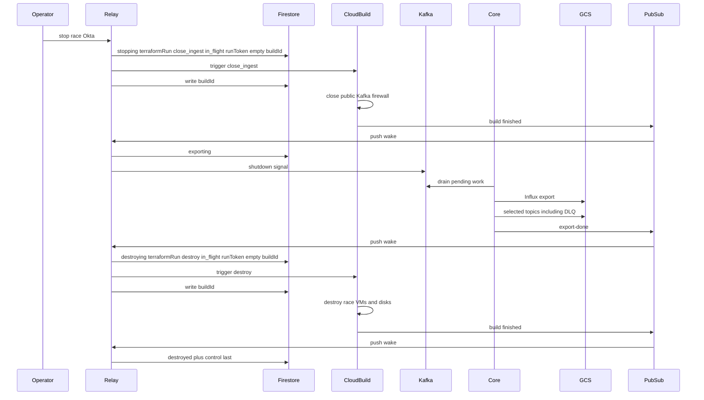

# Part 2b. Race destruction and export

Goal: stop ingest, drain work, export data to GCS, destroy race VMs. Keep always-on pieces.

Gate: stop sequence assigned. Export owner is Core. Destroy Cloud Build owner is Relay. Reject rules: [6-relay-api.md](6-relay-api.md). Mutex: [3-firestore.md](3-firestore.md). `close_ingest` must not replace VMs: [4-terraform.md](4-terraform.md). What is destroyed vs kept: [1-infrastructure.md](1-infrastructure.md).

Out of scope: Core export internals

## Two stop paths

Graceful stop (default): close public ingest, wait until that Terraform run finishes, then shutdown Core, export, then destroy.

Force-destroy: skip export. Operator accepts data loss.

Allowed phases and rejects: [6-relay-api.md](6-relay-api.md). One race Terraform at a time. No queued intent. Relay is the only Cloud Build caller.

## Components in this flow

| Component | Role in stop                                                                                                                                               |
| --- |------------------------------------------------------------------------------------------------------------------------------------------------------------|
| Relay | Stop and force-destroy. Triggers `close_ingest` or `destroy`. Publishes shutdown key `SHUTDOWN`. Wakes on Pub/Sub. Replays terminal Cloud Build on status. |
| Core | On shutdown: drain Kafka, write `{race_id}/export/`, publish export-done. No Cloud Build. No Firestore.                                                    |
| Cloud Build + controller | `close_ingest`: public Kafka firewall only. `destroy`: race VMs, disks, DNS A record.                                                                      |
| Pub/Sub | Build-finished wakes Relay (status can replay). Export-done wakes Relay after Core finishes; status does **not** invent export-done.                       |
| GCS | Export landing place. Survives destroy. Core writes `export/` only. Operators download through Relay.                                                      |

Relay publishes shutdown itself on the private Kafka path. Cloud Build does not talk to Kafka.

Operator laptop sleep is fine: export-done push wakes Relay. That is why Core signals Pub/Sub, not “Relay polls until export”. Missed export-done after Pub/Sub exhaustion: operator force-destroys a hung `exporting` race.

## Graceful stop flow

1. Operator calls stop. Allowed from `applied` (including unhealthy), or retry from `stopping` when mutex not held. Reconcile first. Returns immediately. Does not publish shutdown yet.
2. Controller closes the public Kafka firewall. Private listener stays up. Core and Relay can still use Kafka. This apply must not replace VMs, disks, metadata, or the public IP.
3. On `close_ingest` success: phase `exporting`, then Relay publishes shutdown message. Core on connect reads shutdown message and exports. Tail-only consume is invalid.
4. Firewall close is not a session kill. Some public produce may still arrive during drain. MVP accepts that. New public connections fail.
5. Core drains, writes `{race_id}/export/db` and `{race_id}/export/kafka` (Influx dump, selected topics including DLQ). Cannot write `core-config.yaml`.
6. Core publishes export-done (with `race_id` field). Relay accepts only if phase is `exporting` and mutex not held. Then stamps destroy, triggers Cloud Build. Ack export-done only after that stamp.
7. Controller destroys race VMs and disks and deletes the DNS A record. Always-on stays.
8. On destroy success: phase `destroyed`, `control/last` written, pointer cleared. Status no longer returns a usable Kafka address. Race doc remains. Status with no active race still returns last `raceId`, and export download access.

Shutdown must not start until `close_ingest` succeeds. `close_ingest` and `destroy` must never overlap.

## Export

Owner: Core. It has Influx, disk, OS, and Kafka private access.

Landing: `{raceId}/export/` in the always-on bucket (inside `db` and `kafka` directories). IAM: Core writes that prefix only.

Destroy on the graceful path waits for export-done. Force-destroy is the exception. Late export-done (`destroying` / `destroyed` / `raceId` mismatch): reject. No second destroy.

Do not keep VM disks after a successful export. Prefix alone is not download access; Relay issues time-limited access on status.

## Force-destroy flow

Skip shutdown wait and export wait. Stamp destroy, trigger Cloud Build, return immediately. Pointer stays set until destroy succeeds.

Use after `failed` start, hung `exporting`, unhealthy with a dead Core, trigger never confirmed, or leftover race VMs.

Force-destroy while Core is mid-export may leave a partial GCS object. Operator treats GCS as incomplete. A later export-done is rejected.

## Failure

Terraform destroy is idempotent. Retry force-destroy if the destroy build fails or times out, or after bind-window expiry with no `buildId`.

If Core dies before export-done, graceful stop will not wake Relay to destroy. Status cannot invent export-done. Force-destroy.

If `close_ingest` fails: phase stays `stopping`, mutex clears. Operator retries stop (same `close_ingest`). Do not treat firewall-close failure as data-loss-only.

If `close_ingest` succeeds and export never finishes: stay `exporting` until force-destroy. Do not retry graceful stop once phase is `exporting`. If shutdown never reached Core, force-destroy. Core on connect must observe retained shutdown messages, otherwise this hang is expected.
