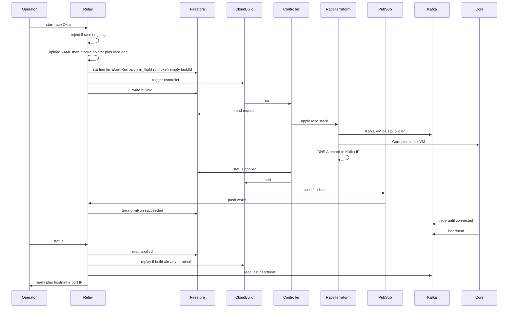

# Part 2a. Race provisioning

Goal: start one race. Create the two race VMs, make Kafka ingestable, and only then hand operators the Kafka hostname, port, and public IP.

Gate: start sequence and healthcheck are assigned. Reject rules: [6-relay-api.md](6-relay-api.md). Phases, mutex, writers: [3-firestore.md](3-firestore.md). Race resources: [4-terraform.md](4-terraform.md). Placement: [1-infrastructure.md](1-infrastructure.md).

Out of scope: Terraform internals, image build pipelines, exact heartbeat interval, Core YAML shape.

## Components in this flow

| Component | Role in start |
| --- | --- |
| Relay | Operator start/status. Writes Firestore. Triggers Cloud Build. Wakes on Pub/Sub. On status: reconcile, then Firestore + heartbeat. |
| Firestore | Lifecycle source of truth. |
| Cloud Build | Runs the controller. Finite timeout; timeout is apply failure. Not a long-lived waiter. |
| Controller | Reads Firestore, applies race Terraform, writes `applied` or `failed` on apply. |
| Race Terraform | Race-scoped resources only. Stable names. |
| Pub/Sub | Terminal Cloud Build → Relay. Status bind/replay if the push is missed. |
| Secret Manager | Long-lived TLS cert. Always on. |
| Kafka VM / Core VM | Prebaked images. Boot below. |

Always-on stack is a separate Terraform stack. Race apply must not manage it. Relay is the only Cloud Build caller. Core is not in this flow except boot and heartbeat.

MVP: one active race. No queue. Pointer and retry rules: [3-firestore.md](3-firestore.md).

## Start flow

1. Operator calls start (Okta). Reject / retry / reconcile: [6-relay-api.md](6-relay-api.md).
2. New race: mint `raceId`; upload YAML to `{gcsPrefix}/core-config.yaml` (orphan YAML acceptable); one transaction sets pointer if empty and creates the race doc. Then stamp apply `in_flight` + `runToken`, trigger Cloud Build, write `buildId`. Returns immediately. Trigger/crash recovery: [3-firestore.md](3-firestore.md).
3. Retry from `failed`: same `raceId`, original YAML kept, new apply run. Request config ignored. Missing YAML object → apply fails again; force-destroy and a new race.
4. Controller: refuse Terraform unless `runToken` matches and status is `in_flight`; refuse apply if YAML object missing; apply race stack (ingest open). Token mismatch: no Terraform, no Firestore write, success exit. Does not parse YAML. First apply pins image ids in race state.
5. Controller writes `applied` (with outputs, including Kafka public IP) or `failed`, only for `apply`, only if phase is still `starting` and the token still matches. Only writer of `applied`.
6. Pub/Sub wakes Relay (or status replays). Relay marks `terraformRun` succeeded. Already `applied`: do not revert. Still `starting` with no `applied`: write `failed`.
7. Kafka boots: fetch TLS cert, do not start broker unless public TLS bound. Private listener comes up with it.
8. Core boots: fetch YAML from metadata path, start Influx and Core, retry private Kafka, then heartbeat key.
9. Status: if phase `applied` and heartbeat fresh, return ready plus hostname, port, public IP. Do not write ready to Firestore. Until then that address is not usable ingest.

Devices already have Okta client id and secret. They use hostname/IP Relay returns (TLS SNI/verify on the hostname).

Both VMs in one apply. Core must tolerate Kafka not listening yet. No install-from-internet on Core (no NAT). IP may change every race; hostname and cert do not.

## Healthcheck

Core has no API. Health is a heartbeat on a private Kafka topic.

- Heartbeat key `CORE` on heartbeat topic. Relay on status reads the last retained record. It does not start a consumer at latest and hope a beat arrives during the request.
- Shutdown key `SHUTDOWN` on control topic. Core on connect reads retained `SHUTDOWN`. If present, Core exports. Tail-only consume is invalid. Stop path: [2-race-destruction.md](2-race-destruction.md).

Heartbeat means: Core process is up, private Kafka is reachable, Influx is reachable. Relay does not probe Influx or the public listener. Kafka boot already refused to start without public TLS bind. If the heartbeat record can be read, private Kafka accepted a connection.

Ready on status:

- Phase `applied` and latest heartbeat fresh (interval plus a small margin) → ready.
- Phase `applied`, no heartbeat record yet → not ready, not unhealthy.
- Phase `applied`, heartbeat went stale, or Kafka read fails → unhealthy. Phase stays `applied`. `lastError` on read fail. Still return phase, `startedAt`, `billableVms`. No auto-destroy.

Provisioning (`starting`) cannot use Kafka. Firestore plus Cloud Build (push, or status bind/replay) own that phase.

Relay scale-to-zero: no continuous consumer. Heartbeat is read on status. Unsolicited wakes: Cloud Build finished, and export-done. Missed Cloud Build push is recovered on status. Export-done is not.

## Failure

Operator-driven. No reconciler daemon. Console VM edits are not the normal path.

- Trigger never starts (bind window expired, no matching build): Relay marks `terraformRun` failed. Retry start or force-destroy.
- Build/apply fails or times out while still `starting`: phase `failed`. Retry apply or force-destroy leftovers.
- Controller wrote `applied`, then build reports failure: phase stays `applied`. Mutex clears. Do not revert.
- Stale Cloud Build, mismatched `runToken`: controller no-op. Relay rejects that build-finished.
- Apply ok, heartbeat never fresh: phase stays `applied`; status not-ready or unhealthy. Force-destroy (nothing reliable to export) or wait.
- Second start while ongoing (not `failed`): rejected.
- Force-destroy from `starting` only when mutex not held. `in_flight` blocks, including empty `buildId`.
