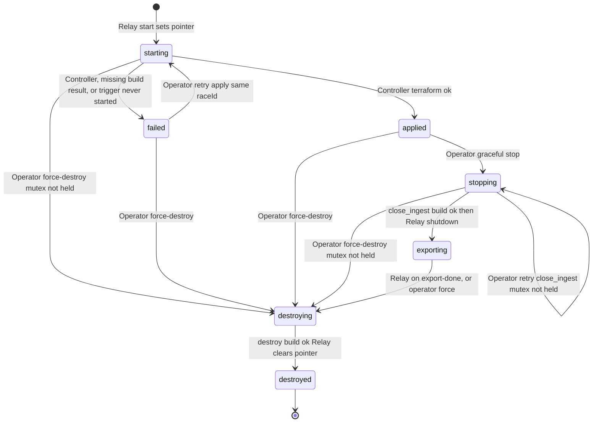

# Part 3. Firestore content

Goal: what is stored, who reads and writes, and the phase machine. This file is the source of truth for phases, fields, writers, and the mutex. Reject rules must match: [6-relay-api.md](6-relay-api.md).

Out of scope: Firestore admin, client libraries, backups, retention.

## Shape

Three documents:

- `control/active` — pointer. `raceId` set or empty. Relay-only write. New start only when empty. Retry from `failed` keeps the same pointer.
- `races/{raceId}` — one doc per race. Kept after destroy. Next new start always creates a new, unique `raceId`.

Operators never read Firestore. They call Relay. Heartbeats do not live here. Liveness is Kafka: [2-race-provisioning.md](2-race-provisioning.md).

## Writers and readers

Writers (only two):

- **Relay:** pointer, race collection; creates the race doc in the same transaction as the pointer; uploads Core YAML to GCS; writes `starting`, `stopping`, `exporting`, `destroying`, `destroyed`; writes `failed` if Cloud Build produced no controller `applied` while still `starting`, if the trigger never started, or if the build failed without a controller write; writes `terraformRun` on stamp (`runToken`, `stampedAt`, empty `buildId`), on bind or trigger `buildId`, on trigger failure (`status` `failed`, not left `in_flight`), on bind-window expiry with no matching build, and on build-finished (push or status replay); writes `startedBy` and timestamps.
- **Controller:** reads `terraformRun.action`, `runToken`, and `raceId`. Runs Terraform only if status is `in_flight` and `runToken` matches this build. Token mismatch: no Terraform, no Firestore write, success exit. Writes `applied` (only writer of `applied`) or `failed` only for `apply`, same write as terraform outputs, only if phase is still `starting` and the token still matches. Does not write Firestore on `close_ingest` or `destroy`. Does not parse YAML. Refuses apply if the GCS YAML object is missing. Does not touch `control/active`, the YAML object, or `terraformRun`.

Not writers, not readers: Core, Kafka VM, devices, operators.

## Core config blob

Relay renders a small YAML from operator request values plus system constants (including `raceId`) and uploads it to `{raceId}/core-config.yaml` **before** the pointer transaction. Firestore does not store the file. Orphan YAML without a pointer is acceptable.

Controller trusts the object and does not parse it. Race Terraform passes the GCS path as Core VM metadata. Core boot fetches the file. Core never uses Firestore.

`raceId` is a field on the race doc. Duplication with YAML contents is accepted.

YAML is immutable after start. Retry from `failed` keeps the original object. A different config requires force-destroy and a new race.

Exports land at `{raceId}/export/db` and `{raceId}/export/kafka` - location not stored in Firestore, derived from `raceId`. Always-on IAM: [1-infrastructure.md](1-infrastructure.md), [4-terraform.md](4-terraform.md).

## Schema

### `control/active`

- `raceId` — string or empty
- `updatedAt`

### `races/{raceId}`

- `raceId`
- `phase` — see machine below
- `terraformRun` — `runToken` (uuid, stamped with `in_flight`, passed into Cloud Build), `stampedAt`, `buildId` (empty until trigger confirms or status binds it), `action` (`apply` | `close_ingest` | `destroy`), `status` (`in_flight` | `succeeded` | `failed`). Empty until the first stamp. Source of truth for the one-build mutex. Not inferred from phase. GCS Terraform state locking is not the mutex.
- terraform outputs after apply: Kafka instance, Core instance, Kafka public IP
- Kafka hostname (stable name, copied on apply for history)
- `startedBy` — Okta subject
- timestamps: `startedAt`, `appliedAt`, `stoppedAt`, `destroyedAt`
- `lastError`

No config YAML field on the race doc. No standalone `action`, “latest Cloud Build id”, or queued-destroy field. No `pendingDestroy`.

## Mutex

Held whenever `terraformRun.status` is `in_flight`. Empty `buildId` does **not** release it.

Relay must not start a second Cloud Build while the mutex is held. No queued intent. Force-destroy while `in_flight` is rejected.

`runToken` is the generation. Cloud Build substitutions carry `raceId`, `action`, `runToken`. A stale build whose token no longer matches is a no-op at the controller.

Reconcile — on operator status, and before mutex checks on start retry / stop / force-destroy:

1. If `in_flight` and `buildId` is set: read Cloud Build. If terminal, run the same build-finished handler as the Pub/Sub push, then re-read the race doc.
2. If `in_flight` and `buildId` is empty: list Cloud Builds for this `raceId` + `runToken`. If found, bind `buildId`, then (1). If none and `stampedAt` is still inside the bind window: mutex stays held. If none and past the bind window: mark `terraformRun.status` `failed`, `lastError` (trigger never started). Then retry or force-destroy is allowed.

Bind window: longer than Cloud Run request timeout. No always-on reconciler daemon.

Every Relay trigger: stamp `in_flight` + new `runToken` + `stampedAt` with empty `buildId` → trigger with those substitutions → write `buildId`. Trigger failure: `status` `failed`, `lastError`, do not leave `in_flight`.

## Phase machine

Firestore stores infrastructure phase only. It does not store `ready` or `unhealthy`. Ready/unhealthy are API output: [6-relay-api.md](6-relay-api.md). Detection: [2-race-provisioning.md](2-race-provisioning.md).

Legal transitions:

- No pointer → YAML upload, then one transaction creates `races/{raceId}` and sets pointer, phase `starting`, then stamps apply `in_flight` + `runToken`
- `starting` → `applied` (Controller, token match, phase still `starting`) or `failed` (Controller on apply fail with token match; Relay if no `applied` while still `starting`, trigger never started, or bind window expired) or `destroying` (force, mutex not held)
- `failed` → `starting` (retry, same raceId, same YAML, new `runToken`, mutex not held) or `destroying` (force, mutex not held)
- `applied` → `stopping` (graceful stop, mutex not held) or `destroying` (force, mutex not held)
- `stopping` → `stopping` (retry `close_ingest`, mutex not held, new `runToken`) or `exporting` (Relay after `close_ingest` succeeds, then publishes shutdown) or `destroying` (force, mutex not held)
- `exporting` → `destroying` (Relay on export-done, or operator force, mutex not held)
- `destroying` → `destroyed` (Relay on destroy success, then updates races, pointer cleared)
- `destroying` may retry destroy if mutex not held (new `runToken`)
- `destroyed` is terminal for that `raceId`
- No graceful stop from `starting`. Force-destroy from `starting` / `stopping` / `exporting` only when mutex not held
- If Controller already wrote `applied`, a later Cloud Build failure does not move phase to `failed`. Mutex clears (`terraformRun` succeeded)

No transition into ready/unhealthy.

Pointer: set only on new start, cleared only when that race reaches `destroyed`. Retry from `failed` does not change the pointer. Destroyed race docs remain. Pointer and race doc are created together; never pointer without a doc.

## Who writes which phase

| Phase | Writer                                                                                                                                                              |
| --- |---------------------------------------------------------------------------------------------------------------------------------------------------------------------|
| starting | Relay                                                                                                                                                               |
| applied | Controller (`apply` only; token + phase `starting`; with outputs)                                                                                                   |
| failed | Controller on `apply` fail with token match, or Relay if trigger never started / bind window expired / build failed with no controller write while still `starting` |
| stopping | Relay                                                                                                                                                               |
| exporting | Relay (build-finished after `close_ingest`, push or status replay; then publishes shutdown)                                                                         |
| destroying | Relay (force-destroy API or export-done push)                                                                                                                       |
| destroyed | Relay (build-finished after destroy, push or status replay); then updates races and pointer clear                                                                   |

Core never writes Firestore. Export-done is Pub/Sub: [6-relay-api.md](6-relay-api.md).
