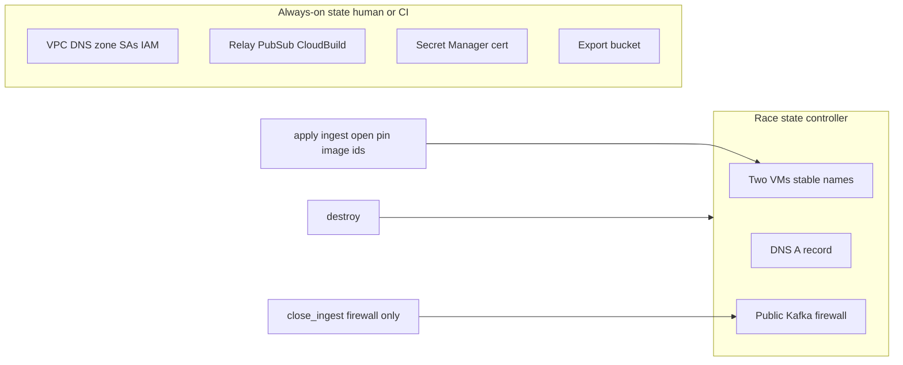

# Part 4. Terraform

Goal: two stacks, two backends, resource lists locked, and a clear definition of each controller Terraform run.

Gate: resources listed by lifecycle. Controller actions pinned. Relay is the only Cloud Build caller. Mutex and trigger sequence: [3-firestore.md](3-firestore.md).

Out of scope: Terraform code, image-build pipelines, cert issuance.

## Backends

Two GCS state files. Never one state for both stacks.

- Always-on state — human or CI applies. Controller never uses this backend.
- Race state — controller only. One file, reused every race. Empty after destroy. `raceId` is a variable (metadata, GCS path), not a new state prefix and not part of resource names.

Bootstrap exception: the state bucket itself is created once outside both states.

GCS state locking serializes Terraform. It is not the mutex. Controller refuses Terraform unless `runToken` matches.

Every controller run has a finite Cloud Build timeout. Timeout is that action failed (`apply` → phase `failed` only if still `starting`; `close_ingest` → stay `stopping`; `destroy` → stay `destroying`).

## Who applies what

| Stack | Who | When |
| --- | --- | --- |
| Always-on | Human / CI | Rare. Platform changes. |
| Race | Controller in Cloud Build | Every start, `close_ingest`, destroy. Triggered only by Relay. |

If the controller could apply always-on, a race destroy could delete Relay, VPC, or Firestore. Invalid.

If Core could trigger Cloud Build, destroy would start without a stamped `runToken` and a second destroy could overlap. Invalid.

## Always-on stack

Creates identities, network, control plane, and secrets. Does not create race VMs.

Resources:

- VPC, subnet, Private Google Access, baseline firewall (IAP SSH, no public Core, private Kafka between VMs and Cloud Run)
- Cloud DNS zone and stable Kafka hostname (no race A record)
- Secret Manager secret for the long-lived TLS cert (secret resource here; certificate value uploaded by operator/CI, not per race)
- GCS export bucket (YAML at `{gcsPrefix}/core-config.yaml`; exports at `{gcsPrefix}/export/`)
- Firestore database
- Cloud Run Relay (public HTTPS, no Google invoker for operators) and VPC access (always-on cost)
- Pub/Sub: Cloud Build notifications topic + push to Relay build-finished (OIDC); export-done topic + push to Relay export-done (OIDC)
- Cloud Build trigger that runs the controller image (Relay-invoked only). Substitutions per run: `raceId`, `action`, `runToken`
- Artifact Registry for the controller image
- Service accounts and IAM (below)
- No Cloud NAT

Not built by this stack: Compute image families (Kafka, Core). A separate image pipeline publishes them. Race `apply` resolves family to a concrete image id in race state. `close_ingest` must not follow a moved family.

### Service accounts

| Account | May | Must not |
| --- | --- | --- |
| Relay | Firestore; write Core YAML object; read `races/*/export/**` and issue time-limited download access; trigger Cloud Build; read and list Cloud Build (bind + replay); receive both Pub/Sub pushes | Terraform state; create VMs; Secret Manager payload |
| Controller (Cloud Build) | Race Terraform (Compute, DNS A in the existing zone, race firewall); race Firestore fields on `apply` only, token-gated; read Core YAML object; race Terraform state | Change VPC, Cloud Run, IAM identities, Secret Manager payload, always-on state; write phase on `close_ingest` / `destroy`; apply Terraform when `runToken` mismatches |
| Kafka VM | Read TLS secret | GCS; Cloud Build; Firestore; Pub/Sub |
| Core VM | Read `races/*/core-config.yaml`; write `races/*/export/**`; publish export-done | Firestore; Secret Manager; Terraform state; Cloud Build; write `core-config.yaml` |

IAM for Core YAML vs export is always-on and wildcarded on `raceId`. Race Terraform does not change IAM. No project Editor on the controller. Relay does not have Terraform permissions. Core does not have Cloud Build permissions.

## Race stack

One module. One reused state. Attaches always-on Kafka/Core service accounts. Does not create SAs or IAM bindings.

Resources (stable names; `raceId` is not in the name):

- Kafka VM `kafka` from Kafka image family at first apply (then pinned to that image id); public + private IP; Kafka SA; boot disk
- Core VM `core` from Core image family at first apply (then pinned to that image id); private IP only; Core SA; boot disk (SSD)
- DNS A record: stable hostname → Kafka public IP, short TTL. Destroy deletes the record.
- Public Kafka firewall rule (open or closed) as its own resource, not fused into VM replace
- Instance metadata only: Core YAML GCS path (Core VM); TLS secret resource id (Kafka VM)

Not in race state: VPC, DNS zone, SAs, IAM, cert bytes, YAML bytes, Relay, Pub/Sub, Cloud Build, images.

Do not copy the TLS private key onto disk via Terraform. That would put the key in state. Kafka boot pulls Secret Manager.

### `close_ingest` invariant

`ingest_open` (or equivalent) may only add/update/remove the public Kafka firewall rule. It must never replace Kafka VM, Core VM, disks, metadata, or the public IP.

Mechanism: first `apply` resolves each image family to a concrete image id in race state. Later `close_ingest` ignores image, boot disk, metadata, and public IP. Firewall rule is the only intended diff. Image family updates apply on the **next** race, after destroy left an empty state.

Violating this recreates VMs mid-drain.

## Controller Terraform runs

Same module, same race backend, three operations. Relay trigger sequence: [3-firestore.md](3-firestore.md). Controller reads Firestore first. Token mismatch or status not `in_flight`: no Terraform, no Firestore write, success exit.

### `apply`

Create (or converge) the race stack with public ingest open.

1. Refuse if `runToken` does not match this build or status is not `in_flight`. Refuse if the Core YAML object is missing.
2. Apply: both VMs (stable names), public IP, DNS A record, firewall open, metadata paths, attach always-on SAs. Resolve image family to concrete ids in state.
3. Write terraform outputs to the race Firestore doc (`applied` or `failed`) only if phase is still `starting` and the token still matches, including Kafka public IP.

Idempotent. Retry from `failed` is the same apply.

### `close_ingest`

Apply the same module with public ingest closed. VMs, disks, metadata, public IP, DNS A record stay. Private Kafka stays up. No Firestore phase write from the controller.

Relay must not publish shutdown until this run succeeds. Overlapping `close_ingest` and `destroy` is invalid.

Idempotent if already closed. Retry from `stopping` when mutex not held is this same apply.

### `destroy`

Terraform destroy of the race state. VMs, disks, public IP, A record, race firewall go away. Always-on untouched. Pointer clear and `control/last` are Relay’s job after the build. No Firestore phase write from the controller.

Idempotent if already empty.

## Images and boot (Terraform boundary)

Two Compute Engine image families: Kafka, Core+Influx. Race `apply` picks current family, then pins that id in race state so `close_ingest` cannot replace VMs. Next race starts from empty state and picks up a newly published family image.

Boot contracts (not this stack): Kafka broker does not start unless public TLS bound. Core on connect reads retained shutdown key `shutdown`. Controller image lives in Artifact Registry; that is not a VM image.

What Terraform stores: GCS path of Core YAML (Core metadata); Secret Manager secret id (Kafka metadata). Not YAML bytes. Not TLS private key.

## Cross-stack contract

Race Terraform may: create VMs in the always-on VPC/subnet with stable names; add/update/remove the A record in the always-on DNS zone; add/update the public Kafka firewall rule; attach always-on VM service accounts.

Race Terraform may not: delete the zone, VPC, Relay, buckets, secrets, or identities; change project IAM; rebuild images; rename VMs per `raceId`.
