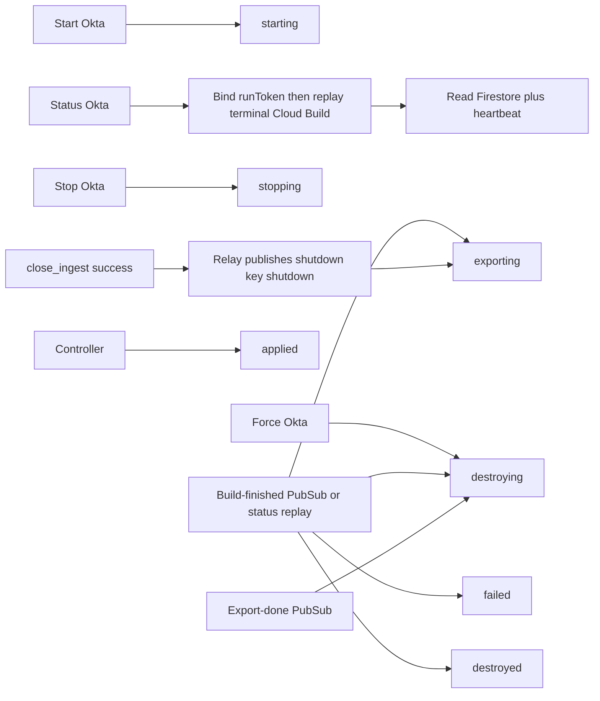

# Part 6. Relay API

Goal: every lifecycle operation has a caller, input, output, and reject rules. Reject rules match the phase machine in [3-firestore.md](3-firestore.md). Mutex and reconcile live there; this file does not restate them.

Out of scope: implementation, HTTP framework, Core YAML shape. Operator config is a dict. Relay stores it into the YAML file and trusts it.

## Callers

Three identities.

- **Operator:** valid Okta token. Any such user may call all four operator operations. No role matrix in v1. Cloud Run is public HTTPS; Relay checks Okta. Operators are not Google identities.
- **Build-finished:** Pub/Sub push identity (OIDC) for the Cloud Build subscription. Not Okta. Cannot start, stop, or force-destroy.
- **Export-done:** Pub/Sub push identity (OIDC) for the export-done subscription. Not Okta. Cannot start, stop, or force-destroy.

Cloud Run does not wait on Terraform. Operator calls return immediately. Relay is the only Cloud Build caller.

Before start retry / stop / force-destroy reject-on-mutex, and on every status: run the Firestore reconcile (bind orphan `buildId` by `runToken`, replay terminal Cloud Build).

## Resource shape

Start creates `races/{raceId}` in Firestore. The API exposes the active race and historical races through separate endpoints. Historical races are race documents whose ID is not the current `control/active` pointer.

Internal build-finished and export-done are separate paths on the same Relay service.

## Operations

### Start (operator)

Caller: Okta.

Input: config dict. On retry from `failed`, config is ignored; original YAML stays.

New race (pointer empty): mint `raceId`; render YAML; upload `{raceId}/core-config.yaml`; one transaction: atomic pointer set if empty **and** create race doc (reject if pointer already set); stamp apply `in_flight` + new `runToken` + `stampedAt` with empty `buildId`; trigger Cloud Build apply with substitutions `raceId`, `action`, `runToken`; write `buildId`. Trigger failure: phase `failed`, `terraformRun.status` `failed`, `lastError`, pointer stays.

Retry (pointer set, phase `failed`, mutex not held): same `raceId`, no new YAML, new apply run, new `runToken`, phase `starting`, stamp, trigger, write `buildId`.

Output: `raceId`, phase `starting`.

Reject: pointer set and phase is not `failed`; `failed` but mutex held.

### Status (operator)

Caller: Okta. Input: none.

If mutex held: reconcile, then re-read Firestore.

If pointer empty: no active race; return `raceId` null.

Else: `raceId`, phase, ready, unhealthy, `lastError`, `startedBy`, `startedAt`, `terraformRun`, `billableVms` true. Kafka hostname, port, and public IP only when ready. Do not return export URLs or last-race data.

Ready / unhealthy are derived. Not written back. Heartbeat only when phase is `applied`:

- No record yet: ready false, unhealthy false
- Fresh record: ready true, unhealthy false
- Stale record or Kafka read fail: ready false, unhealthy true (`lastError` on read fail)
- Other phases: both false

Read fail still returns phase, `startedAt`, `billableVms`. Heartbeat meaning: [2-race-provisioning.md](2-race-provisioning.md).

Export-done is not recovered here. Hung `exporting` uses force-destroy.

### History list (operator)

Caller: Okta. Input: none.

Return every race ID and its race dates from the `races` collection, excluding the race referenced by `control/active`. The list is ordered newest first and includes `raceId`, `startedAt`, and `destroyedAt`.

### Historical race (operator)

Caller: Okta. Return the selected historical race document from the database. An active race is not a historical race and is rejected as not found. With query parameter `export_race=true`, also return `exportUrls` containing temporary GCS export URLs.

### Stop (operator)

Caller: Okta. Input: empty.

Allowed from `applied` (including unhealthy), mutex not held. Also retry from `stopping` when mutex not held.

Relay: stamp `stopping` / `close_ingest` `in_flight` + new `runToken` + `stampedAt` with empty `buildId`, trigger Cloud Build with substitutions, write `buildId`. Do not publish shutdown yet.

Output: `raceId`, phase `stopping`.

Reject: no active race; phase `starting`; `exporting` or `destroying`; mutex held.

### Force-destroy (operator)

Caller: Okta. Input: empty.

Allowed from `failed`, `starting`, `applied`, `stopping`, `exporting` when mutex not held. Also retry from `destroying` if mutex not held.

Reject: no active race; mutex held. No exception for `close_ingest`. No queued intent.

Behavior: write `destroying` / destroy `in_flight` + new `runToken` + `stampedAt` with empty `buildId`, trigger destroy with substitutions, write `buildId`.

Output: `raceId`, phase `destroying`. No HTTP wait.

### Build-finished (Pub/Sub push)

Caller: Cloud Build push identity.

Input: Cloud Build finished event (build id, success/fail). `raceId`, `action`, `runToken` come from the substitutions Relay set at trigger.

Reject: caller is not that push identity; `buildId` does not match `terraformRun.buildId`; `runToken` does not match; raceId does not match the pointer / race doc.

Idempotent: if this `buildId` was already applied to `terraformRun` (status already `succeeded` or `failed` for that id), no second phase move.

Then mark `terraformRun.status` succeeded or failed, and:

- **apply success:** controller should already have written `applied`. If it did not: phase `failed`, `lastError`. Do not invent `applied` without outputs.
- **apply failure:** if phase is already `applied` with outputs: do not revert; mark `terraformRun` succeeded (controller committed). If phase is still `starting`: `failed`, `lastError`.
- **close_ingest success:** phase `exporting`, then Relay publishes shutdown on the private control topic a shutdown message.
- **close_ingest failure:** `lastError`; phase stays `stopping`. Operator retries stop once mutex is clear. Not force-destroy.
- **destroy success:** phase `destroyed`; update races; clear `control/active`.
- **destroy failure:** `lastError`; phase stays `destroying`. Operator retries force-destroy.

Status replay uses this same handler.

### Export-done (Pub/Sub push)

Caller: export-done push identity.

Input: `raceId` from Core (value in message body under `race_id` key)

Reject: caller is not that push identity; raceId does not match the pointer / race doc; phase is not `exporting`; mutex held.

Then: write `destroying`, stamp destroy `in_flight` + new `runToken` + `stampedAt` with empty `buildId`, trigger Cloud Build destroy with substitutions, write `buildId`. Ack this push only after that stamp (and trigger attempt).

Late message after force-destroy or after destroy: reject. No second Terraform.

Not recovered by Cloud Build replay. Hung `exporting` uses force-destroy.

## Start / stop mapping

## Not in this document

- Core YAML schema (dict in, file out).
- Device ingest (Kafka, not Relay).
- Controller Terraform (Cloud Build runs it; Relay only triggers).
- Direct GCS access with Google accounts (download handled via Relay exposing temporary download links, not in this document scope).
