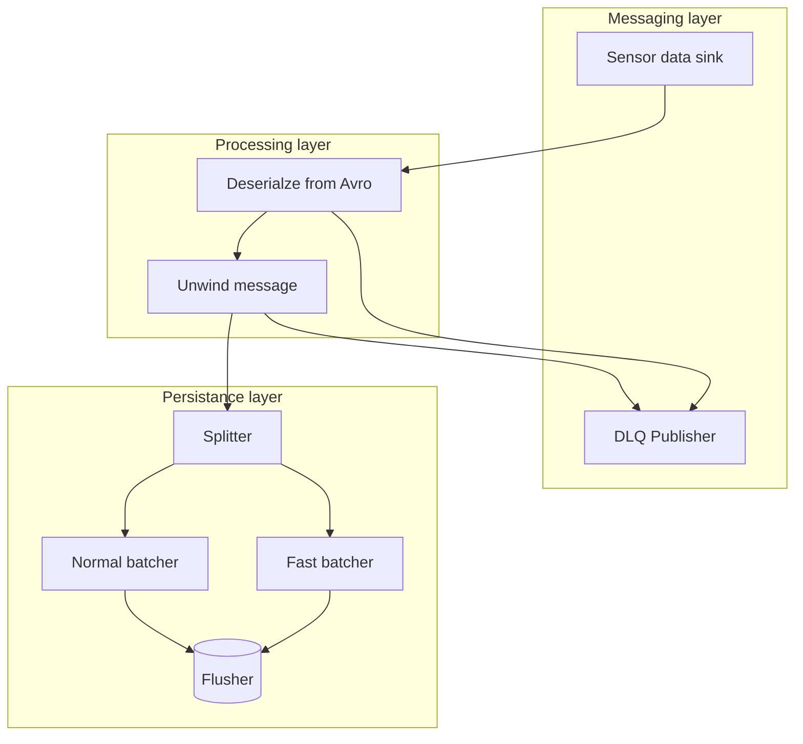
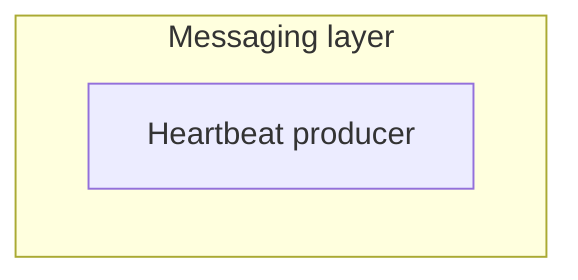
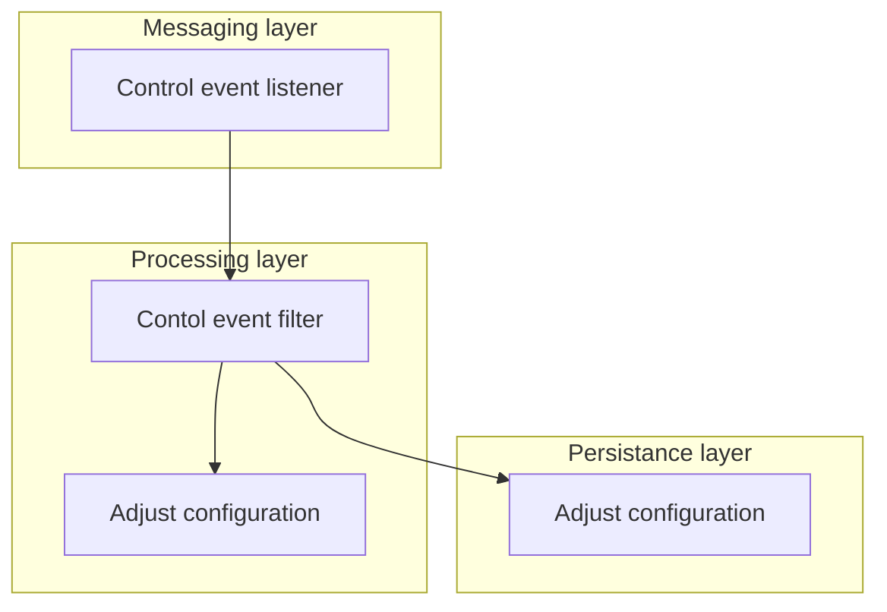
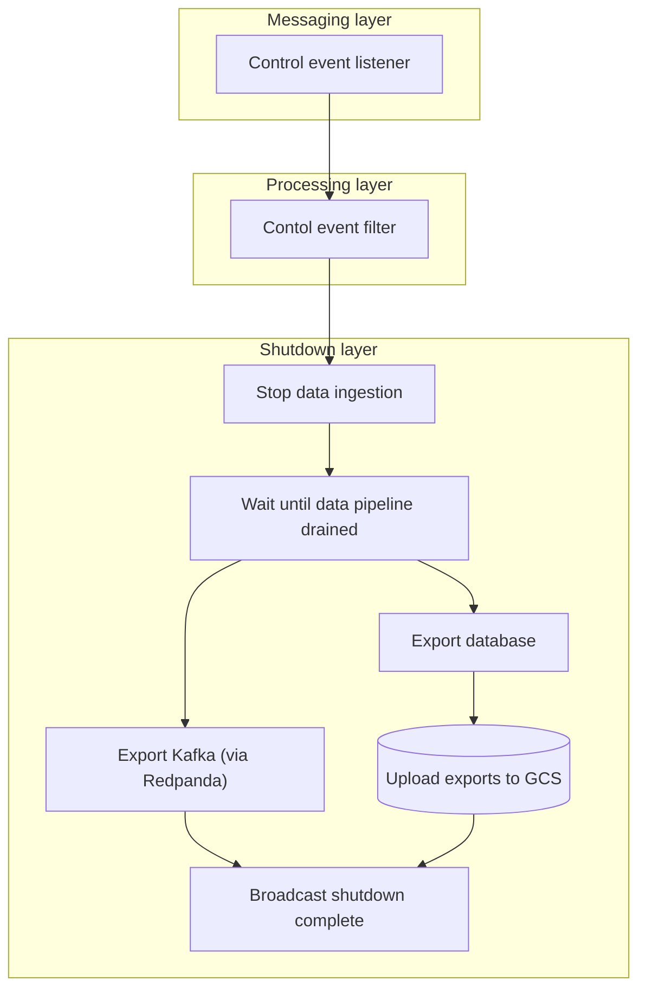

# Deep dive - Core

## Layers

Core can be divided into 3 main layers.

#### Layer 1 - messaging layer

Name: Messaging layer
Purpose: consume and publish messages from Kafka
Main components:
- Consumer for sensor data
- Consumer for control events
- DLQ producer
- Heartbeat producer

#### Layer 2 - processing layer

Name: Processing layer
Purpose: Process the data from messages
Main components:
- receiving pipeline for incoming messages
- process the message, deserialize and transform if needed
- filter component for the control message that decides how to act on the message

#### Layer 3 - persistence layer

Name: Persistence layer
Purpose: handle connection with the database, flush data
Main components:
- batcher collecting data into batches depending on time, batch size and sensor type 
- flusher writing data into the database

#### Layer 4 - Shutdown layer

Name: Shutdown layer
Purpose: Special layer used during shutdown sequence to handle exporting data
Main components:
- kafka exporter
- database exporter
- GCS writer
- Google Pub/Sub publisher

## Data ingestion flow

### Core heartbeat

### Control event handling

### Shutdown event handling

