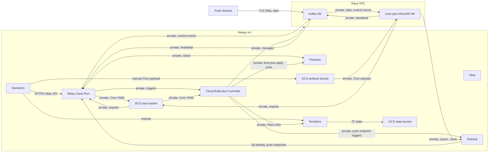

# Chronoracer documentation

Each concept has one owner. Other docs link it. Do not copy or rephrase the same fact.

| Concept                                                                                | Owner                                                             |
|----------------------------------------------------------------------------------------|-------------------------------------------------------------------|
| Region, free-tier, topology                                                            | this file                                                         |
| Resource names                                                                         | [`infra/contract/names.json`](../infra/contract/names.json)       |
| Ports, Kafka/export topics, Kafka OAuth JWKS/issuer/audience                           | [`infra/contract/platform.json`](../infra/contract/platform.json) |
| Terraform stacks, backends, IAM, always-on vs race resources, `ingest_open`, image pin | [Terraform](component-terraform.md)                               |
| Controller process (env, bind, YAML HEAD, CLI, apply Firestore writes, exits)          | [Controller](component-controller.md)                             |
| Relay HTTP and Pub/Sub API                                                             | [Relay](component-relay.md)                                       |
| Firestore schema, mutex, phase machine                                                 | [Firestore](component-firestore.md)                               |
| GCS object layout                                                                      | [GCS](component-gcs_buckets.md)                                   |
| Kafka listeners, topics, boot contract                                                 | [Kafka](component-kafka.md)                                       |
| Kafka boot scripts                                                                     | [Kafka startup](../kafka/startup/README.md)                       |
| Core layers and in-process flows                                                       | [Core](component-core.md)                                         |
| Core boot scripts                                                                      | [Core startup](../core/startup/README.md)                         |
| Influx tables and plugins                                                              | [InfluxDB](component-influxdb.md)                                 |
| Packer VM images and Core payload                                                      | [Compute images](component-images.md)                             |
| Relay + controller Docker publish                                                      | [Control-plane images](operator-control-plane-images.md)          |
| Kafka public TLS issue/upload                                                          | [Kafka TLS](operator-kafka-tls.md)                                |
| Okta apps and operator tokens                                                          | [Okta](component-okta.md)                                         |
| Start sequence and ready/unhealthy detection                                           | [Race provisioning](flow-race_provisioning.md)                    |
| Stop, export, destroy sequence                                                         | [Race destruction](flow-race_destruction.md)                      |

Directory READMEs under `infra/`, `core/`, `kafka/` are how-to for that tree. They must not restate owned facts.

## Infrastructure overview

### Deployment basics

Deployment on Google Cloud Platform.

Whatever can be in the free tier is in the free tier (Cloud Run scale-to-zero; Firestore, Pub/Sub, Cloud Build have
generous free tier limits).

Not free: Cloud Run VPC access to Kafka, Cloud DNS, Artifact Registry, GCS buckets. Race VMs are paid and sized to be
reliable.

Region: all GCP resources in `europe-west3`. Do not split regions.

### Topology

## Components

See graph above for connections.

| Component   | Document                              |
|-------------|---------------------------------------|
| Core        | [Core](component-core.md)             |
| InfluxDB    | [InfluxDB](component-influxdb.md)     |
| Relay       | [Relay](component-relay.md)           |
| Kafka       | [Kafka](component-kafka.md)           |
| Firestore   | [Firestore](component-firestore.md)   |
| GCS Buckets | [GCS](component-gcs_buckets.md)       |
| Terraform   | [Terraform](component-terraform.md)   |
| Controller  | [Controller](component-controller.md) |
| Okta        | [Okta](component-okta.md)             |
| Images      | [Compute images](component-images.md) |

## Flows

| Flow              | Document                                              |
|-------------------|-------------------------------------------------------|
| Race provisioning | [Flow - Race provisioning](flow-race_provisioning.md) |
| Race destruction  | [Flow - Race destruction](flow-race_destruction.md)   |

## Operator runbooks

Procedures humans run outside Terraform apply. Code and Terraform do not replace these.

| Runbook              | Document                                                          |
|----------------------|-------------------------------------------------------------------|
| Control-plane images | [Operator — Relay + controller](operator-control-plane-images.md) |
| Kafka TLS cert       | [Operator — Kafka public TLS](operator-kafka-tls.md)              |
