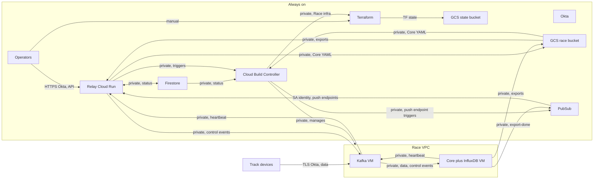

# Chronoracer documentation

## Infrastructure overview

### Deployment basics

Deployment on Google Cloud Platform. 

Whatever can be in the free tier is in the free tier (Cloud Run scale-to-zero; Firestore, Pub/Sub, Cloud Build have generous free tier limits).

Not free: Cloud Run VPC access to Kafka, Cloud DNS, Artifact Registry, GCS buckets. Race VMs are paid and sized to be reliable.

Region: all GCP resources in `europe-west3` (Frankfurt). Do not split regions.

### Topology

## Components

See graph above for connections. Check the dedicated documents for details about components.

| Component   | Document                                        |
|-------------|-------------------------------------------------|
| Core        | [Core - Deep dive](component-core.md)           |
| InfluxDB    | [InfluxDB - Deep dive](component-influxdb.md)   |
| Relay       | [Relay - Deep dive](component-relay.md)         |
| Kafka       | [Kafka - Deep dive](component-kafka.md)         |
| Firestore   | [Firestore - Deep dive](component-firestore.md) |
| GCS Buckets | [GCS - Deep dive](component-gcs_buckets.md)     |
| Terraform   | [Terraform - Deep dive](component-terraform.md) |
| Okta        | [Okta - Deep dive](component-okta.md)           |

## Flows

Some of the business logic flows deserve a dedicated document.

| Flow              | Document                                              |
|-------------------|-------------------------------------------------------|
| Race provisioning | [Flow - Race provisioning](flow-race_provisioning.md) |
| Race destruction  | [Flow - Race destruction](flow-race_destruction.md)   |

