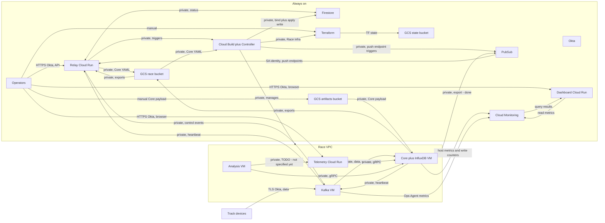

# Chronoracer documentation

Each concept has one owner. Other docs link it. Do not copy or rephrase the same fact, instead point to the source.

| Concept                                                                                | Owner                                                             |
|----------------------------------------------------------------------------------------|-------------------------------------------------------------------|
| Region, free-tier, topology                                                            | this file                                                         |
| GCP region decision                                                                    | [ADR - Region](adr-region.md)                                     |
| Resource names                                                                         | [`infra/contract/names.json`](../infra/contract/names.json)       |
| Ports, Kafka/Cloud Build/export topics, Kafka OAuth JWKS/issuer/audience               | [`infra/contract/platform.json`](../infra/contract/platform.json) |
| Terraform stacks, backends, IAM, always-on vs race resources, `ingest_open`, image pin | [Terraform](component-terraform.md)                               |
| Controller process (env, bind, YAML HEAD, CLI, apply Firestore writes, exits)          | [Controller](component-controller.md)                             |
| Relay HTTP and Pub/Sub API                                                             | [Relay](component-relay.md)                                       |
| Firestore schema, mutex, phase machine                                                 | [Firestore](component-firestore.md)                               |
| GCS object layout                                                                      | [GCS](component-gcs_buckets.md)                                   |
| Kafka listeners, topics, boot contract                                                 | [Kafka](component-kafka.md)                                       |
| Kafka boot scripts                                                                     | [Kafka startup](../kafka/startup/README.md)                       |
| Core layers and in-process flows                                                       | [Core](component-core.md)                                         |
| Core boot scripts                                                                      | [Core startup](../core/startup/README.md)                         |
| Influx tables and plugins                                                              | [InfluxDB](component-influxdb.md)                                 |
| Race-fleet health dashboards and datasource                                            | [Dashboard](component-dashboard.md)                               |
| Near-real-time race preview                                                            | [Telemetry](component-telemetry.md)                               |
| Dashboard/Telemetry split and rejected options                                         | [ADR - Dashboard](adr-dashboard.md)                               |
| Core to Telemetry stream protocol                                                      | [ADR - Core telemetry stream](adr-telemetry-stream.md)            |
| Packer VM images and Core payload                                                      | [Compute images](component-images.md)                             |
| Control-plane Docker publish                                                           | [Control-plane images](operator-control-plane-images.md)          |
| Kafka public TLS issue/upload, Cloud Run domain verify                                 | [Kafka TLS](operator-domain-and-tls.md)                           |
| Influx token create/rotate                                                             | [Influx token](operator-influx-token.md)                          |
| Shared browser Auth0 login setup                                                       | [Browser OAuth](operator-browser-oauth.md)                        |
| Okta apps and operator tokens                                                          | [Okta](component-okta.md)                                         |
| Start sequence and ready/unhealthy detection                                           | [Race provisioning](flow-race_provisioning.md)                    |
| Stop, export, destroy sequence                                                         | [Race destruction](flow-race_destruction.md)                      |

Directory READMEs under `infra/`, `core/`, `kafka/` are how-to for that tree.

Directory `docs/proposals` contains not implemented proposals that may only be referenced by other proposals, not locked in docs.

## Infrastructure overview

### Deployment basics

Deployment on Google Cloud Platform.

Whatever can be in the free tier is in the free tier (always-on Cloud Run services scale to zero; Firestore, Pub/Sub,
Cloud Build have generous free tier limits). Race Telemetry intentionally keeps one billed Cloud Run instance warm.

Not free: Cloud DNS, Artifact Registry, GCS buckets. Race VMs are paid and sized to be reliable. Direct VPC Egress is
used by Relay and race Telemetry; Dashboard has no race-VPC route.

Region: all GCP resources in `europe-west1` (Compute zone `europe-west1-b`). Do not split regions. Why:
[ADR - Region](adr-region.md).

### Topology

## Components

See graph above for connections.

| Component   | Document                              |
|-------------|---------------------------------------|
| Core        | [Core](component-core.md)             |
| InfluxDB    | [InfluxDB](component-influxdb.md)     |
| Dashboard   | [Dashboard](component-dashboard.md)   |
| Telemetry   | [Telemetry](component-telemetry.md)   |
| Relay       | [Relay](component-relay.md)           |
| Analysis    | [Analysis](component-analysis.md)     |
| Kafka       | [Kafka](component-kafka.md)           |
| Firestore   | [Firestore](component-firestore.md)   |
| GCS Buckets | [GCS](component-gcs_buckets.md)       |
| Terraform   | [Terraform](component-terraform.md)   |
| Controller  | [Controller](component-controller.md) |
| Okta        | [Okta](component-okta.md)             |
| Images      | [Compute images](component-images.md) |

## Flows

| Flow              | Document                                              |
|-------------------|-------------------------------------------------------|
| Race provisioning | [Flow - Race provisioning](flow-race_provisioning.md) |
| Race destruction  | [Flow - Race destruction](flow-race_destruction.md)   |

## Decisions

| Decision  | Document                            |
|-----------|-------------------------------------|
| VM types  | [ADR - VM types](adr-vm-types.md)   |
| Dashboard | [ADR - Dashboard](adr-dashboard.md) |
| Region    | [ADR - Region](adr-region.md)       |

## Operator runbooks

Procedures humans run outside Terraform apply. Code and Terraform do not replace these.

| Runbook                 | Document                                                                                  |
|-------------------------|-------------------------------------------------------------------------------------------|
| Container images        | [Operator — Relay + controller + Dashboard + Telemetry](operator-control-plane-images.md) |
| Domain + Kafka TLS cert | [Operator — Domain, Cloud Run verify, Kafka TLS](operator-domain-and-tls.md)              |
| Influx admin token      | [Operator — Influx admin token](operator-influx-token.md)                                 |
| Browser Auth0 login     | [Operator — shared browser Auth0 login](operator-browser-oauth.md)                        |
