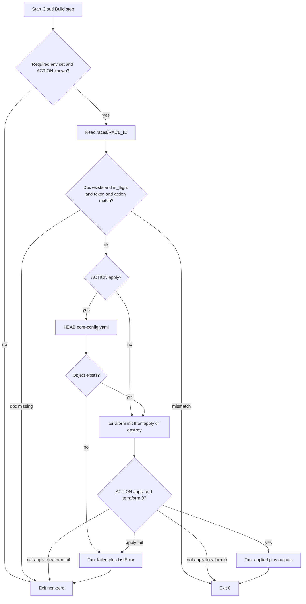

# Deep dive - Controller

Code at: [Controller root](../controller).

Where: one Cloud Build step. Image from Artifact Registry. Trigger `race-controller` (always-on, same region as [docs README](README.md), not `global`). Timeout **30m**. Logging `CLOUD_LOGGING_ONLY` (stdout/stderr).

Lifecycle: always-on image. Invoked per race action, not a long-lived service.

Access: private (Cloud Build service account `chronoracer-controller`). Invoked only through the always-on trigger. Relay run/get/list uses `projects/{project}/locations/{region}/…` with `region` = always-on `var.region` (`gcp.cloud_build_location` in Relay config). Global Cloud Build APIs would miss this trigger.

IAM: [Terraform](component-terraform.md). Sequences: [Race provisioning](flow-race_provisioning.md), [Race destruction](flow-race_destruction.md). Mutex and schema: [Firestore](component-firestore.md). Image freeze while VMs exist: [Terraform](component-terraform.md).

Responsibility:

- Bind this build to `races/{raceId}` using substitutions, then run race Terraform or no-op.
- `apply` / `close_ingest` / `destroy` against the `race/` state prefix only.
- On `apply` only: write Firestore phase `applied` (with outputs) or `failed` (with `lastError`).
- Refuse Terraform unless the Firestore mutex token matches.

## Runtime

Python process in image `controller_image`.

Image bake (build time):

- Terraform binary 1.16.0
- Copied [`infra/race`](../infra/race) `.tf` files and `.terraform.lock.hcl` (not `terraform.tfvars`). VM `startup-script` is inline in the race module (`local.overlay_startup`); bake does not copy `.sh` files.
- Copied [`infra/contract/`](../infra/contract) (`names.json`, `platform.json`) as sibling `infra/contract/` so race `path.module/../contract` still works.
- Image build: `terraform init -input=false -backend=false` (providers only; no GCS credentials at bake). Runtime `terraform init` attaches the `race/` backend.

Publish: [Control-plane images](operator-control-plane-images.md).

Local bake from the **repository root** (Docker context must include `infra/`):

```bash
docker build -f controller/Dockerfile -t controller .
```

`python -m controller`. Tests: `pip install -r controller/requirements-dev.txt` then `pytest` in `controller/`.

## Environment

Relay substitutions (Cloud Build requires `_`; Relay already sends these):

| Cloud Build  | Process env | Source                                              |
|--------------|-------------|-----------------------------------------------------|
| `_RACE_ID`   | `RACE_ID`   | Relay stamp                                         |
| `_ACTION`    | `ACTION`    | Relay stamp: `apply` \| `close_ingest` \| `destroy` |
| `_RUN_TOKEN` | `RUN_TOKEN` | Relay stamp uuid                                    |

Always-on trigger env (not Relay substitutions; values from always-on apply):

| Process env  | Source                          | Terraform `-var` |
|--------------|---------------------------------|------------------|
| `PROJECT_ID` | `var.project_id`                | `project_id`     |
| `KAFKA_FQDN` | `var.kafka_fqdn` (trailing dot) | `kafka_fqdn`     |
| `ZONE`       | `var.zone`                      | `zone`           |

`region` stays the race-module default `europe-west3`. Machine types and disk types stay module defaults. Do not pass them unless those defaults change in Terraform.

Missing any required env: no Terraform, no Firestore write, non-zero exit.

Unknown `ACTION`: same as missing env.

Optional: `FIRESTORE_DATABASE` (default `(default)`), `TERRAFORM_DIR` (default `/app/infra/race`), `NAMES_JSON` (default `/app/infra/contract/names.json`).

## Bind (before Terraform)

Open **only** `races/{RACE_ID}`. Do not read `control/active`. Do not compare the pointer.

| Check                                         | On fail                              |
|-----------------------------------------------|--------------------------------------|
| Race doc missing                              | No Terraform, no write, **non-zero** |
| `terraformRun.status` is not `in_flight`      | No Terraform, no write, **exit 0**   |
| `terraformRun.runToken` not equal `RUN_TOKEN` | No Terraform, no write, **exit 0**   |
| `terraformRun.action` not equal `ACTION`      | No Terraform, no write, **exit 0**   |

Stale or mismatched builds are success no-ops so Cloud Build is `SUCCESS` and Relay still rejects on token/`buildId`. Do not treat that as apply failure.

## YAML existence (`apply` only)

After bind succeeds, `HEAD` (or equivalent exists check) `gs://{race_bucket}/{RACE_ID}/core-config.yaml` with `race_bucket` from `names.json`.

Do not download or parse YAML. Race Terraform only puts the GCS URI in Core metadata.

Object missing: Firestore `failed` write (same guards as apply fail), `lastError` = `core-config.yaml missing`, **non-zero** exit. No Terraform.

`close_ingest` and `destroy`: skip this check.

## Terraform CLI

Working directory: baked `infra/race`. Backend already `bucket` / `prefix` from names (`state_bucket`, prefix `race`). Never `-backend-config` that opens `base/`.

Module operations (`ingest_open`, lock, what each action mutates): [Terraform](component-terraform.md).

Every run:

1. `terraform init -input=false -lock-timeout=5m` (refresh backend; providers already present).
2. Then one of:
   - `apply`: `terraform apply -input=false -auto-approve -lock-timeout=5m` with `-var ingest_open=true`
   - `close_ingest`: same `apply` with `-var ingest_open=false`
   - `destroy`: `terraform destroy -input=false -auto-approve -lock-timeout=5m` with `-var ingest_open=false` (required var; unused by destroy)

Always pass `-var race_id=$RACE_ID`, `-var project_id=$PROJECT_ID`, `-var kafka_fqdn=$KAFKA_FQDN`, `-var zone=$ZONE`.

Terraform is captured, then the full stdout and stderr of every terraform process in that run is written to the controller process **stdout** as one block.
`lastError` is a short tail, persisted in Firestore.

Never: `-lock=false`, force-unlock, `-target`, saved plan file, always-on root, `terraform_remote_state` on `base`.

Idempotent: retry apply / close_ingest / destroy is the same command.

Controller does not verify the close_ingest plan (no VM replace). That invariant is the race module (`ignore_changes`, firewall `count`).

## Firestore writes

Only on `ACTION=apply`. Never write `terraformRun`, `control/active`, YAML, or phase on `close_ingest` / `destroy`.

Use a transaction: re-read the race doc; write only if `phase` is still `starting` and `runToken` still matches `RUN_TOKEN`.

Success (terraform apply 0, outputs present):

- `phase` = `applied`
- `appliedAt` = server timestamp
- `kafkaInstance`, `coreInstance`, `kafkaPublicIp`, `kafkaHostname` from terraform outputs `kafka_instance`, `core_instance`, `kafka_public_ip`, `kafka_hostname` (`kafka_hostname` is the FQDN **without** trailing dot)
- `kafkaPort` is a constant, not modified by controller
- delete `lastError` (retry leftovers must not survive `applied`)

Controller is the only writer of `applied`.

Failure (YAML missing, terraform non-zero, or outputs unreadable) with the same transaction guards:

- `phase` = `failed`
- `lastError` = short reason (YAML missing string, or last 20 lines of terraform stderr, stdout if stderr empty). Full terraform output is on process stdout, not in this field.

If the transaction skips because phase or token changed after Terraform already ran: no write, log, **exit 0**. Leftovers need force-destroy. Mutex should make this rare.

`close_ingest` / `destroy` terraform failure: no phase write; **non-zero** so Relay build-finished sees Cloud Build failure.

## Exit codes

| Situation                                                                     | Exit     |
|-------------------------------------------------------------------------------|----------|
| Bind no-op (status / token / action mismatch)                                 | 0        |
| Apply success after `applied` write (or skipped write after successful apply) | 0        |
| close_ingest / destroy terraform success                                      | 0        |
| Missing doc, missing env, unknown ACTION                                      | non-zero |
| Apply YAML missing or terraform fail (after `failed` write or write skipped)  | non-zero |
| close_ingest / destroy terraform fail                                         | non-zero |

## Process


