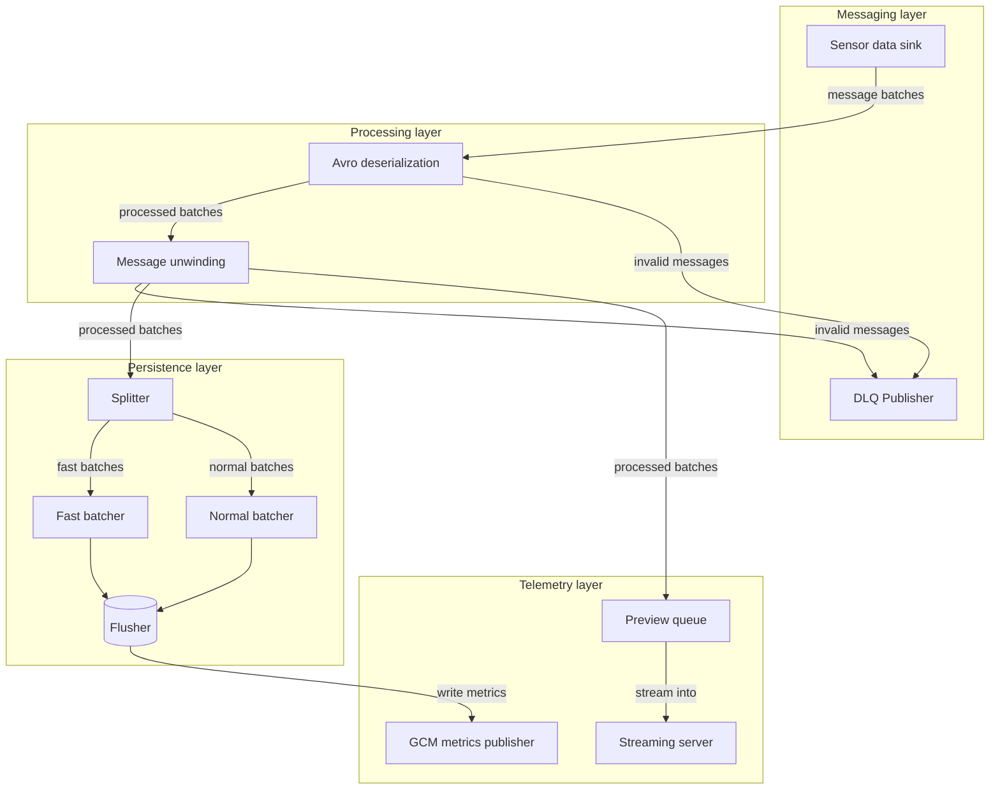
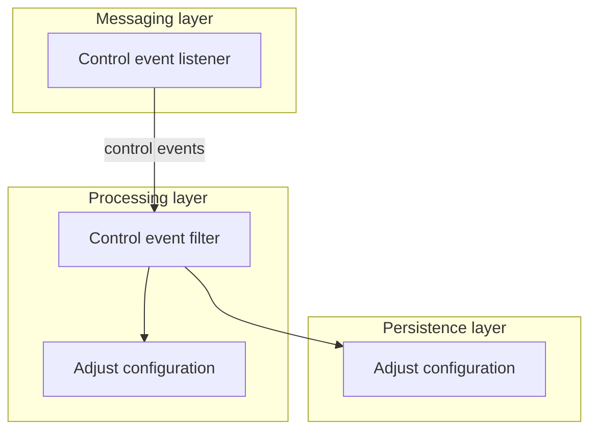
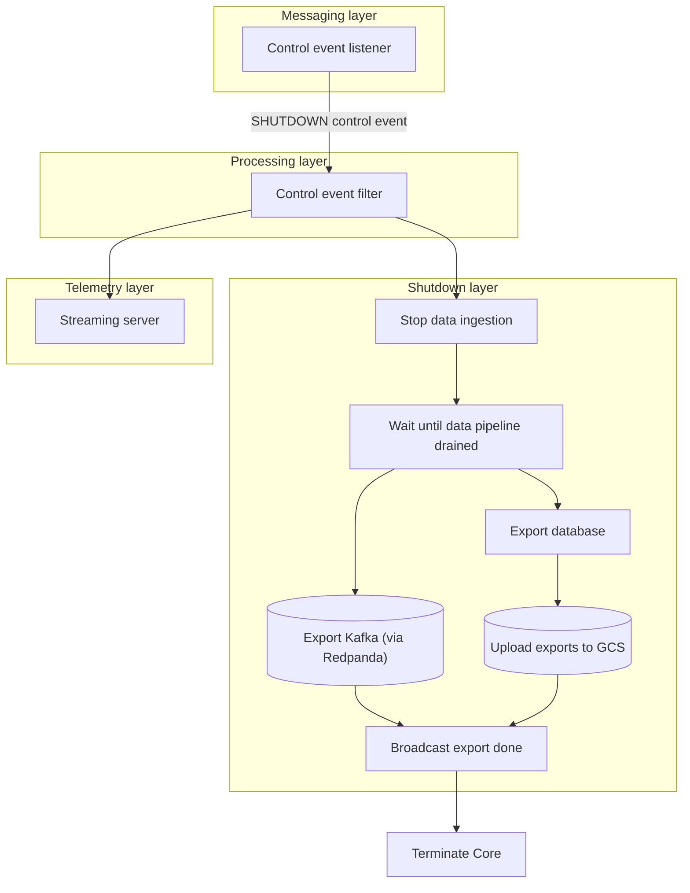

# Deep dive - Core

Code at: [Core root](../core)

Where: one paid VM. Core and InfluxDB 3 Core (self-managed, single node) share that VM.

Shared VM pain points: Core and database share similar load spikes which means that VM usage can spike greatly and when
it does, it's from both components at the same time. Telemetry streaming adds bounded serialization and network work;
it must never backpressure the ingest pipeline: [Telemetry stream](#telemetry-stream).

Lifecycle: race-scoped. Created at the start. After export succeeds, VM and disk are destroyed.

Access: private

Core responsibility:

- ingest data from Kafka
- process, validate data
- batch and write to the database
- serve as a buffer for the database
- expose accepted logical points on one private, best-effort telemetry gRPC stream
- publish cumulative Influx write counters to Cloud Monitoring
- handle shutdown sequence export flow (for both database and Kafka)

## Data pipeline batch contract

The base contract is defined by [`core/default-config.yaml`](../core/default-config.yaml). Its `localhost:9092`
broker, placeholder race values, and disabled GCP block support local development. On a race VM,
[`render-config.sh`](../core/startup/render-config.sh) overlays the metadata-derived broker and race ID, the project
and race bucket, `export-done`, and `gcp.enabled: true`; the platform overlay wins over both defaults and operator YAML.

The sensor data message sink flushes on whichever comes first: a certain number of messages, time spent, or stream
shutdown. The collector processes batches concurrently (processing within each batch is serial).
Invalid messages remain individual DLQ records because their original partition, offset, and parse error are stored in
per-record headers.
The splitter partitions each processed batch into one fast-flush and one normal batch. The persistence
batcher consumes those grouped messages and forms its database point batches using the fast/normal path and
interval settings.

The control path is intentionally separate: a different message sink forwards each control record immediately on a
single-message channel and uses `fetch.min.bytes=1`/`fetch.wait.max.ms=0` Kafka settings. Control events are not subject
to the sensor-data batch size or timer because control events must be acted on as soon as they are available.

## Telemetry stream

Core owns what the private preview stream carries. [Telemetry](component-telemetry.md) is the only caller. This is not a
general Core API. The RPC, windows, batch cap, compression, and rejected transports are owned by
[ADR - Core telemetry stream protocol](adr-telemetry-stream.md). Wire fields are in
[`telemetry_v1.proto`](../core/proto/telemetry_v1.proto).

The listener binds `0.0.0.0` on `core_telemetry_port` from
[`platform.json`](../infra/contract/platform.json). No TLS and no application credential. The dedicated Telemetry
subnet firewall is the authorization boundary. Until that firewall exists, VPC clients cannot connect. The Core VM has
no public address.

The copy happens after Avro unwind (validation and absolute timestamps) and before the batch is sent into persistence.
It does not happen in the batcher or the flusher. The flush intervals delay only the Influx write.

The driver on a preview point is the driver at that copy. Persistence stamps the driver later, when the batcher builds
the database point. A driver change while the message waits behind a slow flush can make those two drivers differ. The
preview keeps the earlier one.

With no `Watch` call, the parse path checks one atomic and returns. It does not copy, assign a sequence, or count
drops. Disconnect discards the unsent queue. A new `Watch` does not report how many points were missed while idle.

While a call is active, the queue is a FIFO. It drops the oldest unsent points once they are older than
`telemetry.max_queue_age_ms` or the queue holds more than `telemetry.max_queue_points`. A client that
keeps up receives every point, in queue order. `stream_id` stays constant for the Core process, so a restart is a new id.

Each point has the same logical fields as the persisted Influx point:

| Field             | Protobuf type | Meaning                                                                 |
|-------------------|---------------|-------------------------------------------------------------------------|
| `sensor_id`       | `string`      | Sensor identifier and Influx measurement name                           |
| `timestamp_nanos` | `uint64`      | Absolute Unix timestamp in nanoseconds                                  |
| `value`           | `double`      | Accepted IEEE-754 sensor value                                          |
| `driver_id`       | `string`      | Driver read at the unwind copy, not the later persistence stamp         |

“Accepted” means Core produced a logical point. It does not promise the later database write succeeds. Kafka delivery
is at-least-once, processing batches run concurrently, and source timestamps are authoritative;

### [IMPORTANT!] Telemetry stream contraints

The current setup supports only one active client. A new `Watch` call will evict the existing client.

Client must accept duplicate points and timestamps that are not in arrival order (should happen rarely if ever).

### Events

`StreamEvent` is one gRPC message:

- `hello`: `protocol_version` is `1`, plus `race_id`, `stream_id`, and `next_sequence`. `next_sequence` is the first
  sequence this call will assign. It is not a count of points emitted while disconnected. A `race_id` mismatch is fatal
  for that Telemetry connection.
- `point_batch`: `first_sequence` and one or more `Point` values. The following points use the next sequences. A batch
  is not empty.
- `gap`: `first_sequence` and `dropped_point_count` for a consecutive range dropped while this call was up (age, the
  point cap, or a full handoff).

Sequence numbers are assigned on the telemetry task for this call. Points that never fit on the handoff still consume a
sequence range so that loss is a `gap`. Core keeps no history and does not replay.

The parse thread does not lock the preview queue and does not wait on gRPC or TCP. It `try_send`s the batch onto a
bounded handoff and returns. The telemetry task assigns sequences and drops the oldest unsent points for age or the
point cap. If that handoff is already over budget, the parse thread records a tail gap and still returns. Serialization,
HTTP/2 flow control, and send errors stay on the serving task. That task is not part of the data-pipeline or
control-task supervisors: its death does not exit Core and does not start export. Shutdown cancels the listener and
does not wait for it before export.

No connection, slow consumer, or gap may fail or pause the persistence pipeline. GCP load testing must prove this
isolation before production use.

## Cloud Monitoring write counters

Core publishes three cumulative custom metrics for [Dashboard](component-dashboard.md) ingest panels. Names:

| Metric | Meaning |
|--------|---------|
| `custom.googleapis.com/chronoracer/influx_write_lines` | Lines Influx accepted |
| `custom.googleapis.com/chronoracer/influx_write_bytes` | Bytes in fully successful writes |
| `custom.googleapis.com/chronoracer/influx_write_requests` | Write calls, label `outcome` = `ok`, `partial`, or `error` |

Counters increment once per flush. A background task sends one `CreateTimeSeries` every 60 seconds while `gcp.enabled` is true. Partial writes count accepted lines and the `partial` outcome, and do not add bytes. Publish failure, or missing GCE metadata, is logged and does not stop ingest.

## Startup

Boot scripts: [Core startup](../core/startup/README.md). Influx on this VM: [InfluxDB](component-influxdb.md). Image and
payload: [Compute images](component-images.md).

## Layers

Core can be divided into 5 layers.

#### Layer 1 - messaging

Consume and publish Kafka messages.

- Consumer for sensor data
- Consumer for control events
- DLQ producer
- Heartbeat producer

#### Layer 2 - processing

Deserialize, transform, and decide how to act.

- receiving pipeline for incoming messages
- process the message, deserialize and transform if needed
- filter component for the control message that decides how to act on the message

#### Layer 3 - persistence

Connect to the database and flush.

- batcher collecting data into batches depending on time, batch size and sensor type
- flusher writing data into the database

#### Layer 4 - shutdown

Export path used during shutdown.

- Kafka exporter
- database exporter
- GCS writer
- Google Pub/Sub publisher

#### Layer 5 - telemetry serving

Live telemetry stream of clean data, GCM metric push of database write rates.

- gRPC streaming server
- Preview queue
- metrics publisher

## Data ingestion and serving flow

### Core heartbeat

Messaging layer publishes on the private heartbeat topic, key `CORE`. Topic and key: [Kafka](component-kafka.md).
Interval: `runtime.heartbeat_interval_s` in [`core/default-config.yaml`](../core/default-config.yaml). Ready/unhealthy
use of that beat: [Race provisioning](flow-race_provisioning.md).

### Control event handling

### Shutdown event handling

Successful shutdown sequence means sending the export-done event to Google Pub/Sub. Failure means not sending the event
and thus forcing either operator to invoke the force-destroy flow after optional manual intervention.

If a tracked data-pipeline task terminates while Core is running, without the shutdown cancellation having started, Core
logs the failure and exits with a failure status without starting the export flow. The service manager is responsible
for restarting Core; no export-done event is sent for this failure path.

Race stop sequence around this: [Race destruction](flow-race_destruction.md). Export
prefix: [GCS](component-gcs_buckets.md).

#### Kafka export

Kafka data export and GCS upload are handled via Redpanda templates rendered during
runtime: [Redpanda templates](../core/redpanda/README.md). Topics to be exported are defined in the Core configuration.
Usually just DLQ, but any number of topics can be included. Behaviour when trying to export a non-existing topic is not
tested and thus undefined.

Whether Kafka export failure marks the shutdown sequence as failed is defined in the Core configuration.

#### InfluxDB export

InfluxDB export handled via InfluxDB plugin: [plugin directory](../core/influxdb-plugins/README.md). After exporting
files are uploaded to GCS.

Whether InfluxDB export failure marks the shutdown sequence as failed is defined in the Core configuration.
