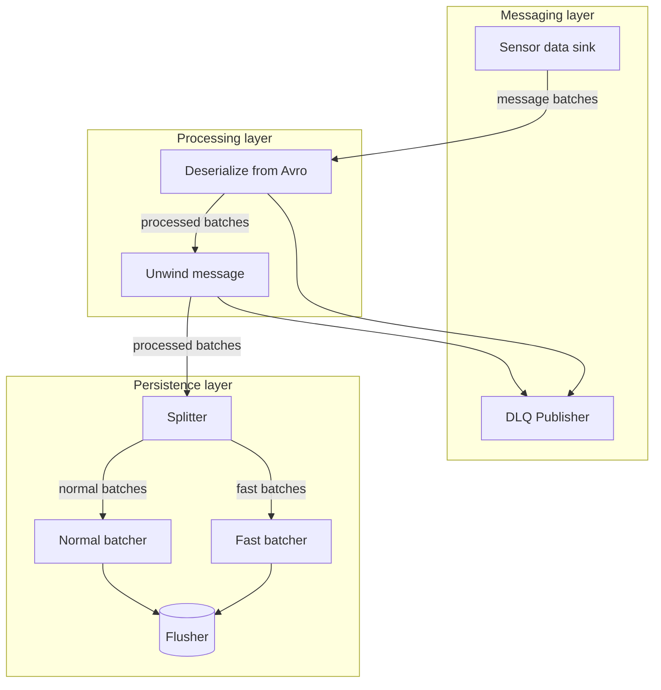
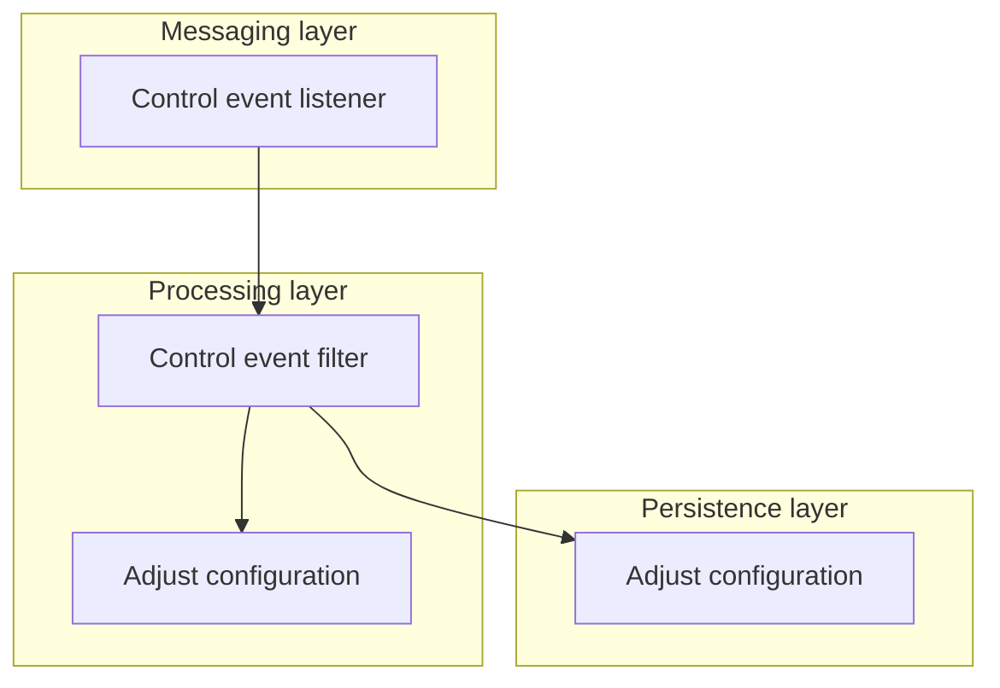
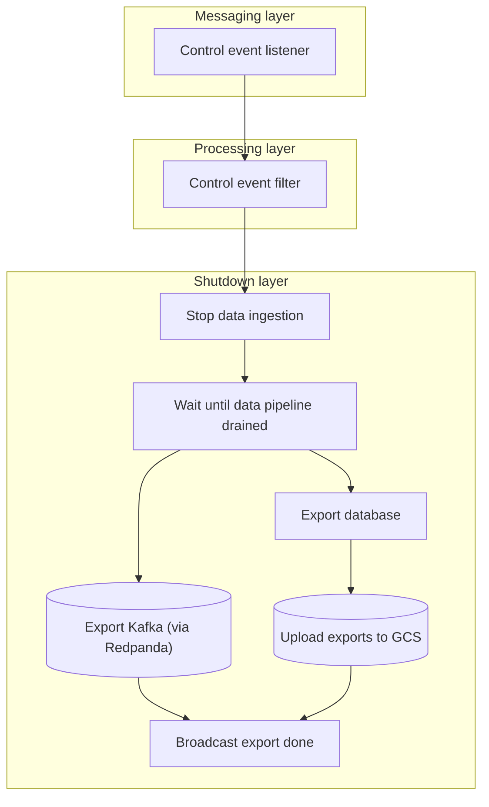

# Deep dive - Core

Code at: [Core root](../core)

Where: one paid VM. Core and InfluxDB 3 Core (self-managed, single node) share that VM.

Shared VM pain points: Core and database share similar load spikes which means that VM usage can spike greatly and when
it does, it's from both components at the same time. Telemetry streaming adds bounded serialization and network work;
it must never backpressure the ingest pipeline: [Telemetry stream](#telemetry-stream).

Lifecycle: race-scoped. Created at the start. After export succeeds, VM and disk are destroyed.

Access: private

Core responsibility:

- ingest data from Kafka
- process, validate data
- batch and write to the database
- serve as a buffer for the database
- expose accepted logical points on one private, best-effort telemetry WebSocket
- handle shutdown sequence export flow (for both database and Kafka)

## Data pipeline batch contract

The base contract is defined by [`core/default-config.yaml`](../core/default-config.yaml). Its `localhost:9092`
broker, placeholder race values, and disabled GCP block support local development. On a race VM,
[`render-config.sh`](../core/startup/render-config.sh) overlays the metadata-derived broker and race ID, the project
and race bucket, `export-done`, and `gcp.enabled: true`; the platform overlay wins over both defaults and operator YAML.

The sensor data message sink flushes on whichever comes first: a certain number of messages, time spent, or stream
shutdown. The collector processes batches concurrently (processing within each batch is serial).
Invalid messages remain individual DLQ records because their original partition, offset, and parse error are stored in
per-record headers.
The splitter partitions each processed batch into one fast-flush and one normal batch. The persistence
batcher consumes those grouped messages and forms its database point batches using the fast/normal path and
interval settings.

The control path is intentionally separate: a different message sink forwards each control record immediately on a
single-message channel and uses `fetch.min.bytes=1`/`fetch.wait.max.ms=0` Kafka settings. Control events are not subject
to the sensor-data batch size or timer because control events must be acted on as soon as they are available.

## Telemetry stream

Core owns the private stream contract consumed by [Telemetry](component-telemetry.md). It is not a general Core API.
The only serving surface is:

- private WebSocket upgrade: `GET /telemetry/v1`
- required WebSocket subprotocol: `chronoracer.telemetry.v1`
- binary frames: one versioned Protobuf `StreamEvent` per frame
- listener: Core private interface on the telemetry port from
  [`platform.json`](../infra/contract/platform.json)
- caller authorization: dedicated Telemetry subnet firewall; no application credential or TLS on this private hop

Core emits points after validation, deserialization, absolute-timestamp expansion, and driver assignment, but before
the Influx write. Each point has the same logical fields as the persisted Influx point:

| Field             | Protobuf type | Meaning                                                        |
|-------------------|---------------|----------------------------------------------------------------|
| `sensor_id`       | `string`      | Sensor identifier and Influx measurement name                  |
| `timestamp_nanos` | `uint64`      | Absolute Unix timestamp in nanoseconds                          |
| `value`           | `double`      | Accepted IEEE-754 sensor value                                 |
| `driver_id`       | `string`      | Driver assigned by Core using the same state as persistence     |

“Accepted” means Core produced a logical point. It does not promise the later database write succeeds. Kafka delivery
is at-least-once, processing batches run concurrently, and source timestamps are authoritative; Telemetry must accept
duplicate points and timestamps that are not in arrival order.

### Protobuf event contract

The schema has a top-level `StreamEvent` with a `oneof` payload:

- `hello`: `protocol_version`, `race_id`, `stream_id`, `next_sequence`
- `point_batch`: `first_sequence`, repeated `Point`
- `gap`: `first_sequence`, `dropped_point_count`

`protocol_version` is `1` and must agree with the WebSocket path and subprotocol. `stream_id` is new for each Core
process lifetime. A mismatch between `hello.race_id` and Telemetry's configured race is fatal to that connection.

Core assigns one monotonically increasing `uint64` sequence to every logical point before attempting delivery.
`point_batch.first_sequence` is the sequence of its first point; remaining points occupy consecutive values. A batch
must not be empty. `next_sequence` is the sequence Core will assign next, allowing a reconnect to detect points emitted
while disconnected. `gap.first_sequence` and `dropped_point_count` describe a consecutive range Core could not put on
the transport path.

WebSocket transport is reliable while connected, but the preview contract is best-effort:

- Core uses a bounded, non-blocking transport queue.
- Full queue drops preview points and advances sequence; it never waits in the ingest path.
- Core emits a `gap` for known queue loss as soon as the connection can accept it.
- Reconnect to the same `stream_id` compares sequence values and exposes disconnected loss.
- New `stream_id` means Core restarted; the amount lost across that boundary may be unknown.
- Core retains no point history and never replays.

Telemetry reconnects with capped backoff and handles WebSocket ping/pong. Core closes the stream during process
shutdown. No connection, slow consumer, serialization error, socket error, or gap-signalling error may fail or pause
the persistence pipeline. GCP load testing must prove this isolation before production use.

## Startup

Boot scripts: [Core startup](../core/startup/README.md). Influx on this VM: [InfluxDB](component-influxdb.md). Image and
payload: [Compute images](component-images.md).

## Layers

Core can be divided into 4 layers.

#### Layer 1 - messaging

Consume and publish Kafka messages.

- Consumer for sensor data
- Consumer for control events
- DLQ producer
- Heartbeat producer

#### Layer 2 - processing

Deserialize, transform, and decide how to act.

- receiving pipeline for incoming messages
- process the message, deserialize and transform if needed
- filter component for the control message that decides how to act on the message

#### Layer 3 - persistence

Connect to the database and flush.

- batcher collecting data into batches depending on time, batch size and sensor type
- flusher writing data into the database

#### Layer 4 - shutdown

Export path used during shutdown.

- Kafka exporter
- database exporter
- GCS writer
- Google Pub/Sub publisher

## Data ingestion flow

### Core heartbeat

Messaging layer publishes on the private heartbeat topic, key `CORE`. Topic and key: [Kafka](component-kafka.md).
Interval: `runtime.heartbeat_interval_s` in [`core/default-config.yaml`](../core/default-config.yaml). Ready/unhealthy
use of that beat: [Race provisioning](flow-race_provisioning.md).

### Control event handling

### Shutdown event handling

Successful shutdown sequence means sending the export-done event to Google Pub/Sub. Failure means not sending the event
and thus forcing either operator to invoke the force-destroy flow after optional manual intervention.

If a tracked data-pipeline task terminates while Core is running, without the shutdown cancellation having started, Core
logs the failure and exits with a failure status without starting the export flow. The service manager is responsible
for
restarting Core; no export-done event is sent for this failure path.

Race stop sequence around this: [Race destruction](flow-race_destruction.md). Export
prefix: [GCS](component-gcs_buckets.md).

#### Kafka export

Kafka data export and GCS upload are handled via Redpanda templates rendered during
runtime: [Redpanda templates](../core/redpanda/README.md). Topics to be exported are defined in the Core configuration.
Usually just DLQ, but any number of topics can be included. Behaviour when trying to export a non-existing topic is not
tested and thus undefined.

Whether Kafka export failure marks the shutdown sequence as failed is defined in the Core configuration.

#### InfluxDB export

InfluxDB export handled via InfluxDB plugin: [plugin directory](../core/influxdb-plugins/README.md). After exporting
files are uploaded to GCS.

Whether InfluxDB export failure marks the shutdown sequence as failed is defined in the Core configuration.
