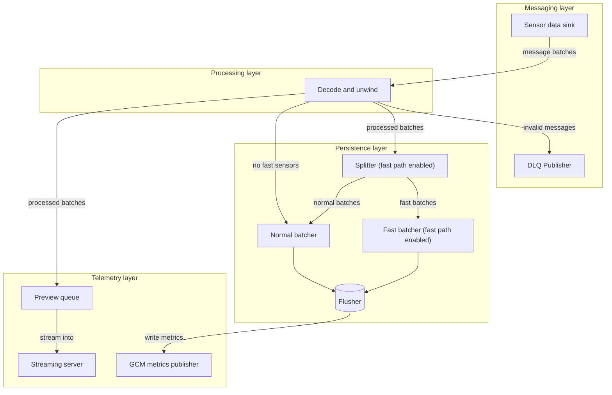
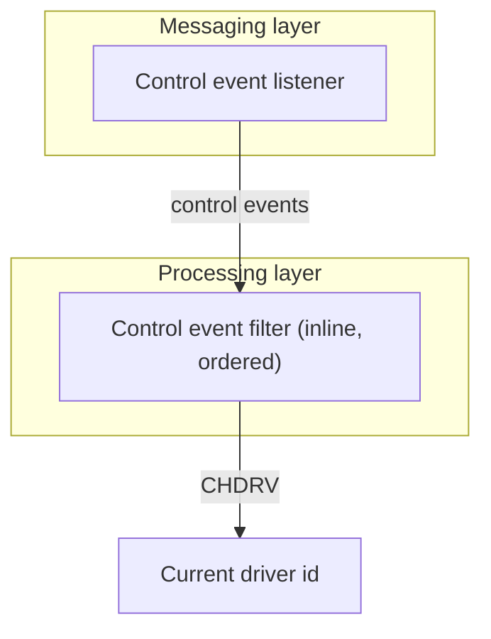
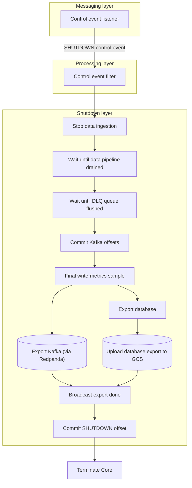

# Deep dive - Core

Code at: [Core root](../core)

Where: one paid VM. Core and InfluxDB 3 Core (self-managed, single node) share that VM.

Shared VM pain points: Core and database share similar load spikes which means that VM usage can spike greatly and when
it does, it's from both components at the same time. Telemetry streaming adds bounded serialization and network work;
it must never backpressure the ingest pipeline: [Telemetry stream](#telemetry-stream).

Lifecycle: race-scoped. Created at the start. The VM is destroyed after export-done: [Race destruction](flow-race_destruction.md).

Access: private

Core responsibility:

- ingest data from Kafka
- decode Avro and apply control events. What is checked: [data pipeline](#data-pipeline-batch-contract) and [control events](#control-event-handling)
- batch and write to the database, retrying transient failures so a slow database backpressures into Kafka
- expose accepted logical points on a private, best-effort telemetry gRPC stream to a few named clients
- publish cumulative Influx write counters to Cloud Monitoring
- handle shutdown sequence export flow (for both database and Kafka)

## Data pipeline batch contract

The base contract is defined by [`core/default-config.yaml`](../core/default-config.yaml). Its `localhost:9092`
broker, placeholder race values, and disabled GCP block support local development. On a race VM,
[`render-config.sh`](../core/startup/render-config.sh) overlays the metadata-derived broker and race ID, the project
and race bucket, `export-done`, and `gcp.enabled: true`; the platform overlay wins over both defaults and operator YAML.

The sensor data message sink flushes on whichever comes first: a certain number of messages, time spent, or stream
shutdown. The timer restarts after a size flush, and an empty buffer is never sent. The collector processes batches
concurrently (processing within each batch is serial), at most one batch per rayon thread at a time, so a slow consumer
backs up into the sink channel instead of memory.

The collector decodes the Avro payload with a hand-written decoder for exactly the schema in
[Kafka `data`](component-kafka.md#data), straight into absolute timestamps. Changing that schema means changing the
decoder; differential tests against `apache-avro` (a dev-dependency only) pin compatibility, and Core does not read
the schema file at runtime. Anything malformed is an invalid message: truncated input, varint overflow, bad lengths or
UTF-8, a negative timestamp or `delta`, or an array block whose byte size disagrees with its items. Bytes after the
datum are ignored. Sensor ids, the race id, and reading values are trusted, including NaN and infinities.
The schema's delta ≤ 2s rule is a producer constraint ([Kafka `data`](component-kafka.md#data)) and is not checked.
Sensor ids are shared per decoding thread (bounded table), so one `Arc<str>` serves all messages of
a sensor.

Invalid messages remain individual DLQ records because their original partition, offset, and parse error are stored in
per-record headers. The parse path never waits on the DLQ: a bad-schema deploy makes every message invalid, and a
blocked parse thread would stop the whole ingest. The record is offered to the DLQ channel
(`processing.dlq_channel_buffer_size`) without waiting. If the channel is full, the record is discarded, counted, and
reported as an error by the DLQ handler; Kafka still holds the original message on `data`. The DLQ handler keeps up to
`kafka.dlq_config.max_inflight_sends` deliveries outstanding, logs one aggregated line every 10 seconds (the first
failure of each window is logged at once), and on channel close finishes every outstanding delivery before it ends.
Control-path invalid messages are few and wait for room instead.
When `persistence.fast_flush_sensor_ids` is non-empty, the splitter partitions each processed batch into one
fast-flush and one normal batch. When the list is empty, processed batches go directly to the normal batcher;
the splitter, fast batcher, fast flusher loop, and their channels are not created or spawned. The persistence
batcher consumes those grouped messages and forms its database point batches using the fast/normal path and
interval settings. If either downstream channel closes, the splitter ends instead of dropping data, which is a
data-task exit under [the failure policy](#shutdown-signals-and-failure-policy).

The flusher sends each point batch as one line-protocol request. `persistence.max_inflight_db_writes` is the only limit
on concurrent writes: the InfluxDB client is configured not to split, limit, or retry on its own. A quarter of those
permits are reserved when the fast path is enabled and the rest are shared. With no fast sensors, all permits are
available to the normal path. With the fast path enabled, the reserved count is at least one whenever more than
one permit exists, and one permit always stays shared, so with two or more permits normal batches cannot take every
permit and starve fast flushes. A single permit is shared by both paths. A transient failure (connection error, timeout, 429, any 5xx, or 401, 403, or 404)
sends the same batch again after a backoff that starts at `persistence.write_retry_initial_backoff_ms`, doubles per
retry up to `persistence.write_retry_max_backoff_ms`, and is jittered. The batch keeps its permit throughout, so a
slow or restarting database slows the pipeline, the bounded channels fill, and the backpressure reaches the Kafka
consumer. Kafka is the spike buffer. Retries have no attempt limit. 401 and 403 (token revoked or rotated) and 404
(database missing) are infrastructure faults: the batch is held, and the write-failure streak withholds the heartbeat
([Core heartbeat](#core-heartbeat)). A payload failure (400, 413, 422, and any other 4xx) drops the batch, and a
partial write drops only the rejected lines; both are counted and logged. Re-sending is safe because line-protocol
writes are idempotent per series and timestamp. Retries are logged on the first failure and then every tenth, and
an auth or config rejection is logged as an auth/config problem.

The control path is intentionally separate: a different message sink forwards each control record immediately on a
single-message channel and uses `fetch.min.bytes=1`/`fetch.wait.max.ms=0` Kafka settings. Control events are not subject
to the sensor-data batch size or timer because control events must be acted on as soon as they are available. The control
filter parses and applies each event inline on the async task, in Kafka arrival order — not on the sensor-data rayon
pool — so SHUTDOWN and CHDRV are never stalled behind data backpressure or reordered by parallel workers.

## Kafka delivery

Delivery is at-least-once: a crash or restart can deliver a message again, never skip one. Core stores an offset for
commit only after its message is **settled**:

- data: the message's points were written to InfluxDB, or the flusher finally dropped them (non-retryable failure,
  rejected lines; see above), or the message went to the DLQ or was discarded on the invalid path;
- control: the event was applied, or sent to the DLQ or discarded on the invalid path. `SHUTDOWN` settles last, see
  [below](#control-consumer-and-shutdown-replay).

Messages settle out of order (concurrent batches, fast and normal paths), so each consumer keeps a per-partition
tracker of pending offset ranges and stores only the **contiguous settled prefix**: the offset below the lowest
unsettled message. Gaps in topic offsets do not stall it. Every batch carries the source offsets of its messages as a
compact range list, and settles once per batch, so a parse or flush thread takes one short lock per batch. librdkafka
commits stored offsets every `kafka.sensor_data_consumer.auto_commit_interval_ms`, for both consumers. After a crash
Core replays at most the unsettled tail plus up to one commit interval of already-settled messages. Replayed points are
harmless for the database (same series and timestamp, see above). A replayed DLQ record is a duplicate.

Data and control use separate groups derived from `kafka.group_id`
([Kafka groups](component-kafka.md#consumer-groups)). Losing one consumer's position never moves the other.

**Rebalance.** On revoke Core drops the partition's tracker state, and librdkafka commits what was already stored when
it unassigns the partition. Nothing is
stored for a revoked partition afterwards, so a message still in flight there is still written to the database and its
late settlement is ignored. On assign the partition starts with a fresh tracker at the group's committed position. Core
is normally the only member of its groups, so this only matters on a restart or a session timeout.

**Long backpressure.** Consumers use `max.poll.interval.ms` = 300 s, `session.timeout.ms` = 45 s, and
`heartbeat.interval.ms` = 15 s. A full pipeline is first simply waited on. Once a batch has waited 30 s the data sink
pauses its partitions and keeps polling without fetching, so a slow or down database does not get Core evicted from the
group, and resumes when there is room. Pausing discards librdkafka's prefetched messages (they are fetched again), which
is why ordinary backpressure does not pause. Settled offsets are still committed in that state.

**Final commit.** On race-end and on signal shutdown, after the data pipeline and the DLQ have drained, Core
synchronously commits both consumers (bounded by `runtime.offset_final_commit_timeout_s`; failure is logged and means
only a replay). The data consumer is not polled after the sink stops. If the drain budget was exhausted twice over
(pipeline and DLQ each time out), the group may already have dropped the member and this commit fails; the same replay
rule applies. Unexpected failure exits without a final commit, which is the same as a crash. Periodic lag is logged
every `kafka.sensor_data_consumer.offset_lag_log_interval_s` as pending offsets per partition, with a warning for a
partition whose position has not moved since the previous report while messages are pending (a stuck database, or a
message that never settles and would hold the commit back forever).

### Control consumer and SHUTDOWN replay

The control consumer's offset is stored once the event is handled, so a restart does not replay already applied
`CHDRV` events. `SHUTDOWN` is the exception: it stays unsettled through the whole export sequence, so a crash or
restart mid-export reads it again and runs the export again. It is settled and committed after the exports have
finished, whether or not they succeeded, immediately before Core exits. After the filter stops, the control sink
keeps polling. The next record that cannot be forwarded, because the filter is gone, pauses its partitions; the sink
then idle-polls so the member stays in the group through the export, which can exceed `max.poll.interval.ms`, and the
`SHUTDOWN` offset can still be committed.

A signal before `SHUTDOWN` commits the events handled so far. A crash or kill after `SHUTDOWN` arrived and before its
commit replays it, which is the intended retry. A group with no committed offset starts at the beginning of `control`
(`auto.offset.reset=earliest`, [Kafka groups](component-kafka.md#consumer-groups)): earlier `CHDRV` events replay in
order and end at the latest driver id.

## Telemetry stream

Core owns what the private preview stream carries. The callers are a few named internal services:
[Telemetry](component-telemetry.md) and the analysis module. This is not a general Core API. The RPC, windows, batch
cap, compression, and rejected transports are owned by
[ADR - Core telemetry stream protocol](adr-telemetry-stream.md). Wire fields are in
[`telemetry_v1.proto`](../core/proto/telemetry_v1.proto).

The listener binds `0.0.0.0` on `core_telemetry_port` from
[`platform.json`](../infra/contract/platform.json). No TLS and no application credential. The dedicated Telemetry
subnet firewall is the authorization boundary. Until that firewall exists, VPC clients cannot connect. The Core VM has
no public address.

The copy happens after Avro unwind (validation and absolute timestamps) and before the batch is sent into persistence.
It does not happen in the batcher or the flusher. The flush intervals delay only the Influx write.

The driver on a preview point is the driver at that copy. Persistence stamps the driver later, when the batcher builds
the database point. A driver change while the message waits behind a slow flush can make those two drivers differ. The
preview keeps the earlier one.

With no `Watch` call, the parse path reads the subscriber interest and returns. It does not copy, assign a sequence, or
count drops. Disconnect discards the call's unsent queue. A new `Watch` does not report how many points were missed
before it joined or while no one was watching.

Each active call has its own FIFO. It drops the oldest unsent points once they are older than
`telemetry.max_queue_age_ms` or the queue holds more than `telemetry.max_queue_points`. A client that
keeps up receives every point it selected, in queue order. `stream_id` stays constant for the Core process, so a restart
is a new id.

Each point has the same logical fields as the persisted Influx point:

| Field             | Protobuf type | Meaning                                                                 |
|-------------------|---------------|-------------------------------------------------------------------------|
| `sensor_id`       | `string`      | Sensor identifier and Influx measurement name                           |
| `timestamp_nanos` | `uint64`      | Absolute Unix timestamp in nanoseconds                                  |
| `value`           | `double`      | Accepted IEEE-754 sensor value                                          |
| `driver_id`       | `string`      | Driver read at the unwind copy, not the later persistence stamp         |

“Accepted” means Core produced a logical point. It does not promise the later database write succeeds. Kafka delivery
is at-least-once ([Kafka delivery](#kafka-delivery)), processing batches run concurrently, and source timestamps are authoritative.

### Clients and sensor selection

Several `Watch` calls can be active at once. `WatchRequest` names the caller and what it wants:

- `client_id`: 1 to 64 bytes, for example `telemetry` or `analysis`. A call whose `client_id` is already active
  replaces it: the old call ends with `ABORTED`. This makes a reconnect immediate even while Core has not yet noticed
  the dead connection. Different ids coexist.
- `selection`: required. Either all sensors, or a list of 1 to 100 distinct `sensor_id`s. Each id is
  1 to 24 UTF-8 bytes. Duplicates collapse. An empty list is an error rather than "all", so a client
  bug cannot turn into a full stream.

An invalid request fails with `INVALID_ARGUMENT` and changes nothing. A new `client_id` while
`telemetry.max_subscribers` calls are active (default 4, startup accepts 1 to 16) fails with `RESOURCE_EXHAUSTED`. No
active client is evicted to make room.

Core does not check that a listed sensor exists. The full sensor set is unknown at startup (only the fast database path
subset is configured), and a client may connect before the first point from its sensor arrives. Whatever the client
lists is accepted.

Core sends each call only its selected sensors, and does the filtering before any per-call work. Each call has its own
sequence space that starts at 1 and numbers only its own points, so a `gap` counts that client's lost points and nothing
else. A slow client gaps alone. Calls share the message data in memory: a call's queue holds references to the same
unwound messages the other calls and persistence hold, not copies of the points. Memory per call is bounded by
`telemetry.max_queue_points`.

A call sees only what was offered after it joined.

Client must accept duplicate points and timestamps that are not in arrival order (should happen rarely if ever).

### Events

`WatchResponse` is one gRPC message:

- `hello`: `protocol_version` is `1`, plus `race_id`, `stream_id`, `next_sequence`, and `selected_sensor_count`.
  `next_sequence` is the first sequence this call will assign (always 1). It is not a count of points emitted while
  disconnected. `selected_sensor_count` is the number of distinct sensors accepted, 0 for all sensors. A `race_id`
  mismatch is fatal for that client's connection.
- `point_batch`: `first_sequence` and one or more `Point` values. The following points use the next sequences. A batch
  is not empty.
- `gap`: `first_sequence` and `dropped_point_count` for a consecutive range dropped while this call was up (age, the
  point cap, or a full handoff).

Sequence numbers are assigned on the telemetry task for this call. Points that never fit on the handoff still consume a
sequence range so that loss is a `gap`. Core keeps no history and does not replay.

The parse thread does not lock a preview queue and does not wait on gRPC or TCP. It skips messages that no active call
selected (the union of all selections), `try_send`s the rest onto one bounded handoff shared by all calls, and returns.
The telemetry task distributes each batch to every call that selected it, assigns that call's sequences, and drops its
oldest unsent points for age or the point cap. If the handoff is already over budget, the parse thread records the
refused points per sensor, so each call's `gap` counts only the sensors it selected, and still returns. Serialization,
HTTP/2 flow control, and send errors stay on the serving task. That task is not part of the data-pipeline or
control-task supervisors: its death does not exit Core and does not start export. Shutdown cancels the listener and
does not wait for it before export.

No connection, slow consumer, or gap may fail or pause the persistence pipeline. GCP load testing must prove this
isolation before production use.

## Cloud Monitoring write counters

Core publishes three cumulative custom metrics for [Dashboard](component-dashboard.md) ingest panels. Names:

| Metric                                                    | Meaning                                                    |
|-----------------------------------------------------------|------------------------------------------------------------|
| `custom.googleapis.com/chronoracer/influx_write_lines`    | Lines Influx accepted                                      |
| `custom.googleapis.com/chronoracer/influx_write_bytes`    | Bytes in fully successful writes                           |
| `custom.googleapis.com/chronoracer/influx_write_requests` | Write attempts, label `outcome` = `ok`, `partial`, `error`, or `retry` |

Counters increment once per write attempt, off the per-point path. Each attempt is counted under one outcome: `ok`
(accepted, including after retries), `partial`, `error` (non-retryable, batch dropped), or `retry` (transient failure,
the batch is sent again). `ok`, `partial`, and `error` therefore still count once per batch, and lines and bytes are added
once when the batch ends. A growing `retry` with a flat `ok` is an outage being absorbed, not data loss. A background task sends one `CreateTimeSeries` every 60 seconds while `gcp.enabled` is true. After the data pipeline drains on race-end or signal shutdown, the publisher sends one final sample (bounded by `runtime.write_metrics_final_timeout_s`) before export or exit. Partial writes count accepted lines and the `partial` outcome, and do not add bytes. Publish failure is logged and does not stop ingest.
Missing GCE metadata can either disable metric sending or fallback to sending sentinel labels for time series, decided by configuration property `gcp.allow_unknown_gce_metrics`. 

## Startup

Boot scripts: [Core startup](../core/startup/README.md). Influx on this VM: [InfluxDB](component-influxdb.md). Image and
payload: [Compute images](component-images.md).

## Layers

Core can be divided into 5 layers.

#### Layer 1 - messaging

Consume and publish Kafka messages.

- Consumer for sensor data
- Consumer for control events
- DLQ producer
- Heartbeat producer

#### Layer 2 - processing

Deserialize, transform, and decide how to act.

- receiving pipeline for incoming messages
- process the message, deserialize and transform if needed
- filter component for the control message that decides how to act on the message

#### Layer 3 - persistence

Connect to the database and flush.

- batcher collecting data into batches depending on time, batch size and sensor type
- flusher writing data into the database

#### Layer 4 - shutdown

Export path used during shutdown.

- Kafka exporter
- database exporter
- GCS writer
- Google Pub/Sub publisher

#### Layer 5 - telemetry serving

Live telemetry stream of clean data, GCM metric push of database write rates.

- gRPC streaming server
- Preview queue
- metrics publisher

## Data ingestion and serving flow

### Core heartbeat

Messaging layer publishes on the private heartbeat topic, key `CORE`. Topic and key: [Kafka](component-kafka.md).
Interval: `runtime.heartbeat_interval_s` in [`core/default-config.yaml`](../core/default-config.yaml). Ready/unhealthy
use of that beat: [Race provisioning](flow-race_provisioning.md).

Core withholds the beat while database writes have failed continuously (no `ok` or `partial` write since the first
failing attempt, retries included) for longer than `runtime.heartbeat_write_failure_threshold_s`. This is what makes
"Influx is reachable" true. A pipeline with no data never fails a write, so it keeps beating. The consequence is the
stale-beat rule in Race provisioning: unhealthy, no auto-destroy, and no connection details until writes succeed and
the beat resumes. The beat body is the race id and is informational.

### Control event handling

Control keys:

- `CHDRV`: payload is the new driver id. Validated at parse time (non-empty, ≤ 24 bytes, no ASCII control
  characters, no Influx line-protocol tag specials `,` `=` space `\` `"`). Invalid payloads go to the DLQ and leave
  the current driver unchanged. The same rules apply to `race.initial_driver_id` at config load.
- `SHUTDOWN`: relays race-end to the supervisor, then the filter stops consuming so its DLQ sender is dropped. Its offset is committed only after the exports ([Kafka delivery](#control-consumer-and-shutdown-replay)).
- Other keys: logged as unknown; ignored.

### Shutdown, signals, and failure policy

Race-end (`SHUTDOWN`) only. A signal stops after the final metrics sample and does not export.

Successful race-end shutdown means sending the export-done event to Google Pub/Sub. It is sent only when both exports
allow it: a failed Kafka export still allows it when `runtime.notify_shutdown_on_failed_kafka_export` is true, and a
failed database export (plugin `failures`, `tables_exported < tables_found`, or a GCS upload error) still allows it
when `runtime.notify_shutdown_on_failed_db_export` is true. Both keys live in
[`core/default-config.yaml`](../core/default-config.yaml). Not sending the event forces the operator to invoke the
force-destroy flow after optional manual intervention.

**Race-end order (SHUTDOWN control event):** stop the data sink → drain tracked data-pipeline tasks (bounded by
`runtime.data_pipeline_drain_timeout_s`) → ensure the control filter has stopped and all DLQ senders are dropped →
await the DLQ handler finishing its queue and in-flight deliveries (same timeout budget; log and continue on timeout) → final synchronous offset commit of both consumers (bounded by `runtime.offset_final_commit_timeout_s`) → publish a final
Cloud Monitoring write-metrics sample (bounded by `runtime.write_metrics_final_timeout_s`; failure is non-fatal) →
export Kafka and InfluxDB (heartbeat keeps running through export; each export/upload/publish step has a per-attempt
timeout — see export subsections) → GCS upload → export-done → commit the `SHUTDOWN` offset → abort remaining control tasks.

**OS signal (SIGTERM / SIGINT, or Ctrl-C on Windows):** same data and DLQ drain and final offset commit, then the final write-metrics sample,
then exit successfully **without** export and **without** export-done. A signal is not a race end. A signal received
after SHUTDOWN has already started export is logged and ignored so the export sequence is not aborted.

**Unexpected failure (no export, no export-done, process exits with failure):** before SHUTDOWN has been received, the
unexpected end (Ok or error) of any essential control task — `control_sink`, `control_filter`, `dlq_handler`,
`heartbeat` — or a dropped shutdown oneshot sender, or any tracked data-pipeline task ending without shutdown having
started, stops the data pipeline and exits. The write-metrics publisher is non-essential: its end is logged and
ignored. The DLQ handler finishing as part of the race-end or signal drain does not trip this policy.

Release builds use `panic = "abort"`: a panic aborts the process immediately without export or export-done; systemd is
expected to restart Core. The supervisor does not treat panics as a distinct recoverable path.

**Startup:** Core logs its release first (`core/version.txt`, baked in at build time). Core creates its topics, then waits
until each is visible in broker metadata (up to 60 seconds) before any consumer subscribes. If a topic never becomes
visible, Core exits with failure and the supervisor restarts it.

**Logs:** plain text by default. Set `CORE_LOG_COLOR=1` (or `true`) in the environment to enable ANSI colour, for local runs.

Race stop sequence around this: [Race destruction](flow-race_destruction.md).

#### Kafka export

Kafka data export and GCS upload are handled via Redpanda templates rendered during
runtime: [Redpanda templates](../core/redpanda/README.md). Topics to be exported are defined in the Core configuration.
Usually just DLQ, but any number of topics can be included. Behaviour when trying to export a non-existing topic is not
tested and thus undefined. Each `rpk connect run` attempt is bounded by `kafka.export.attempt_timeout_s` (child killed
on expiry) and retried up to `kafka.export.max_retries`. Bucket directory is `{raceId}/` plus
`kafka.export.nested_path_in_bucket`. Object layout: [GCS](component-gcs_buckets.md). Effect on export-done:
[failure policy](#shutdown-signals-and-failure-policy).

#### InfluxDB export

InfluxDB export handled via InfluxDB plugin: [plugin directory](../core/influxdb-plugins/README.md). The HTTP trigger
uses `persistence.export.attempt_timeout_s` per attempt and does not retry 4xx responses. A plugin response with any
table `failures`, or with `tables_exported < tables_found`, is an export failure. After exporting, each file is uploaded
as `{raceId}/{persistence.export.nested_path_in_bucket}/{file name}` (layout: [GCS](component-gcs_buckets.md)). Each
upload is bounded by `gcp.upload_timeout_s`; export-done Pub/Sub by `gcp.pubsub_publish_timeout_s`. Effect on
export-done: [failure policy](#shutdown-signals-and-failure-policy).
