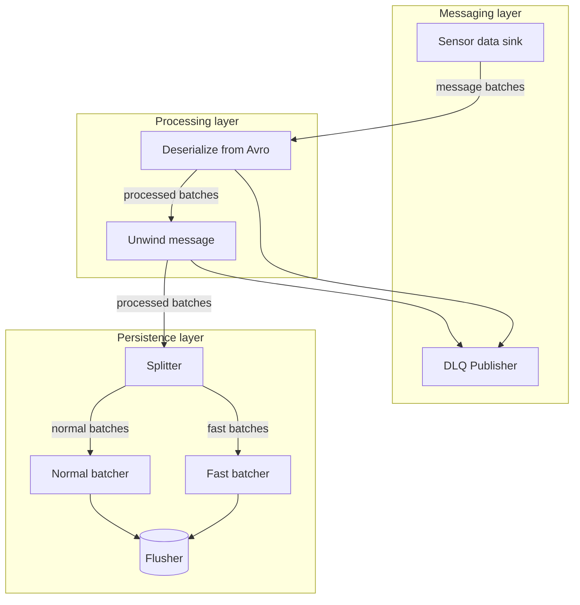
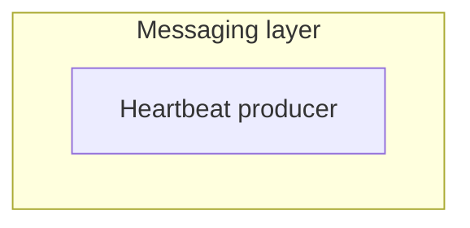
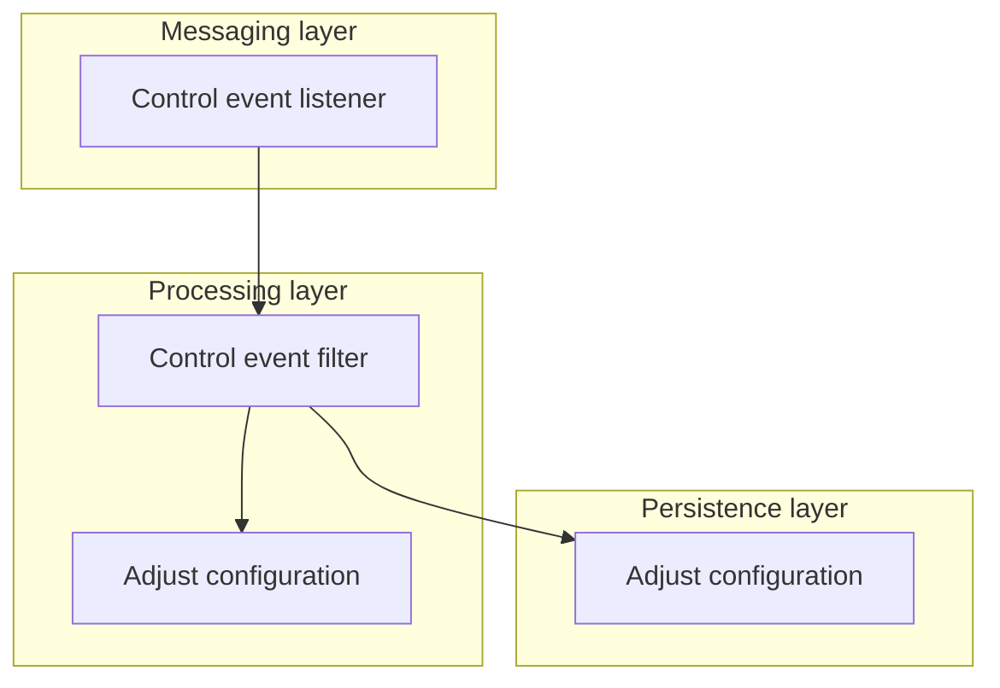
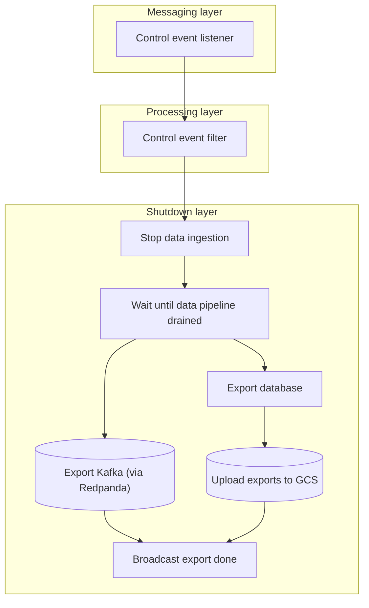

# Deep dive - Core

Code at: [Core root](../core)

Where: one paid VM. Core and InfluxDB 3 Core (self-managed, single node) share that VM.

Shared VM pain points: Core and database share similar load spikes which means that VM usage can spike greatly.

Lifecycle: race-scoped. Created at the start. After export succeeds, VM and disk are destroyed.

Access: private

Core responsibility:

- ingest data from Kafka
- process, validate data
- batch and write to the database
- serve as a buffer for the database
- handle shutdown sequence export flow (for both database and Kafka)

## Data pipeline batch contract

The default contract is defined by [`core/default-config.yaml`](../core/default-config.yaml):

- `processing.message_batch_size`: 1,000 Kafka messages per batch.
- `processing.message_batch_flush_interval_ms`: 15 ms maximum in-memory wait before a partial batch is sent.
- `processing.message_channel_buffer_size`: 64 buffered items. The sensor sink queues up to 64 batches; the control sink
  queues up to 64 individual records. Increasing it increases memory pressure.

The sink flushes on whichever comes first: 1,000 messages, 15 ms, cancellation, or stream shutdown. The collector
processes batches concurrently on the Rayon pool, with at most one in-flight batch per Rayon worker; processing within
each batch is serial. This bounded design applies backpressure before work can accumulate in the Rayon queue and emits
one batch of successfully processed sensor messages, preserving the input order within that batch. Invalid messages
remain individual DLQ records because their original partition, offset, and parse error are stored in per-record
headers. The splitter partitions each processed batch into at most one fast-flush and one normal batch. The persistence
batcher consumes those grouped messages and forms its database point batches using the fast/normal path and
interval settings.

The control path is intentionally separate: `InstantMessageSink` forwards each control record immediately on a
single-message channel and uses `fetch.min.bytes=1`/`fetch.wait.max.ms=0`. Control events are not subject to the
sensor-data batch size or timer because control events must be acted on as soon as they are available.

## Startup

Boot scripts: [Core startup](../core/startup/README.md). Influx on this VM: [InfluxDB](component-influxdb.md). Image and
payload: [Compute images](component-images.md).

## Layers

Core can be divided into 3 main layers.

#### Layer 1 - messaging layer

Name: Messaging layer Purpose: consume and publish messages from Kafka Main components:

- Consumer for sensor data
- Consumer for control events
- DLQ producer
- Heartbeat producer

#### Layer 2 - processing layer

Name: Processing layer Purpose: Process the data from messages Main components:

- receiving pipeline for incoming messages
- process the message, deserialize and transform if needed
- filter component for the control message that decides how to act on the message

#### Layer 3 - persistence layer

Name: Persistence layer Purpose: handle connection with the database, flush data Main components:

- batcher collecting data into batches depending on time, batch size and sensor type
- flusher writing data into the database

#### Layer 4 - Shutdown layer

Name: Shutdown layer Purpose: Special layer used during shutdown sequence. Includes exporting data Main components:

- Kafka exporter
- database exporter
- GCS writer
- Google Pub/Sub publisher

## Data ingestion flow

### Core heartbeat

### Control event handling

### Shutdown event handling

Successful shutdown sequence means sending the export-done event to Google Pub/Sub. Failure means not sending the event
and thus forcing either operator to invoke the force-destroy flow after optional manual intervention.

If a tracked data-pipeline task terminates while Core is running, without the shutdown cancellation having started, Core
logs the failure and exits with a failure status without starting the export flow. The service manager is responsible for
restarting Core; no export-done event is sent for this failure path.

Race stop sequence around this: [Race destruction](flow-race_destruction.md). Export
prefix: [GCS](component-gcs_buckets.md).

#### Kafka export

Kafka data export and GCS upload are handled via Redpanda templates rendered during
runtime: [Redpanda templates](../core/redpanda/README.md). Topics to be exported are defined in the Core configuration.
Usually just DLQ, but any number of topics can be included. Behaviour when trying to export a non-existing topic is not
tested and thus undefined.

Whether Kafka export failure marks the shutdown sequence as failed is defined in the Core configuration.

#### InfluxDB export

InfluxDB export handled via InfluxDB plugin: [plugin directory](../core/influxdb-plugins/README.md). After exporting
files are uploaded to GCS.

Whether InfluxDB export failure marks the shutdown sequence as failed is defined in the Core configuration.
