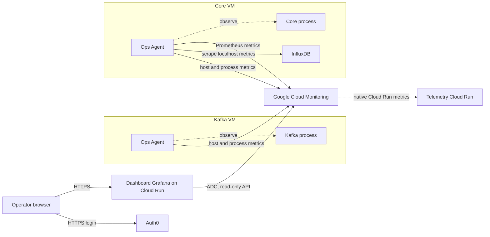

# Deep dive - Dashboard

Read-only operations view of current race-fleet health.

Implementation: Grafana OSS container. Why Grafana and why race telemetry is separate:
[ADR - Dashboard and live telemetry](adr-dashboard.md).

Where: always-on Cloud Run, public HTTPS on `dashboard.{dns zone}` (today
`https://dashboard.chronoracer.live`). Mapping: [Terraform](component-terraform.md). Image from Artifact Registry.
Publish: [Control-plane images](operator-control-plane-images.md).

Lifecycle: always deployed, like Relay. Survives races. Scale-to-zero when idle, `max_instance_count = 1`.

Access: public URL, Auth0 login required. Browser OAuth is shared with
[Telemetry](component-telemetry.md): [Browser OAuth runbook](operator-browser-oauth.md).

## Responsibility

- show whether the current race VMs and their required processes are active
- show CPU, memory, disk, and network pressure on Kafka and Core VMs
- show Kafka, Core, and InfluxDB process health
- show InfluxDB ingest throughput and errors from server metrics
- show Telemetry Cloud Run instance, request, latency, and error health

Not its responsibility:

- sensor values or race progress; those belong to [Telemetry](component-telemetry.md)
- race lifecycle actions; those stay on [Relay](component-relay.md)
- alerting
- finished-race analysis
- readiness signalling; ready/unhealthy remains heartbeat-based
  ([Race provisioning](flow-race_provisioning.md))

Dashboard failure never affects ingest. An unhealthy panel reports fleet state; it does not become a second health
authority and does not change Relay status.

## Statelessness

Grafana's internal database (users, sessions, preferences, annotations, UI-authored dashboards) is ephemeral container
storage and is lost on every cold start. Accepted. Consequences:

- dashboards and datasource are provisioned from files baked into the image
- operators re-login after a cold start
- `max_instance_count = 1` because sessions are instance-local

## Auth

Auth0 authorization-code login uses the existing `chronoracer-relay` application and operator users from an Auth0
database connection. Grants, callback URL, users, and role mapping: [Okta](component-okta.md). Setup and shared client
secret upload: [Browser OAuth runbook](operator-browser-oauth.md).

Grafana's built-in login form is disabled. Every authenticated user is a Viewer; nobody can edit panels or run ad-hoc
queries from the UI.

## Data path

Dashboard has one datasource: Google Cloud Monitoring.

Ops Agent runs on both race VMs. Its host and process receivers publish VM and required-process metrics. On the Core VM,
its Prometheus receiver also scrapes InfluxDB 3 Core's `localhost` `/metrics` endpoint. The endpoint and metric meaning
are owned by [InfluxDB](component-influxdb.md).

Dashboard does not use Direct VPC Egress, connect to a race VM, or hold an Influx token.

## Google authentication gate

Dashboard's attached service account has only the read permissions needed for Cloud Monitoring. No service-account JSON
key is created or mounted.

Grafana calls its attached-identity datasource mode `GCE Default Service Account`. The implementation uses Google
Application Default Credentials, and Cloud Run exposes its attached service identity through the metadata server. The
official Grafana support text names GCE rather than Cloud Run, so this configuration has a mandatory deployment proof
before implementation acceptance:

1. cold-start Dashboard on Cloud Run with no credential file
2. pass datasource health check
3. query one native Compute metric
4. query one Ops-Agent Prometheus metric with PromQL

Failure stops the Dashboard migration. Do not fall back to a long-lived JSON key; revisit the Dashboard runtime or
authentication design in the ADR.

## Dashboards

Provisioned as code. The current-race fleet dashboard answers “is the race infrastructure alive and keeping up?”

| Area       | Required signals                                                                 |
|------------|----------------------------------------------------------------------------------|
| Kafka VM   | instance up, CPU, memory, disk, network, Kafka process                           |
| Core VM    | instance up, CPU, memory, disk, network, Core and InfluxDB processes             |
| InfluxDB   | accepted lines/bytes rate, write request outcomes, available server error metrics |
| Telemetry  | active instance, request count, request latency, server errors                   |

Exact Influx metric names and labels must be verified against the pinned InfluxDB 3 Core version during the deployment
proof. Panels use instance identity and current time range so reused VM names do not merge old and current race
instances.

Between races the race-fleet panels show no active resources. Historical Cloud Monitoring retention is operational
evidence, not finished-race sensor data.

## Accepted risks

- Cloud Monitoring and Ops Agent introduce sampling and ingestion delay. Dashboard is fleet health, not near-real-time
  sensor preview.
- Required Influx metric names can change across InfluxDB versions; the image pin and dashboard queries must move
  together.
- Session loss on cold start remains accepted.
- Grafana's Cloud Run ADC path remains gated by the deployment proof above.

## Container contract

The image contains only Grafana configuration, provisioned datasource, and dashboards.

| Variable                              | Source                        | Use                   |
|---------------------------------------|-------------------------------|-----------------------|
| `GCP_PROJECT_ID`                      | Terraform                     | Monitoring project    |
| `GF_SERVER_HTTP_PORT`                 | [`platform.json`](../infra/contract/platform.json) | Port Grafana binds |
| `GF_SERVER_ROOT_URL`                  | Mapped Dashboard hostname     | OAuth redirect base   |
| `GF_AUTH_GENERIC_OAUTH_CLIENT_ID`     | [`platform.json`](../infra/contract/platform.json) | Auth0 application |
| `GF_AUTH_GENERIC_OAUTH_CLIENT_SECRET` | Secret Manager                | Auth0 application     |
| `GF_AUTH_GENERIC_OAUTH_AUTH_URL`      | Derived from Auth0 issuer     | Login redirect        |
| `GF_AUTH_GENERIC_OAUTH_TOKEN_URL`     | Derived from Auth0 issuer     | Token exchange        |
| `GF_AUTH_GENERIC_OAUTH_API_URL`       | Derived from Auth0 issuer     | Userinfo              |

`GF_SERVER_ROOT_URL` is `https://dashboard.{dns zone}`, not the generated `run.app` URL. A Terraform check asserts the
domain mapping hostname. Auth0 callback registration: [Browser OAuth runbook](operator-browser-oauth.md).
