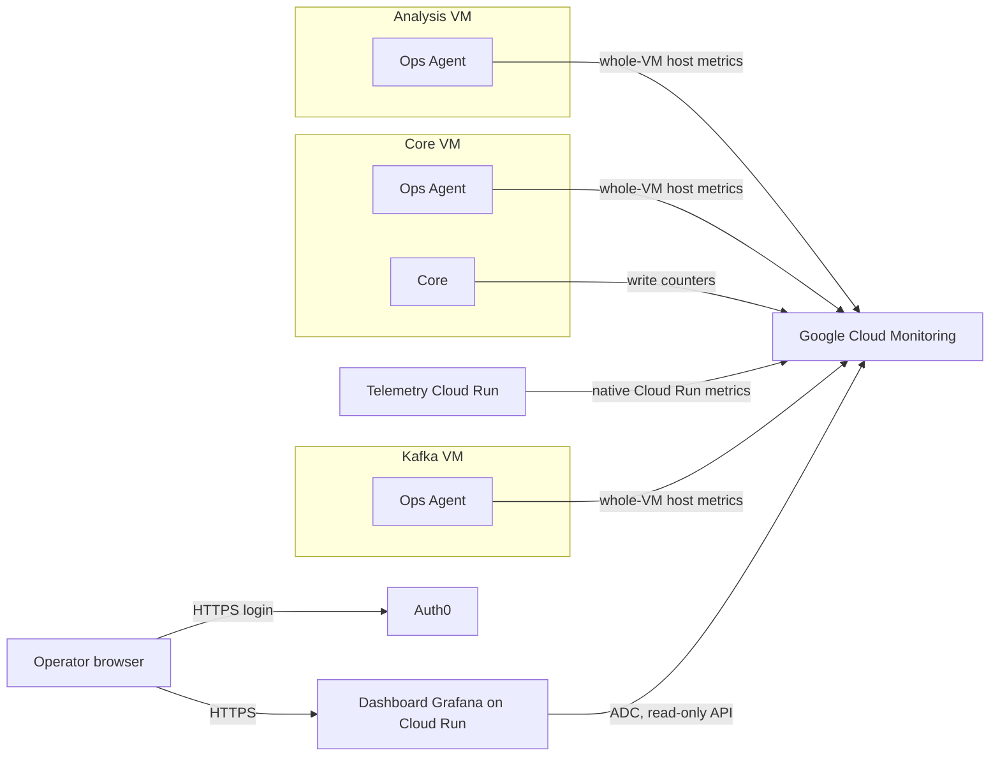

# Deep dive - Dashboard

Read-only operations view of current race-fleet health.

Implementation: Grafana OSS container. Why Grafana and why race telemetry is separate:
[ADR - Dashboard and live telemetry](adr-dashboard.md).

Where: always-on Cloud Run, public HTTPS on `dashboard.{dns zone}` (today
`https://dashboard.chronoracer.live`). Mapping: [Terraform](component-terraform.md). Image from Artifact Registry.
Publish: [Control-plane images](operator-control-plane-images.md).

Lifecycle: always deployed, like Relay. Survives races. Scale-to-zero when idle, `max_instance_count = 1`.

Access: public URL, Auth0 login required. Browser OAuth is shared with
[Telemetry](component-telemetry.md): [Browser OAuth runbook](operator-browser-oauth.md).

## Responsibility

- show whether each race VM is up
- show uptime and whole-VM CPU, memory, disk, and network for Core, Kafka, and Analysis
- show Influx write and pipeline health metrics from [Core](component-core.md#cloud-monitoring-write-counters)
- show Telemetry Cloud Run instance, request, latency, and error health

Not its responsibility:

- sensor values or race progress; those belong to [Telemetry](component-telemetry.md)
- race lifecycle actions; those stay on [Relay](component-relay.md)
- alerting
- finished-race analysis
- readiness signalling; ready/unhealthy remains heartbeat-based
  ([Race provisioning](flow-race_provisioning.md))

Dashboard failure never affects ingest. An unhealthy panel reports fleet state; it does not become a second health
authority and does not change Relay status.

## Statelessness

Grafana's internal database (users, sessions, preferences, annotations, UI-authored dashboards) is ephemeral container
storage and is lost on every cold start. Accepted. Consequences:

- dashboards and datasource are provisioned from files baked into the image
- operators re-login after a cold start
- `max_instance_count = 1` because sessions are instance-local

## Auth

Auth0 authorization-code login uses the existing `chronoracer-relay` application and operator users from an Auth0
database connection. Grants, callback URL, users, and role mapping: [Okta](component-okta.md). Setup and shared client
secret upload: [Browser OAuth runbook](operator-browser-oauth.md).

Grafana's built-in login form is disabled. Every authenticated user is a Viewer; nobody can edit panels or run ad-hoc
queries from the UI.

## Dashboards

Dashboards are provisioned as V2 JSON files ([dashboard files](../dashboard/dashboard_files/v2)). The format is defined by
[Grafana's dashboard kinds](https://github.com/grafana/grafana/tree/v13.0.2/apps/dashboard/kinds).

The entrypoint imports V2 dashboards through Grafana's API.

### Dashboard set

All dashboards use the Google Cloud Monitoring datasource. The home dashboard opens by default and links to each focused
view.

| Dashboard                                                         | Signals                                                                                                                                              |
|-------------------------------------------------------------------|------------------------------------------------------------------------------------------------------------------------------------------------------|
| [Race Home](../dashboard/dashboard_files/v2/race-fleet.json)      | Core, Kafka, and Analysis VM uptime; Telemetry instance count; navigation links                                                                      |
| [Core](../dashboard/dashboard_files/v2/core.json)                 | Core uptime and host resources; Influx write counters; pipeline consumed rate, sink blocked time, unconsumed Kafka messages, and persistence latency |
| [VM Resources](../dashboard/dashboard_files/v2/vm-resources.json) | Uptime and whole-VM CPU, memory, disk, and network for Core, Kafka, and Analysis                                                                     |
| [Telemetry](../dashboard/dashboard_files/v2/telemetry.json)       | Cloud Run instances, request count, latency, and server errors                                                                                       |

Native Compute and Ops Agent host panels group by `resource.label.instance_id`. Core custom metrics use that same
instance id on the `gce_instance` resource, so reused VM names still do not merge races. Metric definitions and
interpretation are owned by [Core](component-core.md#cloud-monitoring-write-counters).

Between races the VM and Telemetry panels show no active resources. Historical Cloud Monitoring retention is operational
evidence, not finished-race sensor data.

Ops Agent on all race VMs publishes whole-VM CPU, memory, disk, and network, and excludes the process scraper.
Core publishes the custom write and pipeline metrics documented in
[Cloud Monitoring write counters](component-core.md#cloud-monitoring-write-counters).

## Accepted risks

- Cloud Monitoring and Ops Agent introduce sampling and ingestion delay. Dashboard is fleet health, not near-real-time
  sensor preview.
- Session loss on cold start remains accepted.
- Grafana's Cloud Run ADC path remains gated by the deployment proof above.

## Container contract

The image contains only Grafana configuration, provisioned datasource, and dashboards.

| Variable                              | Source                                             | Use                 |
|---------------------------------------|----------------------------------------------------|---------------------|
| `GCP_PROJECT_ID`                      | Terraform                                          | Monitoring project  |
| `GF_SERVER_HTTP_PORT`                 | [`platform.json`](../infra/contract/platform.json) | Port Grafana binds  |
| `GF_SERVER_ROOT_URL`                  | Mapped Dashboard hostname                          | OAuth redirect base |
| `GF_AUTH_GENERIC_OAUTH_CLIENT_ID`     | [`platform.json`](../infra/contract/platform.json) | Auth0 application   |
| `GF_AUTH_GENERIC_OAUTH_CLIENT_SECRET` | Secret Manager                                     | Auth0 application   |
| `GF_AUTH_GENERIC_OAUTH_AUTH_URL`      | Derived from Auth0 issuer                          | Login redirect      |
| `GF_AUTH_GENERIC_OAUTH_TOKEN_URL`     | Derived from Auth0 issuer                          | Token exchange      |
| `GF_AUTH_GENERIC_OAUTH_API_URL`       | Derived from Auth0 issuer                          | Userinfo            |

`GF_SERVER_ROOT_URL` is `https://dashboard.{dns zone}`, not the generated `run.app` URL. A Terraform check asserts the
domain mapping hostname. Auth0 callback registration: [Browser OAuth runbook](operator-browser-oauth.md).
