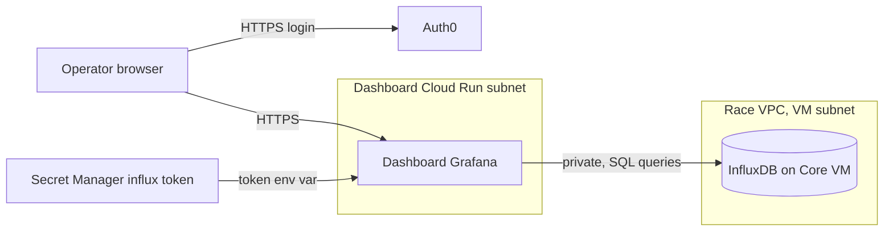

# Deep dive - Dashboard

Live read-only view of race sensor data.

Implementation: Grafana OSS container.

Why Grafana and what was rejected: [ADR - Dashboard](adr-dashboard.md).

Where: Cloud Run, public HTTPS on `dashboard.{dns zone}` (today `https://dashboard.chronoracer.live`). Mapping:
[Terraform](component-terraform.md). Image from Artifact Registry. Publish:
[Control-plane images](operator-control-plane-images.md).

Lifecycle: always deployed, like Relay. Survives races. Scale-to-zero when idle, `max_instance_count = 1`.

Access: public URL, Auth0 by Okta OIDC login required.

Responsibility:

- show whether ingest is working during a race
- show sensor values over time during a race

Not its responsibility:

- race lifecycle actions (start, stop, force-destroy, driver change) - those stay on [Relay](component-relay.md)
- alerting
- finished-race data - the database dies with the race VM; exports are downloaded through Relay
- readiness signalling - ready/unhealthy stays heartbeat-based ([Race provisioning](flow-race_provisioning.md))

Dashboard failure never affects ingest. Ingest failure makes the dashboard empty, not broken.

## Statelessness

Grafana's internal database (users, sessions, preferences, annotations, UI-authored dashboards) is ephemeral container
storage and is lost on every cold start. Accepted. Consequences:

- dashboards and the datasource are provisioned from files baked into the image; a dashboard change is an image rebuild
- operators re-login after a cold start
- `max_instance_count = 1` because sessions are instance-local

## Auth

Auth0 by Okta authorization-code login on the existing `chronoracer-relay` application, operator users from an Auth0 database
connection. Grants, callback URL, users, role mapping: [Okta](component-okta.md). Auth0-side setup and client secret
upload: [Dashboard OAuth runbook](operator-dashboard-oauth.md).

Grafana built-in login form is disabled. Every authenticated user is a Viewer; nobody can edit panels or run ad-hoc
queries from the UI. That is also the mitigation for the datasource credential below.

## Data path

Polling only. InfluxDB 3 Core has no server-side stream; the client Flight/gRPC path is still request-response. There is
no real-time requirement: operators cannot influence a running race, and emergency communication is a separate voice
module outside this repository.

Target: the Core VM's stable internal name, same shape Relay already uses for the private Kafka listener
([Kafka](component-kafka.md)). VM name is stable across races ([Terraform](component-terraform.md)), so the provisioned
datasource needs no per-race rewrite.

Credential: the shared Influx admin token, injected as an environment variable from Secret Manager and interpolated by
the provisioning file. Never baked into the image. Token ownership, creation, rotation
window: [Influx token runbook](operator-influx-token.md). Influx access model and bind
change: [InfluxDB](component-influxdb.md).

InfluxDB 3 **Core** (the free version) issues admin tokens only - read-scoped tokens are an Enterprise feature. The
dashboard therefore
holds a credential that can also write and delete. Mitigations: Viewer-only Grafana, no UI query editing, and the
network boundary below.

## Network

Cloud Run reaches Influx over Direct VPC Egress from the Dashboard subnet. Only that subnet may reach the Influx HTTP
port, and only on the `core` network tag. Relay has its own Cloud Run subnet and is not a source on that rule. The Kafka
VM is the public-facing, highest-risk host in the VPC and is also not allowed to reach the database. Subnets, firewall
rule, service accounts, and IAM are [Terraform](component-terraform.md) resources in the always-on stack.

The race stack is unchanged by this component: no new race resources, no change to the `ingest_open` invariant.

## Dashboards

Provisioned as code. One table per sensor, created lazily, so panels cannot hardcode a sensor list - the sensor variable
is a query over `information_schema.tables`. Table and column
meaning: [InfluxDB](component-influxdb.md).

| Dashboard     | Answers                       | Panels                                                          |
|---------------|-------------------------------|-----------------------------------------------------------------|
| Ingest health | "is data arriving right now?" | write rate, age of newest point per sensor, active sensor count |

Ingest health replaces the current practice of trusting the Relay healthcheck or reading Core logs in Cloud Logging.

The ingest dashboard carries a text panel stating that query errors mean no active race, so an expected empty window is
not mistaken for a broken dashboard. A sensor value dashboard is out of scope for this iteration.

The dashboard is implemented in [`dashboard/`](../dashboard): Grafana settings, InfluxDB datasource provisioning, and
the provisioned dashboard JSON are built into the image. The sensor cards repeat from the `information_schema.tables`
query because Core creates one table per sensor lazily.

## Between races

The Core VM and its database are destroyed after export. The dashboard stays deployed and its datasource is simply
unreachable, so panels show connection errors. Currently fine for MVP - can be refactored later to show a fallback error
screen.

## Accepted risks

- **No query guardrails in MVP.** No enforced minimum refresh, no capped window, no query timeout tuning. Influx shares
  the Core VM and both spike together ([Core](component-core.md)), so heavy dashboard use can compete with ingest.
  Revisit after real GCP load testing.
- **Admin-scoped datasource credential** (see Data path).
- **Session loss on cold start** (see Statelessness).

## Container contract

Everything environment-specific is injected by Terraform, so the image holds only Grafana configuration. The image must
listen on the container port from [`platform.json`](../infra/contract/platform.json) and provision its datasource and
dashboards from these variables.

| Variable                              | Source                        | Use                   |
|---------------------------------------|-------------------------------|-----------------------|
| `INFLUX_URL`                          | Core VM internal name + port  | Datasource address    |
| `INFLUX_DATABASE`                     | `platform.json`               | Datasource database   |
| `INFLUX_TOKEN`                        | Secret Manager                | Datasource credential |
| `GF_SERVER_HTTP_PORT`                 | `platform.json`               | Port Grafana binds    |
| `GF_SERVER_ROOT_URL`                  | Mapped Dashboard hostname     | OAuth redirect base   |
| `GF_AUTH_GENERIC_OAUTH_CLIENT_ID`     | `platform.json`               | Auth0 application     |
| `GF_AUTH_GENERIC_OAUTH_CLIENT_SECRET` | Secret Manager                | Auth0 application     |
| `GF_AUTH_GENERIC_OAUTH_AUTH_URL`      | Derived from the Auth0 issuer | Login redirect        |
| `GF_AUTH_GENERIC_OAUTH_TOKEN_URL`     | Derived from the Auth0 issuer | Token exchange        |
| `GF_AUTH_GENERIC_OAUTH_API_URL`       | Derived from the Auth0 issuer | Userinfo              |

Resource names and ports are owned by the contract files, Cloud Run wiring
by [Terraform](component-terraform.md), and secret payloads by their runbooks
([Influx token](operator-influx-token.md), [Dashboard OAuth](operator-dashboard-oauth.md)).

`GF_SERVER_ROOT_URL` is `https://dashboard.{dns zone}`, not the generated `run.app` URL. A `check` block in the
always-on stack asserts the domain mapping hostname matches that local. Auth0 callback registration:
[Dashboard OAuth runbook](operator-dashboard-oauth.md).
