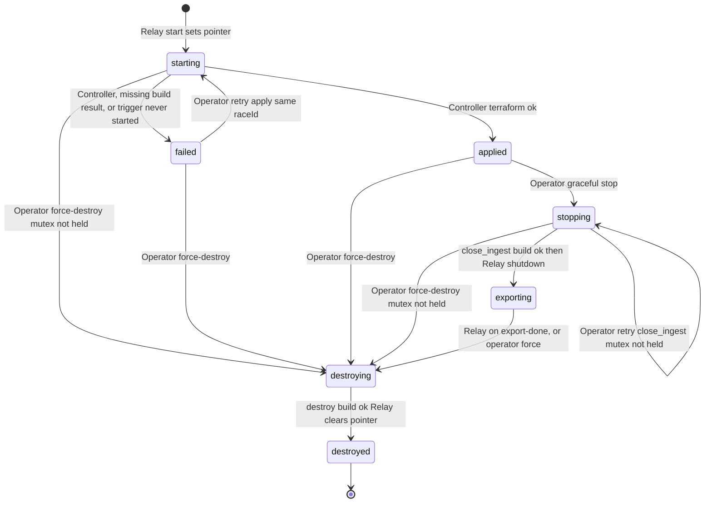

# Deep dive - Firestore

Where: GCP-managed

Lifecycle: always available

Access: private

Responsibility:

- race lifecycle source of truth (pointer + race docs)
- one-build mutex (`terraformRun` / `runToken`)
- store apply outputs the controller writes (`applied`)

## Shape

Three documents:

- `control/active` — pointer. `raceId` set or empty. Relay-only write. New start only when empty. Retry from `failed` keeps the same pointer.
- `races/{raceId}` — one doc per race. Kept after destroy. Next new start needs a **new** operator `raceId`; destroyed ids are rejected.

Operators never read Firestore. They call Relay.

## Writers and readers

Writers (only two):

- **Relay:** pointer, race collection; creates the race doc in the same transaction as the pointer; uploads Core YAML to GCS; writes `starting`, `stopping`, `exporting`, `destroying`, `destroyed`; writes `failed` if Cloud Build produced no controller `applied` while still `starting`, if the trigger never started, or if the build failed without a controller write; writes `terraformRun` on stamp (`runToken`, `stampedAt`, empty `buildId`), on bind or trigger `buildId`, on trigger failure (`status` `failed`, not left `in_flight`), on bind-window expiry with no matching build, and on build-finished (push or status replay); writes `startedBy` and timestamps.
- **Controller:** bind, apply writes, and YAML HEAD: [Controller](component-controller.md). Does not touch `control/active`, the YAML object, or `terraformRun`. Does not write Firestore on `close_ingest` or `destroy`.

Not writers, not readers: Core, Kafka VM, devices, operators.

## Core config blob

Relay uploads the operator YAML mapping as-is to `{raceId}/core-config.yaml` **before** the pointer transaction. It does not inject brokers, `raceId`, or GCP project fields. Firestore does not store the file. Orphan YAML without a pointer is acceptable.

Controller trusts the object exists and does not parse it. Overlay at boot: [Core startup](../core/startup/README.md). Core never uses Firestore.

`raceId` on the race doc is the operator id. Boot overlay writes `race.race_id` from metadata `race-id`.

Operator YAML is immutable after start. Retry from `failed` keeps the original object. A different config requires force-destroy and a new race.

Export paths: [GCS](component-gcs_buckets.md). Always-on IAM: [Terraform](component-terraform.md).

## Schema

### `control/active`

- `raceId` — string or empty. New races: operator-supplied, unique, GCP label-safe, 1–12 chars (`^[a-z0-9]([a-z0-9_-]{0,11})$`). Never reused after destroy.
- `updatedAt`

### `races/{raceId}`

- `raceId`
- `phase` — see machine below
- `terraformRun` — `runToken` (uuid, stamped with `in_flight`, passed into Cloud Build), `stampedAt`, `buildId` (empty until trigger confirms or status binds it), `action` (`apply` | `close_ingest` | `destroy`), `status` (`in_flight` | `succeeded` | `failed`). Present from the create transaction on new start (never persist `starting` without an `in_flight` run). Source of truth for the one-build mutex. Not inferred from phase. GCS Terraform state locking is not the mutex.
- terraform outputs after apply (controller): `kafkaInstance`, `coreInstance`, `kafkaPublicIp`, `kafkaHostname` (stable FQDN without trailing dot). Not `kafkaPort`.
- `startedBy` — Okta subject
- timestamps: `startedAt`, `appliedAt`, `stoppedAt`, `destroyedAt`
- `lastError` — set on apply/trigger/build failure. Cleared when Relay stamps a new `terraformRun` (retry start / stop / force-destroy / export-done). Controller deletes it when writing `applied`.

## Mutex

Held whenever `terraformRun.status` is `in_flight`. Empty `buildId` does **not** release it.

Relay must not start a second Cloud Build while the mutex is held. No queued intent. Force-destroy while `in_flight` is rejected.

`runToken` is the generation. Cloud Build substitutions carry `raceId`, `action`, `runToken`. A stale build whose token no longer matches is a no-op at the controller.

Reconcile — on operator status, and before mutex checks on start retry / stop / force-destroy:

1. If `in_flight` and `buildId` is set: read Cloud Build. If terminal, run the same build-finished handler as the Pub/Sub push, then re-read the race doc.
2. If `in_flight` and `buildId` is empty: list Cloud Builds for this `raceId` + `runToken`. If found, bind `buildId`, then (1). If none and `stampedAt` is still inside the bind window: mutex stays held. If none and past the bind window: mark `terraformRun.status` `failed`, `lastError` (trigger never started). Then retry or force-destroy is allowed.

Bind window: longer than Cloud Run request timeout. No always-on reconciler daemon.

Every Relay trigger: stamp `in_flight` + new `runToken` + `stampedAt` with empty `buildId` (new start: same transaction as pointer + race doc) → trigger with those substitutions → write `buildId`. Trigger failure: `status` `failed`, `lastError`, do not leave `in_flight`. Stamp clears `lastError`.

## Phase machine

Firestore stores infrastructure phase only. It does not store `ready` or `unhealthy`. Ready/unhealthy are API output: [Relay](component-relay.md). Detection: [Race provisioning](flow-race_provisioning.md).

Legal transitions:

- No pointer → YAML upload, then one transaction creates `races/{raceId}` and sets pointer, phase `starting`, **and** stamps apply `in_flight` + `runToken`
- `starting` → `applied` (Controller, token match, phase still `starting`) or `failed` (Controller on apply fail with token match; Relay if no `applied` while still `starting`, trigger never started, or bind window expired) or `destroying` (force, mutex not held)
- `failed` → `starting` (retry, same raceId, same YAML, new `runToken`, mutex not held) or `destroying` (force, mutex not held)
- `applied` → `stopping` (graceful stop, mutex not held) or `destroying` (force, mutex not held)
- `stopping` → `stopping` (retry `close_ingest`, mutex not held, new `runToken`) or `exporting` (Relay after `close_ingest` succeeds, then publishes shutdown) or `destroying` (force, mutex not held)
- `exporting` → `destroying` (Relay on export-done, or operator force, mutex not held)
- `destroying` → `destroyed` (Relay on destroy success, then updates races, pointer cleared)
- `destroying` may retry destroy if mutex not held (new `runToken`)
- `destroyed` is terminal for that `raceId`
- No graceful stop from `starting`. Force-destroy from `starting` / `stopping` / `exporting` only when mutex not held
- If Controller already wrote `applied`, a later Cloud Build failure does not move phase to `failed`. Mutex clears (`terraformRun` succeeded)

No transition into ready/unhealthy.

Pointer: set only on new start, cleared only when that race reaches `destroyed` (`control/active` written as empty `raceId`, not deleted). Retry from `failed` does not change the pointer. Destroyed race docs remain; that `raceId` cannot start again. Pointer and race doc are created together; never pointer without a doc; never `starting` without mutex.

## Who writes which phase

| Phase      | Writer                                                                                                                                                              |
|------------|---------------------------------------------------------------------------------------------------------------------------------------------------------------------|
| starting   | Relay                                                                                                                                                               |
| applied    | Controller (`apply` only; token + phase `starting`; with outputs)                                                                                                   |
| failed     | Controller on `apply` fail with token match, or Relay if trigger never started / bind window expired / build failed with no controller write while still `starting` |
| stopping   | Relay                                                                                                                                                               |
| exporting  | Relay (build-finished after `close_ingest`, push or status replay; then publishes shutdown)                                                                         |
| destroying | Relay (force-destroy API or export-done push)                                                                                                                       |
| destroyed  | Relay (build-finished after destroy, push or status replay); then updates races and pointer clear                                                                   |
