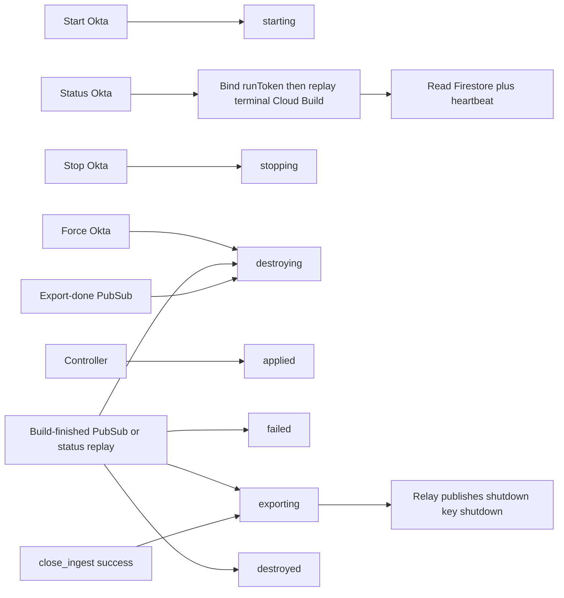

# Deep dive - Relay

[!IMPORTANT] At the time of writing this, the public URL of Relay is `https://chronoracer-relay-585760075678.europe-west3.run.app`

Code at: [Relay root](../relay)

Where: Cloud Run, public HTTPS. Image from Artifact Registry (`ar_relay_image` in [
`names.json`](../infra/contract/names.json)). Publish: [Control-plane images](operator-control-plane-images.md).

Lifecycle: always deployed. Survives races. Scale-to-zero when idle. Firestore holds state so Relay stays stateless.

Access: public. No Google invoker IAM for operators. Relay checks Okta on operator calls. Pub/Sub pushes use Google
OIDC, not Okta. Operators are not Google identities.

IAM and Cloud Run instance caps: [Terraform](component-terraform.md). Cloud Build trigger location and regional

APIs: [Controller](component-controller.md). Mutex, schema, reconcile: [Firestore](component-firestore.md).
Ready/unhealthy detection: [Race provisioning](flow-race_provisioning.md).

Responsibility:

- manage race lifecycle
- allow for exported data download

## Callers

Three identities.

- **Operator:** valid Okta token. Who may call which operation: [Okta](component-okta.md).
- **Build-finished:** Pub/Sub push identity (OIDC) for the Cloud Build subscription. Not Okta. Scoped to one endpoint.
- **Export-done:** Pub/Sub push identity (OIDC) for the export-done subscription. Not Okta. Scoped to one endpoint.

Cloud Run does not wait on Terraform. Operator calls return immediately. Relay is the only Cloud Build caller.

Before start retry / stop / force-destroy reject-on-mutex, and on every status: run the Firestore reconcile.

## Resource shape

Start creates `races/{raceId}` in Firestore. The API exposes the active race and historical races through separate
endpoints. Historical races are race documents whose ID is not the current `control/active` pointer.

Internal build-finished and export-done are separate paths on the same Relay service.

## Configuration boundary

The production Relay configuration is rendered by Terraform into the Secret Manager secret mounted by Cloud Run:
[`relay-config.yaml.tftpl`](../infra/always-on/relay-config.yaml.tftpl). The checked-in
[`relay/config.yaml`](../relay/config.yaml) mirrors the current always-on values for standalone runs. The shared topic
names come from the platform contract; the generated configuration also receives the regional Kafka bootstrap address,
push audiences, service accounts, and the Cloud Build trigger ID from the always-on stack.

## Operations

### Start (operator)

Caller: Okta.

Input: required `raceId` (no default; operator chooses) and config dict (opaque Core YAML mapping; partial OK). Relay
does not mint `raceId` and does not schema-validate Core. `raceId` rules: [Firestore](component-firestore.md). On retry
from `failed`, config is ignored; the original YAML stays. `raceId` must match the active race.

New race (pointer empty): reject if `raceId` is invalid or `races/{raceId}` already exists (including destroyed races).
Upload operator YAML as-is to `{raceId}/core-config.yaml` (no platform inject; overlay at
boot: [Core](component-core.md)); one transaction stamps apply `in_flight` as [Firestore](component-firestore.md);
trigger Cloud Build apply with substitutions `raceId`, `action`, `runToken`; write `buildId`. Trigger failure: phase
`failed`, `terraformRun.status` `failed`, `lastError`, pointer stays. Stamp clears `lastError`.

Retry (pointer set, phase `failed`, mutex not held): same `raceId`, no new YAML, new apply run, new `runToken`, phase
`starting`, stamp, trigger, write `buildId`.

Output: `raceId`, phase `starting`.

Reject: invalid or reused `raceId`; pointer set and phase is not `failed`; `failed` but mutex held; `raceId` ≠ active
race.

### Status (operator)

Caller: Okta. Input: none.

If mutex held: reconcile, then re-read Firestore.

If pointer empty: no active race; return `raceId` null.

Else: `raceId`, phase, ready, unhealthy, `lastError`, `startedBy`, `startedAt`, `terraformRun`. Kafka hostname, port,
and public IP only when ready. Do not return export URLs or last-race data.

Ready / unhealthy are derived. Not written back. Rules: [Race provisioning Healthcheck](flow-race_provisioning.md).
Other phases: both false. Read fail still returns phase, `startedAt`.

Export-done is not recovered here. Hung `exporting` uses force-destroy.

### History list (operator)

Caller: Okta. Input: none.

Return every race ID and its race dates from the `races` collection, excluding the race referenced by `control/active`.
The list is ordered newest first and includes `raceId`, `startedAt`, and `destroyedAt`.

### Historical race (operator)

Caller: Okta. Return the selected historical race document from the database. An active race is not a historical race
and is rejected as not found. With query parameter `export_race=true`, also return `exportUrls` containing temporary GCS
export URLs (15-minute GET, IAM `signBlob` from the Relay SA: [Terraform](component-terraform.md)).

### Stop (operator)

Caller: Okta. Input: empty.

Allowed from `applied` (including unhealthy), mutex not held. Also retry from `stopping` when mutex not held.

Relay: stamp `stopping` / `close_ingest` `in_flight` + new `runToken` + `stampedAt` with empty `buildId`, trigger Cloud
Build with substitutions, write `buildId`. Do not publish shutdown yet.

Output: `raceId`, phase `stopping`.

Reject: no active race; phase `starting`; `exporting` or `destroying`; mutex held.

### Force-destroy (operator)

Caller: Okta. Input: empty.

Allowed from `failed`, `starting`, `applied`, `stopping`, `exporting` when mutex not held. Also retry from `destroying`
if mutex not held.

Reject: no active race; mutex held. No exception for `close_ingest`. No queued intent.

Behavior: write `destroying` / destroy `in_flight` + new `runToken` + `stampedAt` with empty `buildId`, trigger destroy
with substitutions, write `buildId`.

Output: `raceId`, phase `destroying`. No HTTP wait.

### Build-finished (Pub/Sub push)

Caller: Cloud Build push identity.

Input: Cloud Build finished event (build id, success/fail). `raceId`, `action`, `runToken` come from the substitutions
Relay set at trigger.

Reject: caller is not that push identity; `buildId` does not match `terraformRun.buildId`; `runToken` does not match;
raceId does not match the pointer / race doc.

Idempotent: if this `buildId` was already applied to `terraformRun` (status already `succeeded` or `failed` for that
id), no second phase move.

Then mark `terraformRun.status` succeeded or failed, and:

- **apply success:** controller should already have written `applied`. If it did not: phase `failed`, `lastError`. Do
  not invent `applied` without outputs.
- **apply failure:** if phase is already `applied` with outputs: do not revert; mark `terraformRun` succeeded
  (controller committed). If phase is still `starting`: `failed`, `lastError`.
- **close_ingest success:** phase `exporting` and `terraformRun.status` `succeeded` persisted first (mutex clear,
  export-done gate open), then Relay publishes shutdown on the private control topic. Status replay while already
  `exporting` republishes shutdown (idempotent key).
- **close_ingest failure:** `lastError`; phase stays `stopping`. Operator retries stop once mutex is clear. Not
  force-destroy.
- **destroy success:** phase `destroyed`; update races; clear `control/active`.
- **destroy failure:** `lastError`; phase stays `destroying`. Operator retries force-destroy.

Status replay uses this same handler.

### Export-done (Pub/Sub push)

Caller: export-done push identity.

Input: `raceId` from Core (value in message body under `race_id` key)

Reject: caller is not that push identity; raceId does not match the pointer / race doc; phase is not `exporting`; mutex
held.

Then: write `destroying`, stamp destroy `in_flight` + new `runToken` + `stampedAt` with empty `buildId`, trigger Cloud
Build destroy with substitutions, write `buildId`. Ack this push only after that stamp (and trigger attempt).

Late message after force-destroy or after destroy: reject. No second Terraform.

Not recovered by Cloud Build replay. Hung `exporting` uses force-destroy.

## Start / stop mapping

