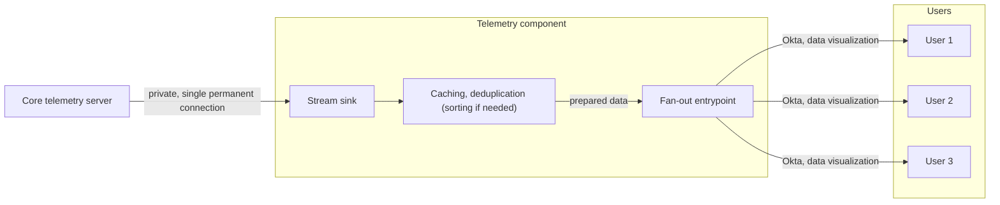

# Deep dive - Telemetry

Near-real-time, read-only preview of accepted race sensor values, and of the predictions and alerts the analysis
module pushes to it. Operators also send messages to the driver from it ([Driver messages](#driver-messages)).

Where: race-scoped Cloud Run service `telemetry`, public HTTPS on its deterministic `run.app` URL. The service uses
Direct VPC Egress through a dedicated Telemetry subnet to reach Core. It is created by race Terraform, remains present
through `stopping` and `exporting`, and is destroyed with the race stack.

Lifecycle and IAM: [Terraform](component-terraform.md). URL exposure: [Relay](component-relay.md). Core stream contract:
[Core](component-core.md#telemetry-stream).

Access: public Cloud Run invoker with application-level Auth0 authorization-code login. Only authenticated operators
may use it. Browser authentication is shared with the Dashboard: [Okta](component-okta.md). Setup:
[Browser OAuth runbook](operator-browser-oauth.md).

## Responsibility

- connect to Core's private gRPC `Watch` stream for the whole race
- retain and shape the received preview data for browser use
- present accepted sensor values with near-real-time target latency of two to five seconds
- expose browser HTTPS and WebSocket surfaces, read-only except for driver messages
- make stream gaps visible rather than imply a complete record
- accept prediction and alert events from the analysis module and show them next to the sensor values
  ([Analysis ingest](#analysis-ingest))
- send operator messages to the driver over Kafka ([Driver messages](#driver-messages))

Not its responsibility:

- race lifecycle actions; those remain on [Relay](component-relay.md)
- fleet or infrastructure health; that belongs to the [Dashboard](component-dashboard.md)
- durable storage, export, or post-race analysis
- validating or transforming sensor messages independently of Core
- race readiness or unhealthy detection
- computing predictions or evaluating alert rules; analysis does that and Telemetry only displays the result

Telemetry failure never blocks ingest and never changes race `ready` or `unhealthy`. Relay returns its URL with the
other connection details once the existing Core-heartbeat readiness rule passes. The URL can still lead to an
unavailable service; readiness deliberately does not probe Telemetry.

## Runtime shape

Cloud Run uses one warm instance for the race:

- minimum instances: 1
- maximum instances: 1
- CPU allocated outside requests
- deterministic generated URL:
  `https://telemetry-{project number}.{region}.run.app`
- WebSocket-capable request timeout; browser clients must reconnect before or after Cloud Run's maximum request
  duration

The warm singleton is required because Telemetry pulls continuously from Core and owns any in-memory preview history.
Scale-to-zero would lose all points received before the first browser request. A Cloud Run restart loses component
memory and reconnects to Core; Core does not provide replay.

The generated URL is used instead of a custom domain. A sufficiently short Cloud Run service name receives the
deterministic URL, which can be registered in Auth0 before a race. Terraform obtains and outputs the actual service URI;
Relay returns that output rather than constructing the URL.

## Private Core connection

Telemetry and Analysis may reach Core's telemetry port. The network authorization boundary is owned by
[Terraform](component-terraform.md#always-on-stack). For Telemetry, always-on Terraform owns:

- a dedicated `/26` Direct VPC Egress subnet
- a firewall rule from that subnet to the `core` network tag on the telemetry port
- that subnet as a source of the private Kafka listener rule to the `kafka` tag, for
  [driver messages](#driver-messages)
- the Telemetry service account and access to the shared browser OAuth secret (same resource as Dashboard)

Race Terraform attaches those resources to the Cloud Run service. The port is owned by
[`platform.json`](../infra/contract/platform.json). No application credential or TLS is used on this private hop; the
network boundary linked above controls access, matching the private Kafka listener model.

Telemetry calls `Watch` as `client_id` `telemetry` and selects sensors with `TELEMETRY_SENSORS`. Selection rules, limits,
and what happens on a second call with the same id are owned by [Core](component-core.md#clients-and-sensor-selection).

Telemetry retries the private Core connection while the race service exists. Core may not be listening when Cloud Run
starts, and either process may restart. Disconnect and reconnect never affect Core ingestion. Stream ordering,
versioning, payload fields, and loss semantics are owned by [Core](component-core.md#telemetry-stream).

## Browser boundary

The component provides an HTTPS UI, read-only except for driver messages, and pushes near-real-time changes to
authenticated browsers over WebSocket. Browser API shape, chart selection, sensor discovery, aggregation, retention window, and implementation
language or framework are intentionally left to the Telemetry implementation.

The implementation must preserve these externally visible properties:

- only authenticated operators can establish browser sessions or WebSockets, or send driver messages
- the UI distinguishes connected data, known dropped-point gaps, reconnect gaps, and Core restart boundaries
- it does not claim to be a complete or durable race record
- it does not query InfluxDB or Kafka; it only produces driver messages to Kafka

## Analysis ingest

The analysis module pushes its results to Telemetry over HTTPS on the same Cloud Run URL. This surface is for that
one service, not for browsers. Telemetry keeps the newest state per prediction and the most
recent alerts in memory, and pushes changes to browsers on the next fan-out tick.

Every request carries `Authorization: Bearer {ANALYSIS_INGEST_TOKEN}` and one JSON object
(`Content-Type: application/json`, at most 64 KiB). Without `ANALYSIS_INGEST_TOKEN` the routes answer `503`, except
in local runs with `TELEMETRY_AUTH_DISABLED`, where they are open.

| Route (`POST`)                         | Body                        | When analysis sends it                                     |
|----------------------------------------|-----------------------------|------------------------------------------------------------|
| `/analysis/v1/predictions/running`     | `PredictionRunningJSON`     | it knows a prediction it can make (announcement)           |
| `/analysis/v1/predictions/unavailable` | `PredictionUnavailableJSON` | a prediction cannot be made now, e.g. a sensor is silent   |
| `/analysis/v1/predictions`             | `NewPredictionJSON`         | a new prediction result                                    |
| `/analysis/v1/alerts`                  | `NewAlertJSON`              | a new alert fired                                          |

Fields are snake_case. `timestamp` is an integer of Unix microseconds, at least `1767225600000000` (2026-01-01 UTC).
Ids and required strings are non-empty. Every field is required; `| null` means the key must be present with `null`.
Unknown keys are ignored.

| Body                        | Fields                                                                                                    |
|-----------------------------|-----------------------------------------------------------------------------------------------------------|
| `PredictionRunningJSON`     | `timestamp`, `prediction_id`, `name` (display title), `refresh_rate` (integer ≥ 1, or `null` when irregular) |
| `PredictionUnavailableJSON` | `timestamp`, `prediction_id`, `info` (reason shown to operators)                                          |
| `NewPredictionJSON`         | `timestamp`, `prediction_id`, `sensors_id` (Core sensor ids, may be empty), `instruction` (string or `null`), `value` (finite number or `null`) |
| `NewAlertJSON`              | `timestamp`, `alert_id` (one id per alert type), `sensors` (at least one `{sensor_id, value}`, finite value), `analysis_message` and `analysis_reason` (1–255 characters) |

Responses: `204` accepted, `400` invalid JSON or schema with the failing field paths, `401` wrong or missing token,
`413` body too large, `422` a new `prediction_id` beyond the cap of 200, `503` ingest not configured.

One `prediction_id` is one card in the UI:

- `running` sets the title and refresh rate; a prediction or `running` with a `timestamp` at or after the
  `unavailable` one clears it.
- `unavailable` marks the card unavailable with `info` and keeps the last result dimmed.
- A prediction or `unavailable` for an id that was never announced is accepted and titled by its id, because
  Telemetry forgets announcements when it restarts. Analysis should re-send `running` after a Telemetry restart.
- Alerts are a list, newest first; the last 200 are kept.

## Driver messages

Signed-in operators send short messages to the driver from the Telemetry UI. Telemetry produces each one to the Kafka
`event` topic on the private listener. Keys and body follow the driver message convention owned by
[Kafka](component-kafka.md#event). Relay's [operator event](component-relay.md#event-operator) still writes arbitrary
bytes to the same topic.

- A message counts as sent when Kafka acknowledges the write. Telemetry cannot know whether the driver has read it.
- Every operator sees the same recent history with sender and status. It is kept in memory and lost on restart.
- Without the Kafka variables in the [container contract](#container-contract), sending is disabled and the UI says
  so.
- Unlike Relay, Telemetry does not check the race phase; it sends whenever Kafka accepts the write. During `stopping`
  and `exporting` Kafka may still accept a message that the track device can no longer receive.

Route, limits, and producer settings: [Telemetry implementation](../telemetry/IMPLEMENTATION.md).

## Container contract

Environment-specific values are injected by race Terraform:

| Variable              | Source                                             | Use                                     |
|-----------------------|----------------------------------------------------|-----------------------------------------|
| `CORE_TELEMETRY_URL`  | Core internal name + telemetry port                | Private h2c gRPC `Watch`                |
| `RACE_ID`             | Relay/controller race input                        | Reject mismatched Core `hello` events   |
| `TELEMETRY_ROOT_URL`  | Cloud Run service output                           | OAuth callback and browser origin       |
| `OAUTH_CLIENT_ID`     | [`platform.json`](../infra/contract/platform.json) | Shared Auth0 application                |
| `OAUTH_CLIENT_SECRET` | Shared browser OAuth secret (Secret Manager)       | Authorization-code token exchange       |
| `OAUTH_ISSUER`        | [`platform.json`](../infra/contract/platform.json) | Auth0 authorization and token endpoints |
| `KAFKA_PRIVATE_BOOTSTRAP` | Kafka internal name + private port             | [Driver messages](#driver-messages)     |
| `KAFKA_EVENT_TOPIC`   | [`platform.json`](../infra/contract/platform.json) `kafka_event_topic` | Driver message topic |

Fixed browser OAuth paths on this service: login `/auth/login`, callback `/auth/callback`, logout
`/auth/logout`. Logout returns to `TELEMETRY_ROOT_URL` as an origin, without a trailing slash.

`ANALYSIS_INGEST_TOKEN` (at least 32 characters) authorizes the [analysis ingest](#analysis-ingest). It is not yet
provisioned: no Secret Manager secret or Terraform wiring exists, so the deployed ingest answers `503` until it is.

`TELEMETRY_SENSORS` is the exception: the image sets it (`*`, all sensors) and Terraform does not inject it. It
is unset or `*` for all sensors, otherwise a comma-separated sensor id list.

Optional tuning variables and the local-only auth switch:
[Telemetry implementation](../telemetry/IMPLEMENTATION.md#tuning-and-local-variables).

Resource names and ports remain owned by contract files. Cloud Run wiring belongs to
[Terraform](component-terraform.md); Auth0 values and URL registration belong to
[Browser OAuth](operator-browser-oauth.md).

## Architecture

[IMPORTANT!] Current files implement the monolith described in
[`telemetry/IMPLEMENTATION.md`](../telemetry/IMPLEMENTATION.md). Replace or extend that layout rather than
reintroducing a multi-process Core client.

Telemetry **MUST** not open multiple connections to Core, especially not one dedicated connection per user.
It should instead have a fan-out architecture model with one, permanent and reliable connection to Core with an internal
dedup and caching mechanism, later replaying the data to individual connected users. A monolith app is preferred over a
client/server setup.

## Accepted risks

- Preview delivery is best-effort. Core reports known loss but never retains history for replay.
- One warm Cloud Run instance costs for the race duration even with no browser connected.
- Runtime memory disappears on Telemetry restart, including prediction announcements, alerts, and the driver
  message history.
- Core and Telemetry stream throughput must be load-tested on GCP before production use. Preview overload must lose
  preview points, never slow Core ingestion.
- Telemetry scaling issues with a single connection (CR locked to one instance) - needs load testing
