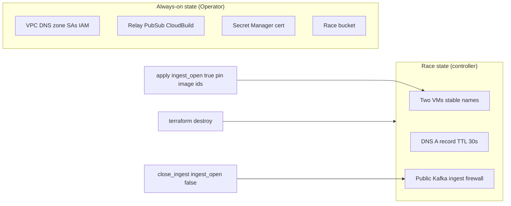

# Deep dive - Terraform

Two stacks. Two GCS state files. Never one state for both.

Race Terraform is the only stack the controller applies.
Sequences: [Race provisioning](flow-race_provisioning.md), [Race destruction](flow-race_destruction.md). Controller CLI
and env: [Controller](component-controller.md).

Terraform: **1.16.0 or newer** (`required_version = ">= 1.16.0"` on all three roots).

## Backends

State bucket `chronoracer-state` (always-on). Bootstrap exception: that bucket is created once outside both states.

Terraform GCS backend stores workspace state as `{prefix}/default.tfstate`.

| Prefix | Who             | Contents                                                                             |
|--------|-----------------|--------------------------------------------------------------------------------------|
| `base` | Human or CI     | Always-on stack. Object `base/default.tfstate`. Controller never opens this backend. |
| `race` | Controller only | Race stack. Object `race/default.tfstate`. Empty after destroy.                      |

`raceId` is a Terraform variable for GCS object paths, Core metadata, and the `race-id` label. It is not a second state
prefix and not part of resource names (`kafka`, `core`, firewall, DNS record set). Label
rules: [Firestore](component-firestore.md).

Every Terraform command uses `-lock-timeout=5m`. Nothing unlocks the lock; other Terraform applies must wait. Stuck lock
after a killed build: human/CI unlocks `race/default.tfstate` only, then retry the same action.

## Who applies what

| Stack     | Who                       | When                                                               |
|-----------|---------------------------|--------------------------------------------------------------------|
| Always-on | Human / CI                | Rare. Platform changes.                                            |
| Race      | Controller in Cloud Build | Every `apply`, `close_ingest`, `destroy`. Triggered only by Relay. |

## Always-on stack

Creates identities, network, control plane, and secrets. Does not create race VMs, race disks, the Kafka public IP, the
Kafka A record, or the public Kafka firewall.

Resources:

- VPC, `/24` subnet with Private Google Access, baseline firewall (IAP SSH only, no public `22` to the internet; no
  public Core; private Kafka from the VPC and Direct VPC Egress to tag `kafka` — ports: [
  `platform.json`](../infra/contract/platform.json))
- Cloud DNS managed zone and stable Kafka FQDN (zone exists with no A record between races)
- Secret Manager secret resource for the long-lived public TLS cert (value uploaded by operator/CI, not per race).
  Procedure: [Kafka TLS runbook](operator-kafka-tls.md)
- Race GCS bucket, artifacts GCS bucket, layout: [GCS](component-gcs_buckets.md)
- Firestore database
- Cloud Run Relay (public HTTPS, no Google invoker for operators, `max_instance_count = 1`) with Direct VPC Egress to
  the shared subnet
- Pub/Sub: Cloud Build notifications topic + push to Relay build-finished (OIDC); export-done topic + push to Relay
  export-done (OIDC)
- One Cloud Build trigger in `var.region` that runs the controller image. Trigger location, timeout,
  substitutions: [Controller](component-controller.md). Native build notifications use topic `cloud-builds` (Pub/Sub
  topics are global; push to Relay). Export-done uses topic `export-done`.
- Artifact Registry for the **controller and Relay** images (not Kafka/Core VM families). First
  tags: [Control-plane images](operator-control-plane-images.md)
- Service accounts and IAM (below)
- Project `_Default` log sink exclusions ([`logging.tf`](../infra/always-on/logging.tf)): drop unread infra noise
  (firewall, VPC flows, health checks, guest-agent chatter). **Keep** GCE `startupscript`,
  `google_metadata_script_runner`, and serial console so race VM boot script stdout stays in Cloud Logging.
- Google-managed service agents via `google_project_service_identity` (google-beta): Cloud Build, Pub/Sub, Cloud Run,
  Compute, Artifact Registry, Secret Manager. Created before IAM bindings so first apply on a new project does not fail
  with a missing agent SA. Extra grants: Cloud Run service agent reads Relay config secret and AR; Cloud Build agent reads
  AR; Pub/Sub push SAs
  `roles/run.invoker` (in addition to public invoker).
- No Cloud NAT
- No reserved Kafka static IP (would bill while idle)

Not built by this stack: Compute image families. Packer in [
`infra/packer`](../infra/packer). [Compute images](component-images.md). Control-plane Docker images are pushed into
this stack’s Artifact Registry **before** a full always-on
apply: [Control-plane images](operator-control-plane-images.md).

### Stable names for race data sources

Canonical strings: [`names.json`](../infra/contract/names.json), [`platform.json`](../infra/contract/platform.json).
Bootstrap, always-on, race, Relay template, and Core/Kafka boot scripts read those files. Do not duplicate the strings
in each root.

Race stack does **not** use `terraform_remote_state` on the `base` prefix. It looks up always-on **resources** (VPC,
subnet, zone, DNS zone, Kafka/Core SAs, TLS secret, race bucket, image families). Missing resource = plan fail. Adjust
names only via always-on apply, then next race.

`kafka_fqdn` is a Terraform variable (must sit in the always-on zone; no fake default). Public Kafka firewall name is
`public_fw` in `names.json`; created by the race stack; controller IAM is scoped to that name.

### Service accounts

| Account                  | May                                                                                                                                                                                       | Must not                                                                                                                                                                                       |
|--------------------------|-------------------------------------------------------------------------------------------------------------------------------------------------------------------------------------------|------------------------------------------------------------------------------------------------------------------------------------------------------------------------------------------------|
| Relay                    | Firestore; write Core YAML object; read `*/export/**` and issue time-limited download access; trigger Cloud Build; read and list Cloud Build (bind + replay); receive both Pub/Sub pushes | Terraform state; create VMs; Secret Manager payload                                                                                                                                            |
| Controller (Cloud Build) | Race Terraform (Compute, DNS A in the existing zone, race public firewall); race Firestore fields on `apply` only, token-gated; read Core YAML object; `race/` state prefix               | Change VPC, Cloud Run, IAM identities, Secret Manager payload, `base/` state prefix; write phase on `close_ingest` / `destroy`; apply Terraform when `runToken` mismatches; force-unlock state |
| Kafka VM                 | Read TLS secret                                                                                                                                                                           | GCS; Cloud Build; Firestore; Pub/Sub                                                                                                                                                           |
| Core VM                  | Read `{raceId}/core-config.yaml`; write `{raceId}/export/**`; publish export-done; read artifacts bucket `core/current/`                                                                  | Firestore; Secret Manager; Terraform state; Cloud Build; write `core-config.yaml`; write artifacts                                                                                             |

Residual (GCP constraints, not project Editor):

- Relay has `iam.serviceAccountUser` on the controller SA so it can run the Cloud Build trigger. Relay must not get
  Compute or `race/` state IAM. Impersonation is still a residual: Relay can mint controller tokens.
- Relay has `roles/iam.serviceAccountTokenCreator` on **itself** so Cloud Run can call IAM `signBlob` for export signed
  URLs. No JSON key on the service. `iamcredentials.googleapis.com` is already in the always-on API list.
- Controller firewall IAM is project-scoped (create conditions are unreliable). Race module must only manage the public
  Kafka firewall from `names.json`.
- Controller DNS is a custom role (record sets + changes + zone get/list). Not `roles/dns.admin`. No
  `dns.managedZones.delete`. Bound at project (one zone in MVP).
- Controller `secretmanager.viewer` on the TLS **secret resource** (metadata for the race data source). Not
  `secretAccessor`. Kafka VM is the only accessor of the payload.
- Controller `roles/iam.serviceAccountViewer` so SA data sources fail if Kafka/Core SAs are missing.
- State bucket: controller `objectAdmin` only under `race/`; `legacyBucketReader` on the bucket (Terraform init lists
  objects; GET of `base/` stays denied).
- Always-on creates Google service agents with `google_project_service_identity` before binding them. Cloud Run service
  agent: Secret Manager accessor on Relay config and Artifact Registry reader. Cloud Build agent: `actAs` controller SA,
  publish `cloud-builds`, Artifact Registry reader. Pub/Sub agent: `tokenCreator` on both push SAs. Push SAs: `run.invoker`
  (public `allUsers` invoker stays for operators).

## Race stack

Root: [`infra/race`](../infra/race). One module. One reused state. Attaches always-on Kafka/Core service accounts. Does
not create SAs or IAM bindings.

VM defaults (Terraform variables; changing them mid-race is forbidden — see close_ingest invariant):

| VM                   | Name    | Network                                                |
|----------------------|---------|--------------------------------------------------------|
| Kafka                | `kafka` | Public + private IP (ephemeral public `access_config`) |
| Core (with InfluxDB) | `core`  | Private IP only                                        |

For rationale on VM types, see [ADR - VM types](adr-vm-types.md).

Network tags: `kafka`, `core`. Label `race-id` = `raceId`. No extra data disks. No preemptible.

Resources (stable names from `names.json`):

- Kafka VM from family `chronoracer-kafka` at first apply, then pinned to that image id in instance state
- Core VM from family `chronoracer-core` at first apply, then pinned
- DNS A record: stable FQDN → Kafka public IP, TTL **30s**. Destroy deletes the record. Between races the name must not
  resolve
- Public Kafka firewall: TCP public ingest port from `platform.json`, source `0.0.0.0/0`, target tag `kafka`. Own
  resource. Present only when `ingest_open=true`
- Instance metadata only: Core `core-config-gcs-uri` (`gs://{bucket}/{raceId}/core-config.yaml`), `race-id`, and
  `startup-script` (inline `local.overlay_startup`: `exec /chronoracer/entrypoint.sh`). Kafka same `startup-script`,
  `tls-secret-id` = Secret Manager secret resource name (`projects/{project}/secrets/{id}`), `kafka-fqdn` =
  `var.kafka_fqdn` without trailing dot (advertised public listener). Not a short secret id string. Not YAML bytes. Not
  TLS private key. Not a separate `.sh` file in the controller image.

Not in race state: VPC, DNS zone, SAs, IAM, cert bytes, YAML bytes, Relay, Pub/Sub, Cloud Build, image families, Cloud
Run Direct VPC Egress.

Do not copy the TLS private key onto disk via Terraform. That would put the key in state. Kafka boot pulls Secret
Manager.

### `ingest_open` and `close_ingest` invariant

Variable `ingest_open` (bool). `apply` sets `true`. `close_ingest` sets `false`. Same module, same `race` state prefix,
`terraform apply` both times (not `destroy -target`).

When `ingest_open` is `false`, the public ingest firewall resource is absent (`count` / `for_each` empty). That is the
only intended plan diff.

It must never replace Kafka VM, Core VM, disks, metadata, or the public IP.

Mechanism:

1. First `apply` resolves each image **family** to a concrete image id and writes that id on
   `boot_disk.initialize_params.image` (never leave the family name on the instance).
2. Both VMs use `lifecycle.ignore_changes = all`. A moved family, machine type var, or metadata tweak is not a plan diff
   on the instance.
3. Image **family** data sources still run every plan. Missing family fails `close_ingest` (fail early). That lookup
   must not replace VMs.
4. Image family updates apply on the **next** race, after destroy left empty state.

**Hard invariant:** Do not add or remove race-module resources (new disks, new firewalls, renamed VMs) while VMs exist.
`ignore_changes = all` freezes instance attributes, not the rest of the module. Upgrade path = destroy, then next apply.
Do not change the controller image (or the race module it contains) while race VMs exist.

Violating this recreates VMs mid-drain.

Existing public TCP sessions may survive firewall delete. MVP accepts that. New public connections fail.

## Controller Terraform runs

Runtime, env, bind, YAML HEAD, exit codes, Firestore field names: [Controller](component-controller.md). This section is
the module operations only.

Same module, same race backend, three operations. Cloud Build timeout: [Controller](component-controller.md). Timeout
means that action failed (`apply` → phase `failed` only if still `starting`; `close_ingest` → stay `stopping`;
`destroy` → stay `destroying`).

### `apply`

`terraform apply` with `ingest_open=true`. Create (or converge) the race stack with public ingest open.

1. Refuse if bind/YAML checks fail ([Controller](component-controller.md)).
2. Apply: both VMs, public IP, DNS A record, public ingest firewall present, metadata paths, attach always-on SAs.
   Resolve image families to concrete ids in state.
3. Persist terraform outputs on the race doc only per controller write rules.

Idempotent. Retry from `failed` is the same apply (same `raceId`, same YAML, same names). Partial leftovers converge.

Terraform outputs the controller must persist: Kafka instance, Core instance, Kafka public IP, Kafka hostname (stable
FQDN).

### `close_ingest`

`terraform apply` with `ingest_open=false`. No YAML existence check. No Firestore phase write.

VMs, disks, metadata, public IP, DNS A record stay. Private listener stays up. Public ingest rule is deleted.

Relay must not publish shutdown until this run succeeds. Overlapping `close_ingest` and `destroy` is invalid (mutex).

Idempotent if already closed. Retry from `stopping` when mutex not held is this same apply.

### `destroy`

`terraform destroy` of the `race` state prefix. VMs, disks, public IP, A record, and public firewall (if still present)
go away. Always-on untouched. No YAML check. No Firestore phase write.

Idempotent if already empty.

## Images and boot (Terraform boundary)

Race `apply` picks current family, then pins that id on the instance. Packer and
payload: [Compute images](component-images.md). Boot
scripts: [Kafka startup](../kafka/startup/README.md), [Core](component-core.md).

What Terraform stores: GCS URI of Core YAML, `race-id`, and the Core `startup-script` text on the Core VM; Kafka
`startup-script`, `tls-secret-id` (Secret Manager resource name), `kafka-fqdn`. Not YAML bytes. Not TLS private key. Not
Kafka brokers (boot script builds internal DNS from GCE metadata project/zone plus `names.json`). Boot scripts read
instance attributes from the metadata server. They do not need Compute IAM.

Core payload prefix is not pinned by Terraform: [GCS](component-gcs_buckets.md).

## Cross-stack contract

Race Terraform may: create VMs in the always-on VPC/subnet with stable names; add/update/remove the A record in the
always-on DNS zone; add/remove the public Kafka ingest firewall rule; attach always-on VM service accounts; set label
`race-id`.

Race Terraform may not: delete the zone, VPC, Relay, buckets, secrets, or identities; change project IAM; rebuild
images; rename VMs per `raceId`; open the `base` state prefix; create Cloud NAT; reserve an idle static Kafka IP.

Always-on rejects a `zone` outside `region`. Direct VPC Egress uses `subnet_cidr`; Google requires at least a `/26`
subnet and allocates ephemeral Cloud Run addresses from it. The current `/24` is shared with Kafka and Core.
