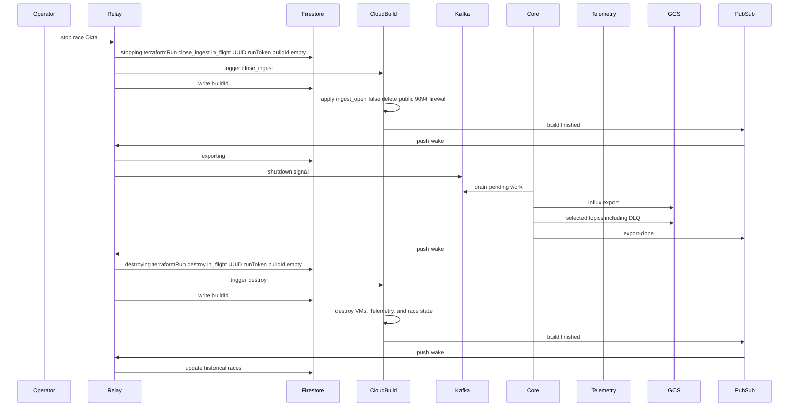

# Flow - Race destruction and export

Goal: stop ingest, drain work, export data to GCS, destroy race VMs. Keep always-on pieces.

API: [Relay](component-relay.md). Phases and mutex: [Firestore](component-firestore.md). `close_ingest` /
`destroy`: [Terraform](component-terraform.md). Export landing: [GCS](component-gcs_buckets.md). In-process
export: [Core](component-core.md).

## Two stop paths

Graceful stop (default): close public ingest, wait until that Terraform run finishes, then shutdown Core, export, then
destroy.

Force-destroy: skip export. Operator accepts data loss.

## Graceful stop flow

1. Operator stop. Allowed phases and rejects: [Relay stop](component-relay.md). Does not publish shutdown yet.
2. Controller `close_ingest`. Private Kafka and Telemetry stay up. Relay publishes shutdown only after this run
   succeeds.
3. Core on connect reads shutdown (`SHUTDOWN` on the control topic: [Kafka](component-kafka.md)), drains, writes export,
   publishes export-done.
4. Relay accepts export-done only in `exporting` with mutex not held, then stamps destroy and triggers Cloud Build. Ack
   only after that stamp.
5. Controller `destroy`. Both VMs and Telemetry Cloud Run are deleted. On success Relay moves to `destroyed` and clears
   the pointer. Status no longer returns usable Kafka or Telemetry addresses. Race doc remains.

Firewall delete is not a session kill. Some public produce may still arrive during drain. MVP accepts that. New public
connections fail.

`close_ingest` and `destroy` must never overlap.

Relay publishes shutdown itself on the private Kafka path. Cloud Build does not talk to Kafka. Operator laptop sleep is
fine: export-done push wakes Relay. Missed export-done after Pub/Sub exhaustion: operator force-destroys a hung
`exporting` race.

## Export

Owner: Core. Landing prefix and IAM: [GCS](component-gcs_buckets.md).

Destroy on the graceful path waits for export-done. Force-destroy is the exception. Late export-done (`destroying` /
`destroyed` / `raceId` mismatch): reject. No second destroy.

Do not keep VM disks after a successful export. Prefix alone is not download access; Relay issues time-limited access on
historical status. The database and [Telemetry](component-telemetry.md) die with the race stack; the export is the only
durable record of a finished race. [Dashboard](component-dashboard.md) keeps only operational Cloud Monitoring history,
not sensor values.

## Force-destroy flow

Skip shutdown wait and export wait. Stamp destroy, trigger Cloud Build, return immediately. Pointer stays set until
destroy succeeds.

Use after `failed` start, hung `exporting`, unhealthy with a dead Core, trigger never confirmed, or leftover race VMs.
API: [Relay force-destroy](component-relay.md).

Force-destroy while Core is mid-export may leave a partial GCS object. Operator treats GCS as incomplete. A later
export-done is rejected.

## Failure

Terraform destroy is idempotent. Retry force-destroy if the destroy build fails or times out, or after bind-window
expiry with no `buildId`.

If Core dies before export-done, graceful stop will not wake Relay to destroy. Status cannot invent export-done.
Force-destroy.

If `close_ingest` fails: phase stays `stopping`, mutex clears. Operator retries stop. Do not treat public-firewall
delete failure as data-loss-only. Stuck GCS lock: human unlocks `race/default.tfstate` only, then retry.

If `close_ingest` succeeds and export never finishes: stay `exporting` until force-destroy. Do not retry graceful stop
once phase is `exporting`. If shutdown never reached Core, force-destroy. Core on connect must observe retained shutdown
messages, otherwise this hang is expected.
