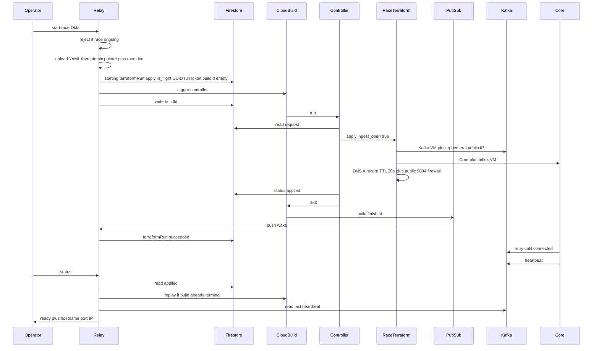

# Flow - Race provisioning

Goal: start one race. Create the two race VMs, ensure Kafka readiness, and only then hand operators the Kafka hostname,
port, and public IP.

MVP: one active race. No queue. Always-on stack is a separate Terraform root; race apply must not manage it.

API: [Relay](component-relay.md). Pointer, mutex, phases: [Firestore](component-firestore.md). Race
apply: [Terraform](component-terraform.md). Controller process: [Controller](component-controller.md).

## Start flow

1. Operator start (Okta). New race vs retry from `failed`: [Relay start](component-relay.md).
2. Cloud Build runs controller `apply`. Both VMs in one apply. Core must tolerate Kafka not listening yet (Currently
   Core dies on Kafka not listening, but runs as service so will restart).
3. Kafka boot: [Kafka startup](../kafka/startup/README.md). Core boot: [Core startup](../core/startup/README.md).
4. Pub/Sub wakes Relay, or status replays a terminal build: [Relay build-finished](component-relay.md).
5. Status returns hostname, port, and public IP only when Healthcheck says ready. Devices already have Okta client id
   and secret. They use that hostname/IP (TLS SNI/verify on the hostname).

IP may change every race; hostname and cert do not.

## Healthcheck

Canonical ready/unhealthy rules. Relay status only exposes them; Firestore does not store them.

Core has no API. Health is a heartbeat on the private Kafka heartbeat topic, key `CORE`
([Kafka topics](component-kafka.md)). Relay on status reads the last retained record. It does not start a consumer at
latest and hope a beat arrives during the request.

Heartbeat means: Core process is up, private Kafka is reachable, Influx is reachable. Relay does not probe Influx or the
public listener. Kafka boot already refused to start without public TLS bind. If the heartbeat record can be read,
private Kafka accepted a connection.

- Phase `applied` and latest heartbeat fresh (interval plus a small margin) → ready.
- Phase `applied`, no heartbeat record yet → not ready, not unhealthy.
- Phase `applied`, heartbeat went stale, or Kafka read fails → unhealthy. Phase stays `applied`. `lastError` on read
  fail. Still return phase, `startedAt`. No auto-destroy.

Provisioning (`starting`) cannot use Kafka. That phase is Firestore plus Cloud Build (push, or status bind/replay).

Relay scale-to-zero: heartbeat is read on status only. Unsolicited wakes: Cloud Build finished, and export-done. Missed
Cloud Build push is recovered on status. Export-done is not.

## Failure

Phase and mutex outcomes: [Firestore](component-firestore.md). API rejects: [Relay](component-relay.md).

Apply ok, heartbeat never fresh: phase stays `applied`; status not-ready or unhealthy. Force-destroy (nothing reliable
to export) or wait.
