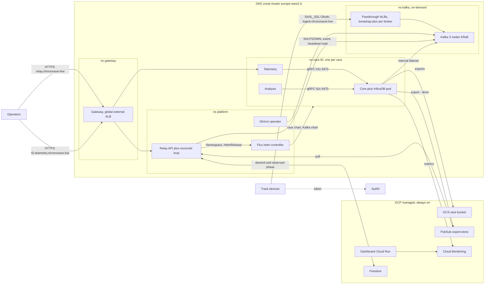
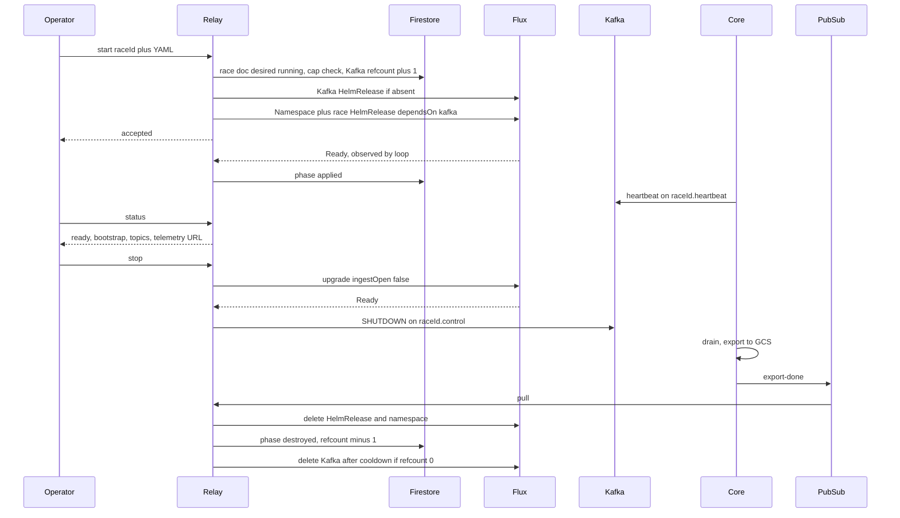

# Proposal - Chronoracer on GKE: multi-race architecture

[IMPORTANT!] TLDR: Implementing this means throwing existing infra to the bin and building something completely new.
Individual service internal implementation and behaviour says the same or with at most minor changes. 
Idle costs will rise from about 2$ per month to around 100$ per month. However, the max race count is only limited by
node count.

Status: **proposed, not implemented or validated in detail - treat as a draft.** The existing [docs](../README.md)
remain the source of truth for the running
system. This document does not change them. It links to them where it describes something that exists today.

Scope: target architecture only. No migration path: tear down and recreate. Grafana Dashboard rework is out of scope.

Problem: the current infrastructure supports one race at a time. A single `control/active` pointer, stable VM names
and one race Terraform state ([Firestore](../component-firestore.md), [Terraform](../component-terraform.md)) make
concurrent races impossible. Extending the VM model to dozens of loosely connected VMs is not maintainable (note:
I've worked in a project where there were several hundred VMs to control - it was migrated away in less than two months)

## 1. Is a separate Controller still needed? No.

The Controller exists because Relay on Cloud Run cannot run long work:

- Cloud Run has a request timeout, scales to zero, and throttles CPU outside requests.
- Terraform runs in a separate Cloud Build job ([Controller](../component-controller.md)).
- Relay learns the outcome through the Cloud Build Pub/Sub push.
- The `runToken`/bind-window mutex exists to correlate those asynchronous builds
  ([Firestore mutex](../component-firestore.md#mutex)).

In the new structure:

- **The long work disappears rather than moving.** Flux helm-controller does the Helm install and the wait, Strimzi
  creates the Kafka cluster, and Core does the export. Relay only writes Kubernetes objects and Firestore documents and
  reads their status. Each of those calls takes milliseconds.
- **The remaining asynchronous work fits a background loop in an always-running Relay pod:**
    - mirror the `HelmRelease` Ready condition into the Firestore phase
    - keep the Kafka refcount and the idle cooldown timer
    - publish `SHUTDOWN` once close-ingest is Ready
    - consume export-done, then delete the release
    - wait until the namespace is gone, then mark the race `destroyed`
- **Removed:** the Controller image, the Cloud Build trigger, the `cloud-builds` topic, both Pub/Sub push endpoints and
  their OIDC checks, and the `runToken`/`buildId`/bind-window mutex. Declarative apply is idempotent, so two
  overlapping writes cannot start conflicting builds. Firestore transactions are still needed for the phase and for
  the race cap.
- **Export-done:** Core keeps publishing to Pub/Sub, and Relay reads it with a **pull** subscription. There is no
  webhook. Delivery is durable, and Core's code does not change.

What the merge costs, and how to mitigate it:

- **Privilege separation.** Today a public API (Relay) and an infrastructure admin (the Cloud Build SA) are separate.
  After the merge, Relay holds narrow Kubernetes RBAC only:
    - create and delete labelled Namespaces, enforced by a `ValidatingAdmissionPolicy`
    - create, update and delete `HelmRelease` objects and their values Secrets in race namespaces
    - manage the Kafka `HelmRelease` in `kafka`

  Flux installs charts under its own service account. Relay has no rights on Pods, workloads or IAM.
- **Crash safety.** All state lives in Firestore and Kubernetes. The loop re-runs from the start after a restart.
- **Replicas.** Run 1 replica with `Recreate`. For HA later, add a Kubernetes `Lease` so only one replica runs the
  background loop.
- **Cloud Run.** This works only with Relay **inside the cluster**. On Cloud Run, Relay would still have no background
  loop ([rejected alternatives](#12-rejected-alternatives)).

## 2. Key points

- **GKE instead of VMs: accepted.** It replaces `infra/race`, Packer images, and the per-race DNS, firewall and IP work.
- **Each race is a Helm release in its own namespace: accepted.** The release is a Flux `HelmRelease`, written by Relay.
- **Core pod, Telemetry pod, Analysis pod: accepted, with one change.** InfluxDB stays in the Core pod as a second
  container ([section 5](#5-race-namespace-race-raceid-one-helmrelease)).
- **Only Telemetry public per race: accepted.** The shared Kafka public listener and Relay are also public, but neither
  is per race.
- **Shared Kafka in its own namespace: accepted.** It is on-demand and fixed-size while it exists. Broker count does
  not scale per race.
- **Topic prefix `race123-data`: will not work.** `raceId` may contain `-`, so the prefixed ACL `race1-` also matches
  `race1-x-data`. Use the `.` separator: `race123.data`.
- **`raceId` charset: must change.** `_` is invalid in Kubernetes namespace names and DNS labels. Use
  `^[a-z0-9]([a-z0-9-]{0,11})$`.
- **NAP, not autopilot**: accepted. Use autoscaled, tainted node pools (min 0).
- **Controller runs Helm: replaced.** Flux does the Helm work and Relay drives it, so there is no Controller
  ([section 1](#1-is-a-separate-controller-still-needed-no)).
- **Ingress through GKE: accepted.** Telemetry and Relay use the GKE Gateway API (L7). Kafka uses L4 passthrough
  LoadBalancer Services.
- **Idle cost rises.** Today it is close to zero. In the new structure it is about $60-100/month
  ([section 10](#10-cost-shape-rough)).

## 3. Topology

## 4. Cluster and node pools

- **GKE Standard, zonal** (`europe-west1-b`, region rationale unchanged: [ADR - Region](../adr-region.md)). The
  free-tier credit covers one zonal cluster's management fee. Enable Dataplane V2 (needed for NetworkPolicy) and
  Workload Identity Federation.
- Node pools, autoscaled and tainted by role:

| Pool      | Machine type    | Nodes | Runs                                                    |
|-----------|-----------------|-------|---------------------------------------------------------|
| `system`  | `e2-medium`     | 1     | Flux, Strimzi operator, cert-manager, Relay. Always on. |
| `kafka`   | `n4-standard-2` | 0..3  | Kafka. Scales to 0 when the Kafka cluster is deleted.   |
| `core`    | `c4d-highcpu-4` | 0..N  | One Core pod per node.                                  |
| `general` | small `n4`/`e2` | 0..N  | Telemetry and Analysis, kept off Core nodes.            |

- **Core CPU build.** Core is built with `-C target-cpu=native`
  ([`build-core-binary.sh`](../../infra/packer/build-core-binary.sh)). Either pin the `core` pool to one machine
  family, or switch to a portable build (`x86-64-v3`) if a ComputeClass is allowed to fall back to another family.
- **Disruptions during races:** a maintenance exclusion (no minor or node upgrades) while races run, a
  PodDisruptionBudget, and `safe-to-evict: false` on Core (note: we might need a CC resource, stockouts are common these
  days, though C4 machines should be safe)
- **Socket buffers.** If Core's Kafka socket buffer exceeds `net.core.rmem_max`, set it through node system config.
  This is a Standard-only feature.

## 5. Race namespace (`race-{raceId}`), one HelmRelease

- **Core + InfluxDB:** a StatefulSet (1 replica) with **2 containers in one pod** and separate resource limits.
    - The Influx data PVC is `hyperdisk-balanced`.
    - `/export` is a shared volume between the containers.
    - The separate limits address the shared-VM load spikes described in [Core](../component-core.md).
    - note 1: we might want to refactor the export sequence to have separate pods (and pin the pods with taints to same
      node)
    - note 2 (if note 1 accepted): make Core horizontally scalable and low resource pod, so it scales with race load (need to redesign Telemetry and Analysis data serving flow) 
- **Core Service:** ClusterIP on `9470`. NetworkPolicy allows only Telemetry and Analysis in the namespace.
- **Telemetry:** Deployment, `replicas: 1`, `Recreate`, plus an `HTTPRoute` on `{raceId}.telemetry.chronoracer.live`.
  The single permanent Core connection rule from [Telemetry](../component-telemetry.md) is unchanged.
- **Analysis:** Deployment, internal only.
- **Kafka objects:** `KafkaTopic` and `KafkaUser` CRs are rendered into namespace `kafka`, because the Strimzi
  operators watch a single namespace. They are deleted when the release is uninstalled.
- **GCP IAM:** a per-race Workload Identity principal gets GCS object create on `{raceId}/`, Pub/Sub publish and
  Monitoring write. The bindings come from Config Connector `IAMPolicyMember`, part of the chart.
- **Isolation:** ResourceQuota and LimitRange per namespace.
- **Operator YAML:** passed as HelmRelease `valuesFrom` a Secret. This drops the GCS YAML upload and the HEAD probe.

## 6. Kafka (shared, on-demand)

Note: technically it's possible to scale this, but it's really difficult to do it safely, especially scaling down. There
are tools for it though, but not for the first version of this proposal.

- **Cluster:** Strimzi, KRaft, 3 combined broker/controller nodes, RF 3, `min.insync.replicas` 2. PVCs use
  `deleteClaim: true`.
- **Lifecycle:** Relay keeps a refcount in Firestore `control/kafka` (`absent | creating | ready | deleting`), updated
  in a transaction.
    - On 0 to 1 active races, Relay creates the Kafka HelmRelease. Race releases `dependsOn` it.
    - On 1 to 0, Relay deletes it after a cooldown.
    - A start that arrives during deletion waits, then recreates the cluster.
    - The first race pays about 3-5 minutes extra start time.
- **Listeners:**

| Listener   | Port | Exposure                                                           | Auth                                                                         | Clients       |
|------------|------|--------------------------------------------------------------------|------------------------------------------------------------------------------|---------------|
| `internal` | 9092 | ClusterIP                                                          | SASL ([open decision 2](#13-open-decisions))                                 | Core, Relay   |
| `external` | 9094 | `loadbalancer`: NLB per broker plus bootstrap, reserved static IPs | TLS (cert-manager, Let's Encrypt DNS-01) plus OAUTHBEARER against Auth0 JWKS | Track devices |

- **Authorization:** `simple`, with prefixed ACLs on topics and groups `{raceId}.`, and per-race produce quotas.
- **Relay's Kafka access.** Relay is a superuser on the internal listener: Kafka ACLs cannot match a topic suffix such
  as `*.control`. This is an accepted risk.
- **Topics per race:** `{raceId}.data`, `.control`, `.heartbeat`, `.dlq`, `.event`, created by the chart. Key and
  payload contracts stay as in [Kafka](../component-kafka.md).
- **Close ingest:** a Helm upgrade with `ingestOpen=false` removes the device WRITE ACLs. ACLs are checked per request,
  so this takes effect immediately.

## 7. Ingress, DNS, TLS

- **Gateway:** one shared `Gateway` (`gke-l7-global-external-managed`) with a static IP.
    - The Certificate Manager certmap holds `relay.chronoracer.live` and `*.telemetry.chronoracer.live`.
    - `allowedRoutes` accepts routes only from labelled namespaces.
- **WebSocket:** `GCPBackendPolicy.timeoutSec` sets the maximum connection lifetime. Clients reconnect.
- **DNS:** all records are static, in always-on Terraform: `relay`, `*.telemetry`, `ingest`, and per-broker records.
- **Auth0:** per-race subdomains need a wildcard callback URL ([open decision 3](#13-open-decisions)).
- **Dashboard** stays on Cloud Run with its domain mapping.

## 8. Lifecycle (Relay only)

## 9. Component behaviour changes

- **Relay:**
    - Runs in the cluster as an API plus a reconcile loop.
    - Supports multiple active races with a cap, replacing the single `control/active` pointer.
    - Uses Kubernetes, Kafka and Pub/Sub-pull clients.
    - Drops the Cloud Build and push-endpoint code.
- **Controller:** deleted.
- **Core:**
    - Config comes from a ConfigMap and Secret, replacing [`render-config.sh`](../../core/startup/render-config.sh) and
      GCE metadata.
    - Topics and groups are prefixed with `{raceId}.`.
    - Uses SASL on the internal listener.
    - Waits for topics instead of creating them.
    - **Stays idle after export-done instead of exiting.** Exiting would make the StatefulSet restart it.
    - Metrics use the `k8s_container` monitored resource.
    - Ships as a container image that includes `rpk`.
- **Telemetry:** reaches Core at `core.race-{id}.svc:9470`. Its root URL is the race subdomain.
- **Infra:**
    - `infra/race` and `infra/packer` are deleted.
    - Always-on Terraform owns the VPC, GKE and node pools, static IPs, DNS, Certificate Manager, Firestore, buckets,
      the
      `export-done` topic and pull subscription, Artifact Registry and IAM.
    - Cluster add-ons are installed by a Flux bootstrap.

## 10. Cost shape (rough)

- **Idle:** about $60-100/month:
    - `system` node: at most 10-25$ (depends on what we pick, can technically go for a potato spot VM here)
    - Gateway forwarding rule: about $18
    - reserved IPs: about $7 each
    - control plane: $0 under the credit
- **Per race:** a `c4d-highcpu-4` node, plus a share of a `general` node (note: more or less the same as today)
- **While any race runs:** 3x `n4-standard-2` for Kafka (note: this might hurt with only a single race, but we need to
  form a cluster)

## 11. Decisions

| Topic              | Decision                                                        | Why                                                                                         |
|--------------------|-----------------------------------------------------------------|---------------------------------------------------------------------------------------------|
| Platform           | GKE Standard, zonal                                             | Node sysctls and a pinned machine family; the free-tier credit covers the fee               |
| Per-race unit      | Namespace plus Flux `HelmRelease`                               | Teardown is one delete; Ready conditions replace Cloud Build status                         |
| Orchestrator       | Relay in the cluster, no Controller                             | The long work moves to Flux, Strimzi and Core, leaving short calls plus a background loop   |
| Race state         | Firestore keeps race history and phase                          | Relay writes desired state, the loop writes observed state; history must outlive namespaces |
| Export-done signal | Pub/Sub pull subscription                                       | No webhook or OIDC; durable; no Core change                                                 |
| Kafka              | Shared Strimzi, on-demand, fixed 3 nodes                        | No state survives an empty cluster, so idle Kafka costs about $0                            |
| Kafka isolation    | `{raceId}.` prefix, prefixed ACLs, quotas                       | The `.` separator is unambiguous with the restricted `raceId` charset                       |
| Core + InfluxDB    | One pod, two containers                                         | Localhost writes and a shared export filesystem; separate limits remove today's contention  |
| Public L7          | One shared GKE Gateway for Relay and all Telemetry routes       | One IP, one certmap, routes per namespace                                                   |
| Public L4          | Strimzi `loadbalancer` listener with static IPs                 | Kafka cannot go through HTTP ingress; static IPs give static DNS                            |
| TLS                | cert-manager for Kafka, Certificate Manager for the Gateway     | Automates the manual Kafka certificate runbook                                              |
| GCP identity       | Workload Identity per race namespace, Config Connector bindings | Least privilege, torn down with the release                                                 |

## 12. Rejected alternatives

| Alternative                                                           | Why rejected                                                                                                              |
|-----------------------------------------------------------------------|---------------------------------------------------------------------------------------------------------------------------|
| Separate in-cluster Controller next to Relay                          | Duplicates the Firestore state handling; privilege separation is covered by narrow RBAC plus Flux service accounts        |
| Relay on Cloud Run, no Controller                                     | No background loop, so it still needs push webhooks; also needs internal LBs to Kafka and a Kubernetes API path           |
| Controller running `helm` in Cloud Build                              | Keeps the Cloud Build mutex, the bind window and the push webhooks                                                        |
| Custom `Race` CRD operator                                            | The most code to write; Flux already covers the Helm reconcile                                                            |
| Export-done as a Kafka record (`EXPORT_DONE` on `{raceId}.heartbeat`) | Removes Pub/Sub, but changes Core and mixes signals on the heartbeat topic. Fallback if Pub/Sub has to go                 |
| Export-done as an HTTP callback from Core to Relay                    | Not durable across a Relay restart                                                                                        |
| Broker count scaled per race                                          | Removing a broker needs a Cruise Control rebalance during live races                                                      |
| Always-on fixed Kafka cluster                                         | About $150-250/month idle, for state that is deleted after every race anyway                                              |
| Google Managed Kafka                                                  | Private-only (PSC) with Google IAM auth only; cannot validate Auth0 device tokens                                         |
| Confluent Cloud                                                       | Viable; adds an external vendor and cost on top of GKE                                                                    |
| Per-race Kafka inside the race namespace                              | N brokers, N sets of public IPs and N certificates: today's problem again                                                 |
| Separate InfluxDB pod                                                 | Breaks the localhost write path and the shared export directory; needs an RWX volume or direct GCS upload from the plugin |
| Manually provisioned nodes                                            | Brings back VM management                                                                                                 |
| Autopilot                                                             | Viable; node sysctls and pinning are simpler on Standard                                                                  |
| Whole cluster created on demand                                       | extra 10 minute create time, and Relay must live outside the cluster (might need extra LB)                                |
| ingress-nginx TLS passthrough for Kafka                               | The project is retired (EOL March 2026). Envoy Gateway `TLSRoute` is the single-IP option if the IP count matters         |
| Telemetry on per-race Cloud Run                                       | Needs an internal LB per Core                                                                                             |
| Topic separator `-`                                                   | Prefix ACLs collide, because `raceId` contains `-`                                                                        |

## 13. Open decisions

1. **Device Kafka identity.**
    - Option A: a per-device principal list in the start request. Needs a lowercase Auth0 claim, because Auth0 client
      IDs are mixed-case and `KafkaUser` names must be valid Kubernetes names. A device then belongs to one race at a
      time.
    - Option B: one Auth0 M2M app per race, created by Relay through the Auth0 Management API (note: this will hit free
      Okta limits of 5 concurrent apps, A is better)
2. **Internal Kafka auth.**
    - Option A: SCRAM `KafkaUser`, with the Secret copied into the race namespace
    - Option B: OAUTHBEARER with projected Kubernetes service account tokens. No secrets, but Core needs a token
      callback.
3. **Telemetry hostname.** A per-race subdomain (needs an Auth0 wildcard callback) or path routing with one callback
   (note: better subdomain, though routing is better if we ever want to join the races)
4. **Capacity.** The concurrency cap, the Kafka size chosen at cluster creation, and the idle cooldown (note: static
   Kafka size might be a problem with 5+ concurrent races, because we need to increase it and lose money when peak race
   count is not reached)
5. **Per-race IAM mechanism.** Config Connector or Relay-managed bindings. IAM propagation delay affects first access.
   (note: IAM propagation might be at most a few minutes though for small changes it should be quick enough)
